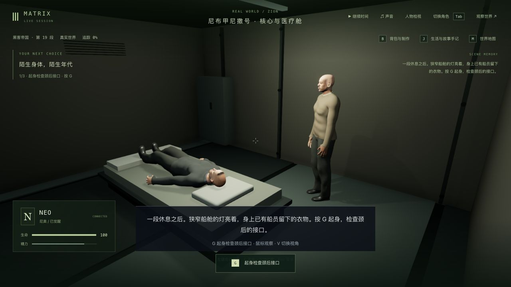
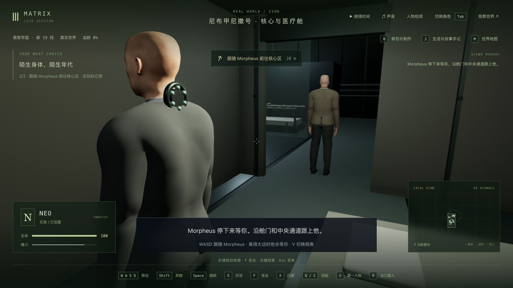
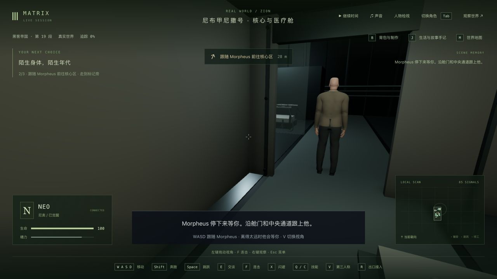

# 第一部船上针织服装接入

2026-10-12。继续 1-07 的舱室苏醒与船员介绍。Neo 和 Morpheus 原先仍显示 Matrix 的西装式衣领/袖子；现在复用已交付的蒙皮针织上衣和内领，隐藏旧衣物，Morpheus 使用暖褐色。第一部船上片段单独保留 Neo 的剃发外观，后两部原有发型、Hammer 会议服装与受伤眼带规则保留。患者演出仍优先使用裸身，返回 Matrix 恢复原服装和材质。没有新增依赖或生成新人物资产。

实际查看的[舱室成片片段](https://clip.cafe/the-matrix-1999/morpheus-whats-happened-to-me/)中，Morpheus 穿褐色针织衣，在金属舱壁前解释年代并邀请 Neo 参观飞船。本轮仅据此改进服装选择，复用的网格、织纹与色彩仍是近似；未下载或嵌入影片，也不代表演员相似度或电影服装已经还原完成。

## 验证与失败

原有服装/舱室基线 16/16。新增先失败用例分别复现 Morpheus 未启用针织衣、Neo 误长出后两部头发，以及生产人物渲染器未选中第一部服装，见 `costume-before.log` 与 `costume-pipeline-before.log`。

第一次扩大 Morpheus 的服装条件导致既有 Hammer 场景范围测试失败，保留 `costume-after.log`（27/28）；已将新条件限定到第一部船上片段。最终服装、生产渲染器、舱室与 Hammer 相关 28/28；实际人物/床/连接椅接触 4/4，共 32 项通过。三个包的最终类型检查和最终客户端构建通过，原有大包告警保留；没有最终全库通过结论。

新增衣物已纳入 42 个起身时刻和 10 个入椅时刻的实际可见几何检查；另沿用颈后接口、Dozer 旋钮、Neo 摸接口及 Morpheus 连接插头检查。有限姿态采样不保证每帧、任意动作或所有衣物接触无穿模。

## 真实存档与实机范围

使用此前完整真实舱室入口副本，tick 5616 / `m1_cabin` 第 0 步，暂停且无人控制，含 7 份记忆。独立端口 3165 / 5365。首次在暂停时点击 G 被正常拒绝；继续时间后再次 G，正常完成起身，进入第 1 步带路。WASD 朝舱门实际移动后暂停在 tick 5723；**没有走完带路、坐入连接椅或进入 Construct**。连接椅部分来自实际模型与剧情自动化验证，本轮不称为整段人工通关。

一次辅助抓取尚未完成就关闭了后台，导致 `capture.mjs:18` 的 `fetch failed / ECONNREFUSED`。该次没有生成有效比较，不计通过。重新启动后先完整抓取，再正常关闭/同配置重新启动：真实带路档的[立即冷读](escort-cold-comparison.json)及[原生双视角/释放后](escort-reviewed-comparison.json)，人物、区块、地点、事件、沙盒、模拟严格 6/6，时间/日期/刻度与 7 份记忆字节均保持，未过滤差异。

正式 data/ 与前十轮目录的 1801 文件无新增、删除或内容变化，见[保护比较](protected-comparison.json)。用户 5197 页面未操作。没有新录像、窄窗口检查或性能基准，不能用此前医疗段的性能结果代替本段性能。

服装织纹/破损与剪裁、人物相似度、Dozer 专属服装、自然动作/表情/口型/声音、电影舱室结构/材质、稳定帧率与完整连续人工试玩仍需制作。1-07、42 组与三部曲保持未完成。

本轮两个临时检查页及独立后台/客户端已关闭；没有设置临时画幅。完整副本保留在本轮本地目录中。
