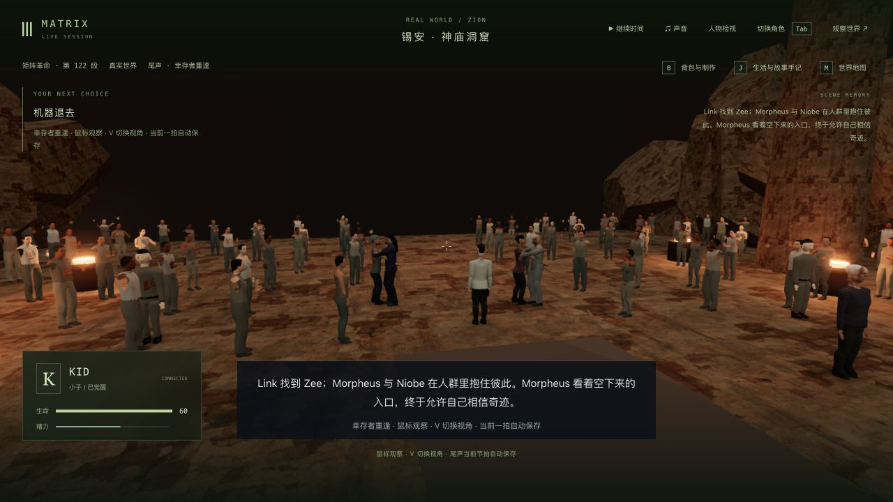
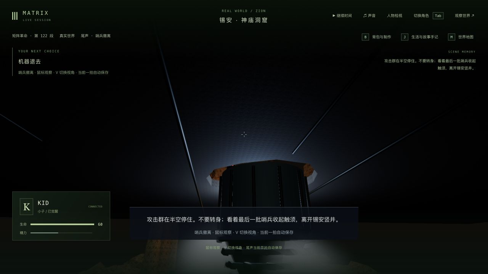
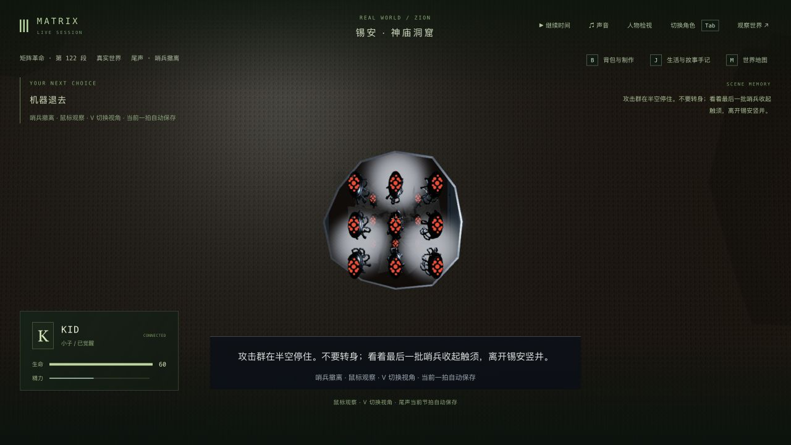
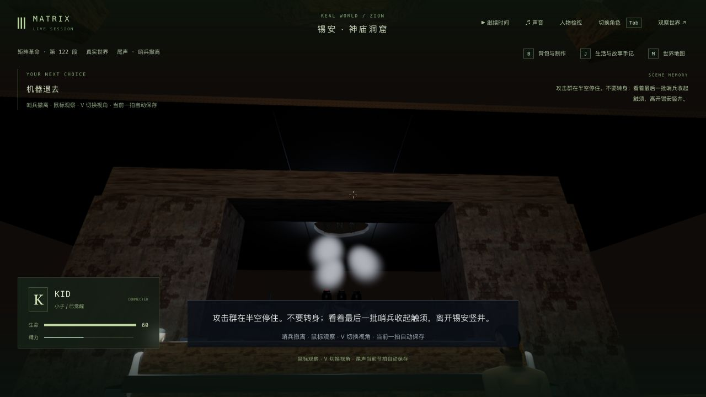

# 锡安停战：群众反应与撤离路线（2026-10-11）

本轮细化 3-12 的 Kid 报信与群众反应，并修复实际城顶加入后遮住撤离机器、机器穿过未破损屋顶的问题。三部曲仍处于玩法补全、局部精修与验收并行阶段，没有将 42 组剧情标为全部开发完成。

## 改动与代价

- 群众分为安静观看、鼓掌与举手欢呼，反应稍有延迟，并有左右转头。鼓掌使用实际手掌相对的开合姿态；脚底保持原位，报信切到拥抱时使用连续的保存时间。
- 复用既有男女背景人体，新增四个形变，仍为六个表面/人体、共十二个实例批次，没有增加运行时骨骼、人物 AI 或依赖。两个 GLB 共增加约 0.89 MiB，三角形数保持。人物相似度、服装种类和自然表演没有因此达到电影级。
- 钻机先从已有破口退开；十八台机器分上下两组汇聚后正向升空，避免机体交叉和穿过完整屋顶。第三人称先从城侧观察，再从钻机下方看破口；增加随队伍移动的冷色补光，不隐藏实体布景来绕过遮挡。
- 不新增剧情节点或存档字段；撤离、群众和钻机均由原有保存时间驱动。队列、时长和分镜是游戏改编，不是原片逐镜重建。

## 原片参照

复看公开的 [Kid 报信片段](https://clip.cafe/the-matrix-revolutions-2003/i-just-have-never/) 约 43.05 秒的群众画面，确认欢呼、举手和人物情绪的方向，截图为 `reference-crowd-43s.png`。结合[第三部台词记录](https://www.matrixfans.net/movies/the-matrix-revolutions/transcript/)核对撤军、报信、重逢的先后。只复看该片段，不声称观看或下载了完整三部曲；新鼓掌比例和钻孔队列是本游戏的编排。

## 真实进度与读档

源为前轮 `trilogy-paused-retry-2026-10-11/verified-state` 的全部 16 个文件。复制到隔离后端 3158 / 客户端 5358，以普通玩家协议移动/交互和原生界面接管、V 切换、释放角色结合验证；未修改存档坐标、直接跳过剧情或推进用户主存档。

1. 从实际 `m3_surrender` done / tick 13491 交接 Kid，步行到入口，触发撤军，等待机器离开，再跑回群众、报信、见证拥抱，最后正常进入 Neo / `m3_neo_carried` 第 0 步 ready / tick 13563。没有开始运送、重置街道或公园段。
2. 群众在 announcement 1.819 秒和 embrace 3.332 秒检查第一、第三人称；拥抱中途真正重启后复看。`reunion-restart-check.json` 为 5/6：只有 Kid 的 `currentAction` 在启动时被清空；剧情、时间与十五份记忆未变。原生接管恢复动作、双视角并退出后，`reunion-native-check.json` 六组状态、时间和记忆全部一致。此启动差异保留为待修项。
3. 原撤离实际画面 `retreat-baseline.png` 被屋顶/钻机遮住。另用相同源档正常走到撤离，检查初段 0.730 秒以及中段 2.563 秒；最终中段取自真实存档的独立副本，没有写入测试夹具。
4. 撤离 2.563 秒 / tick 13533 真正重启，`retreat-restart-check.json` 同样只有 Kid 的临时动作差异。接管、双视角并释放后的 `retreat-native-check.json` 为 6/6。最后朝向修正后的冷读及原生双视角 `orientation-native-check.json` 也为 6/6，时间和十五份记忆一致。最终图为 `retreat-final-third.png` 与 `retreat-final-first.png`；`retreat-restored-*.png` 是朝向修正前的中间版本，不能作为最终机器朝向证据。
5. `protection-final.json` 比较 225 项保护文件，只有本次计划修改的 `ZION-CROWD.md` 文档不同，其他保护项未变；主试玩八组状态一致。旧 48 段完成历史、45 项选择、18 项反思、69 条手记和十名既有死者保持。源档、主试玩服务及前轮 QA 档未被重置。

## 测试、失败和版本边界

- 基线 `baseline.log` 38/39，已有撤离镜头被屋顶碎片挡住；新增真实破顶布景回归 `camera-red.log` 复现钻机挡住机器。
- `reactions-red.log` 0/2，旧资产没有鼓掌及不同反应；第一次鼓掌闭合姿态又发生手掌重叠，见 `reactions-initial.log`。修正腕部目标后实际 GLB 接触、脚底、通道、暂停/冷载和释放检查通过。
- 路线调整过程中 `roof-route-red.log` 复现穿过完整屋顶；`formation-red.log` 发现汇聚机体中心仅相距约 1.15，改为保留前后次序的两层队列。`orientation-red.log` 又复现抬头角与转身组合令机体倒着升空，最终修正升空朝向。
- 最终 `orientation-green.log` 相机/撤离 11/11，包括宽/窄画幅、十八个机体投影与布景射线、261 帧两两机体间距、100 帧实际实例表面在屋顶厚度内穿越破口、朝向/尾部、保存时钟和资源释放。它们是有限采样，不证明任意动作、全部触须互相接触都没有穿模。
- 最终 `final-regressions.log` 91/91：ceasefire-camera、ceasefire-renderer、ceasefire-reunion、epilogue-cast、story-sync、temple-defense、trilogy-epilogue、zion-crowd、zion-homecoming。该轮在最后朝向修正后运行。更早 70/70、88/88、90/90 仅是各中间版本结果。
- 三包类型检查通过；最后朝向修正后三包再次构建通过，见 `verified-typecheck.log` 和 `final-build.log`。最终客户端 JS 3,405.79 kB / gzip 1,034.29 kB，已有大包警告未消除。最终原生 warn/error 为空，见 `final-console.json`；群众冷读日志也为空。
- 本轮没有跑最终全库、整条电影自动路线、新性能基准或录制长视频。原生截图为 1280×720；没有新窄窗口实机验收。背景运行时 HUD 瞬时帧率不作为性能通过证据。

完整世界、记忆、副本和回放脚本保留本地忽略目录。提交选取的失败/最终日志、状态比较与实机截图；日志仅去掉行尾空白和多余文件尾空行，原字节保留在本地 `raw-logs/`。

## 仍需制作

群众仍只有两种装饰人体，无独立生活 AI；表情、重心、拥抱全身接触和自然衣物仍欠缺。洞窟/城顶/机器资产、灯光与过大的雾斑仍近似；撤离编队偏整齐。第一人称处于真实神庙入口，后段上方机器会被门梁/屋顶挡住，部分下方机器又与字幕重叠；未验收为无遮挡电影镜头。冷启动尚未接管时 Kid 动作清空待修，声音、稳定帧率及从终战到日出的连续人工通关仍缺。3-12 与三部曲不标高质量完成。
