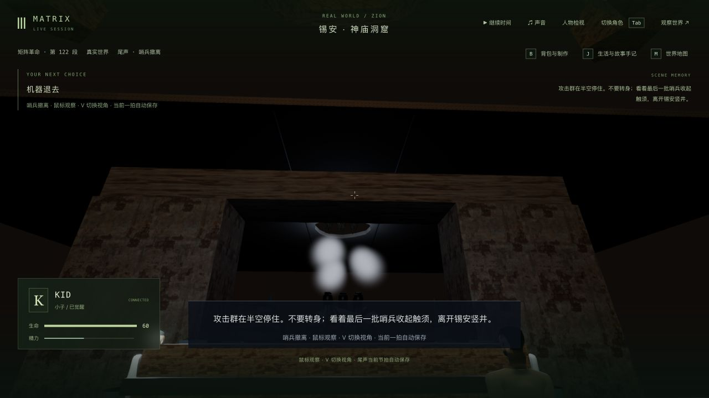
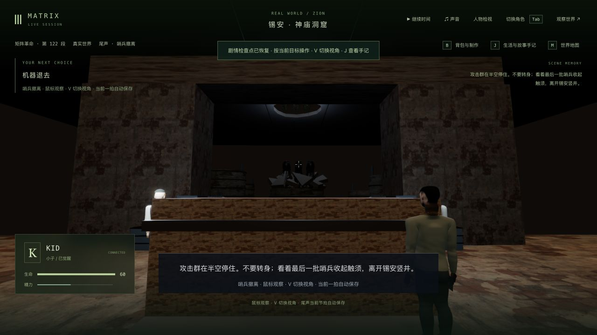
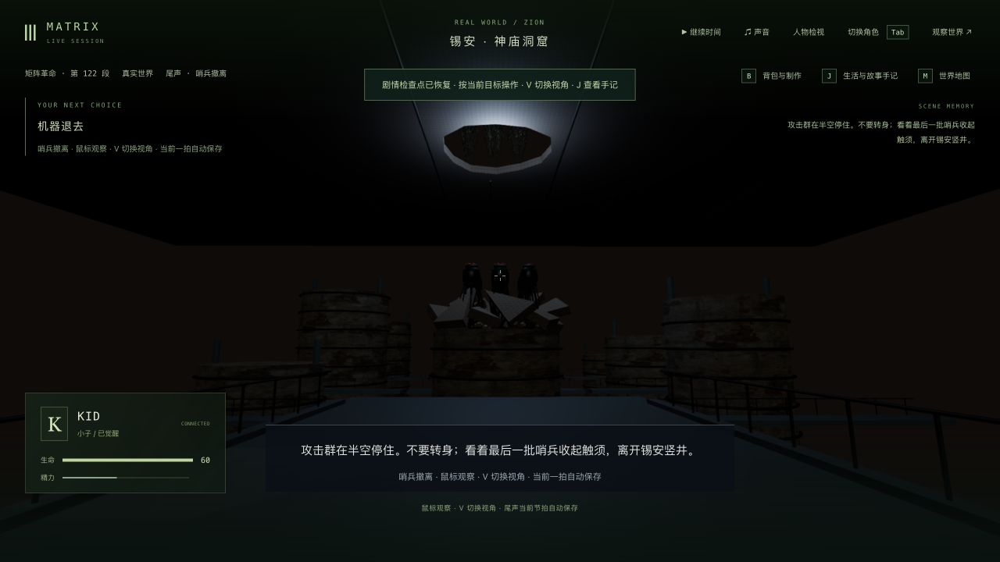
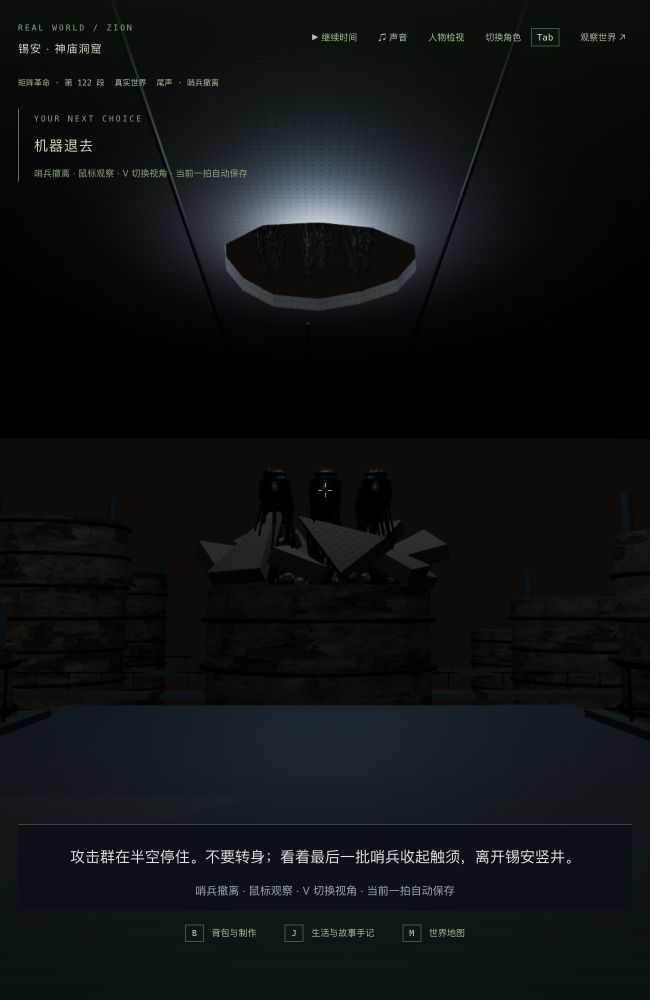
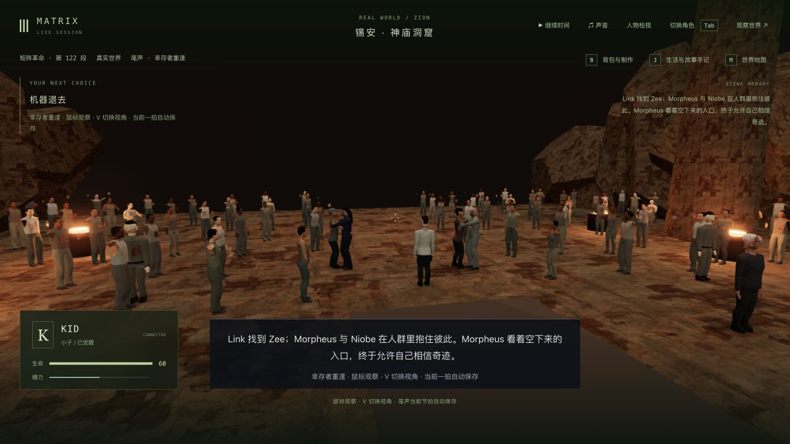

# 3-12：入口观察、灰尘消散与冷读恢复

2026-10-11，基于 `16cb2cf`。本轮修复停战段的实际视线和保存连续性；三部曲与本组仍未达到最终美术、声音、性能和完整人工游玩验收。

## 实际改动

- Kid 的新观察目标移到两门炮之间的真实入口。目标说明提示绕过祭台；普通移动可以走通，没有关闭碰撞。开始撤军时保存玩家实际站位，按 G 不再把他拉回祭台后方。已经进行中的旧撤军存档保留原站位和节拍。
- 第一人称保留人物真实头部眼位，跟随最后一批仍在洞窟内的机器；机器穿过屋顶后，目光停在出口，不再继续朝不透明屋顶瞄准。鼠标主动转头仍可接管方向。第三人称沿用已有的外部观察镜头。
- 破顶灰尘接续已保存的等待时间，逐渐稀释；到了停战阶段已散去，不再将破顶末帧的发白云团冻结在城市上空。暂停和恢复不会重新生成一团新灰尘。
- 启动时从尾声保存状态重建演员动作。修复 Kid 在尚未被玩家接管时动作为空的问题，不再依赖重新接管才能补回姿势。

入口位置、镜头目标和灰尘时长是本游戏的实现；沿用此前的原片参照，本轮没有新增完整原片或逐镜对照验收。

## 真实存档与实机

使用上一轮完整存档的独立副本，后端 3158、前端 5358。普通玩家协议负责移动与阶段操作，原生浏览器负责接管、V 切换、画面检查与释放；没有写入坐标、修改时钟或用夹具跳过真实 QA 进度。完整世界、记忆与回放脚本保留在本地忽略目录。

| 检查 | 实际结果 |
| --- | --- |
| 旧撤离档 | 2.563 秒 / tick 13533；原位置不变。真正重启、尚未接管时，以及双视角接管再释放后，六组状态、世界时间和 15 份记忆均一致 |
| 新入口路线 | 从实际终战完成档 tick 13491 正常交给 Kid；绕祭台到入口 / tick 13554。实际局部站位约 `(0.0026, -50.8698)`，开始撤军及两次恢复检查位置完全相同，见 `standing-check.json` |
| 新撤离档 | 2.560 秒 / tick 13559；真正重启后未接管比较通过。原生 1280×720 与 650×1000 的第一、第三人称检查后，释放并再次比较通过 |
| 报信与重逢 | 等机器离开，亲自绕过祭台走回人群，报信；重逢 3.338 秒 / tick 13626 真正重启，未接管与双视角接管后的比较均通过 |
| 本轮实际终点 | 正常完成重逢并交给 Neo / `m3_neo_carried` 第 0 步 ready / tick 13628；没有开始运送、街道恢复或公园日出 |

上述“六组”为 agents、chunks、locations、events、sandbox、simulation。比较文件为 `legacy-restart-check.json`、`legacy-native-check.json`、`retreat-restart-check.json`、`retreat-native-check.json`、`reunion-restart-check.json` 和 `reunion-native-check.json`，均为 6/6，时间及记忆相同。

`protection-and-progress.json` 验证 273 项保护文件未变，主试玩八组状态未变；原有 48 段完成记录、45 个选择、18 个反思、69 条手记与十名既有死者保留。新的“机器退去”手记插在最前，旧 69 条按原顺序完整保留在尾部。初次检查错误地把手记当成尾部追加，得到 false；逐条核对没有缺失后按实际前插顺序复核，初始结果保留为 `protection-and-progress-initial.json`，没有改动存档。

重逢冷载的第一张第三人称截图中，异步群众模型尚未完成加载，保留为 `reunion-third-loading.png`；上面的最终画面在模型实际出现后复查，不将加载中的空场当作完成证据。第一人称默认朝向会把两组重逢人物放在画面边缘，可主动转头；本轮没有重新编排该镜头。

## 验证及失败记录

- 基线 40/41：既有暂停重试测试的临时车流结构比对失败。没有修改这部分逻辑或测试，同名独立重跑 1/1，最终批次也通过；这不能证明其偶发差异根因已修复。原始 `baseline.log` 与 `baseline-retry-check.log` 保留本地。
- 冷重启回归修改前 0/2，明确复现 Kid 动作变空；修复后 2/2，见 `restart-green.log`。失败完整世界转储保留本地 `restart-red.log`。
- `witness-red.log` 0/2 复现目标仍在祭台后及第一人称跟错机器；中间版 27/28，旧测试仍要求盯住已经离开洞窟的上层机器，调整为验证最后一批机器/出口，同时新增实际头部眼位到实体场景的射线检查。
- `dust-red.log` 0/1 复现等待期间灰尘不衰减。后续检查覆盖阶段边界、等待中的透明度、暂停、重建与停战无残留云团。
- 最终 `final-regressions.log` **114/114**：相机、机器、重逢、尾声演员、真实服务器同步、神庙炮位/破顶/同步、尾声流程、群众、神庙场景与启动检查。此批在最后代码和测试修改后运行。
- `route-regressions.log` **1/1**：电影全路线自动交互、驾驶和战斗到下一轮。它并非全程人工试玩；本轮没有另跑全库或全部场景目标点检查。
- `typecheck.log` 三包类型检查通过；`final-build.log` 三包构建通过。客户端 JS 3,406.09 kB / gzip 1,034.36 kB，既有大包警告仍存在。
- 最终原生重逢检查的 warn/error 为空，见 `native-console.json`。没有新稳定帧率基准、连续长视频或音频验收。650×1000 窗口通过实际 DOM 尺寸确认，测试后恢复默认视口。

## 尚未完成

机器在第一人称下偏暗，远景城市仍由粗略体块构成，编队过于整齐；屋顶、碎片、灯光、触须与人物都未达到电影精度。第一人称不会穿透实体屋顶看见已离开的机器；有限射线、路径和姿态采样也不证明所有帧、所有身体部位均无穿模。群众仍是装饰实例，表情、衣物、自然庆祝与双人全身接触、正式声音、稳定帧率和从终战到日出的连续人工通关均待继续制作。
