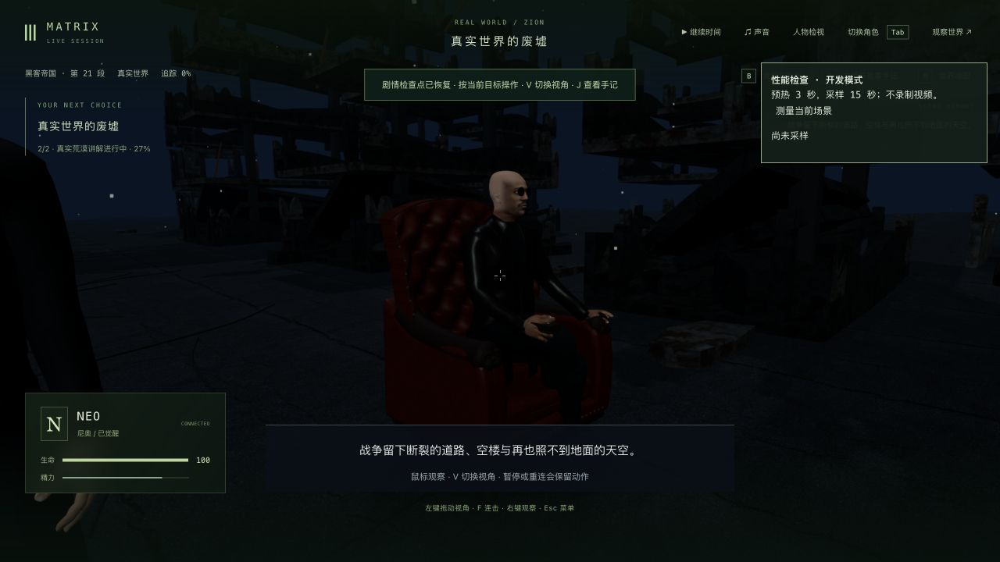
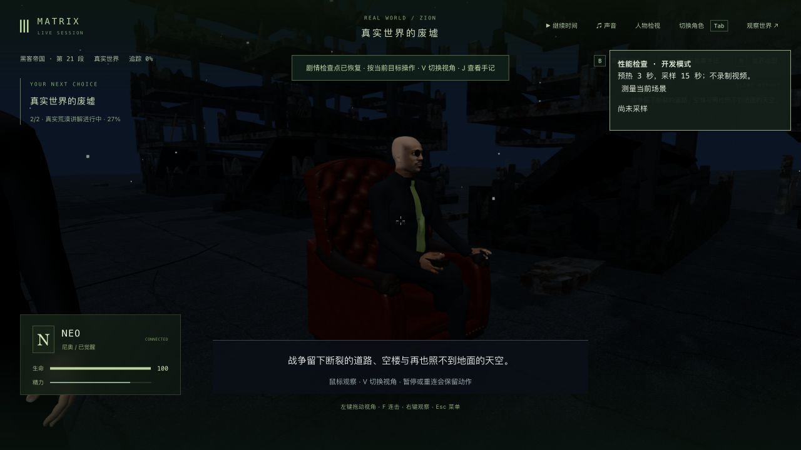
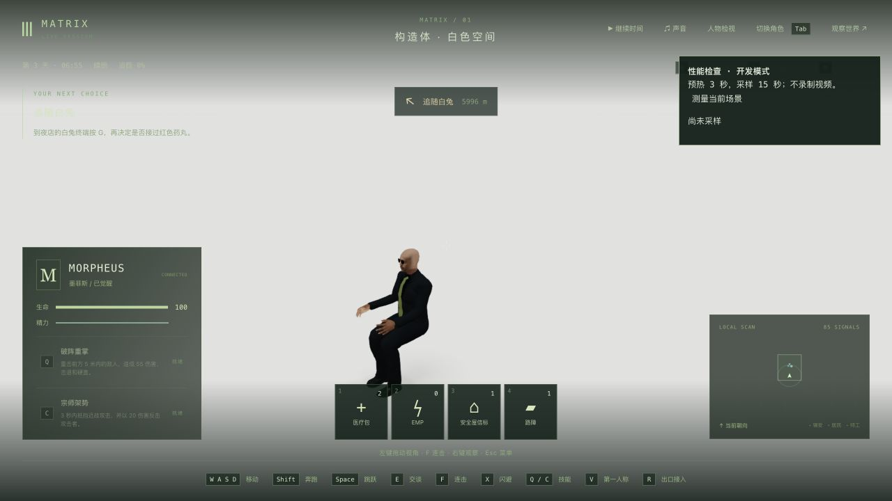
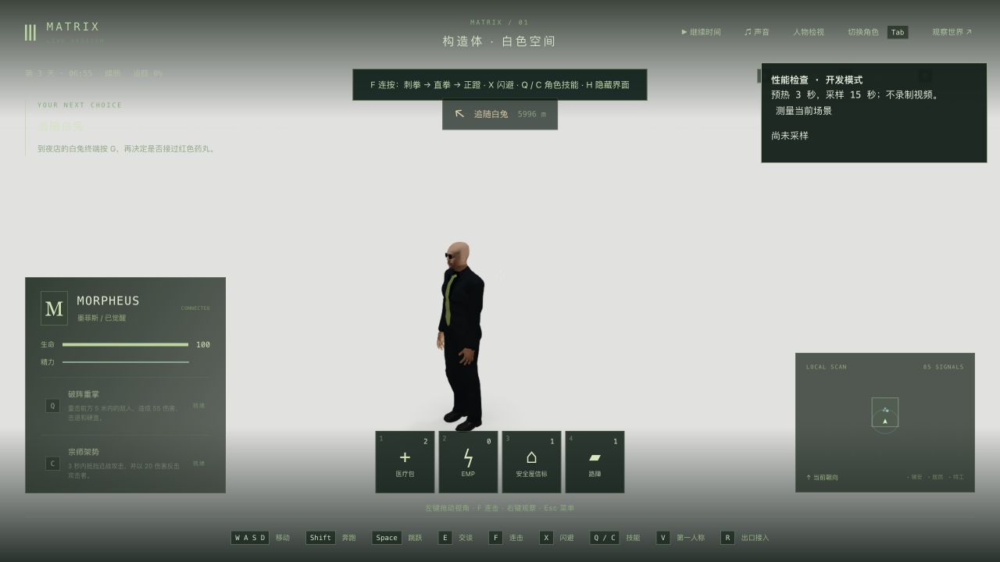
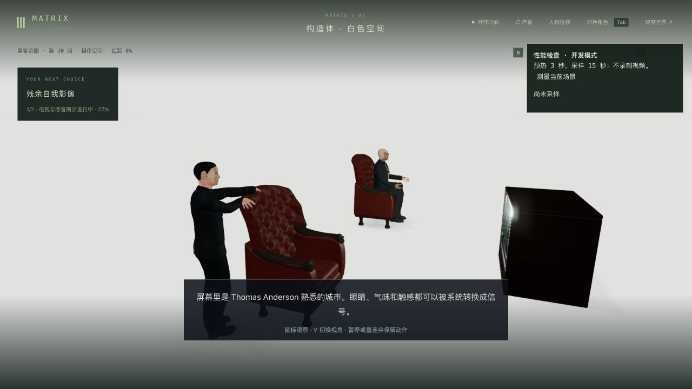
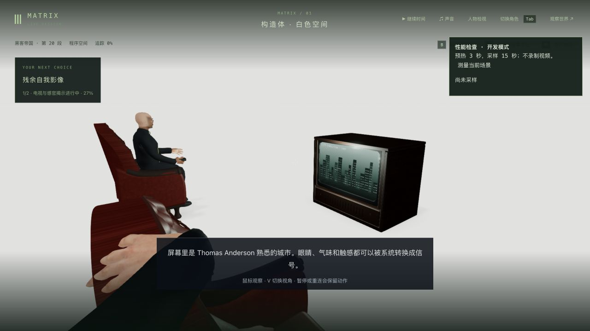

# 构造体与荒漠：墨菲斯的讲解服装

2026-10-13，继续第一部 1-07。核对[成片短片](https://clip.cafe/the-matrix-1999/welcome-to-quot-the-desert-of-the-real/)约 6.42 秒的实际坐姿画面：深色短西装、马甲和深色衬衫，宽橄榄色领带与小领带别针；此前仍是长皮衣。只观看这个公开片段，没有下载或声称看完原片。

沿用现有 Morpheus 身体、骨架与服装表面，增加蒙皮马甲、弯曲的衬衫领片、领带和别针。短外套改为开襟，保留原有肩部、袖子和翻领；隐藏长衣摆，调整为深色哑光面料。坐姿和走动沿用同一套骨骼权重。离开这两个程序空间时恢复原来的几何与材质，飞船针织服装不受替换。没有新增依赖、角色 GLB 或贴图文件。

初版按较宽松的针织表面贴合，上部领带距离实际衬衫约 10.7 厘米。改为在领口开口内取实际衬衫表面，低处取马甲的底层表面；领片用弯曲网格跟随衬衫，避免平面跨过曲面。贴合在加载时使用缓存的原始三角形，不为每个采样反复执行完整蒙皮。

## 姿势与接触检查

实际接管 Morpheus 时发现暂停状态下仍保留坐姿：人物已离开椅子，腿却弯着。服务端已清除动作，客户端动作状态仍有 seated=1，而暂停的零增量无法完成插值。现在切入这两个场景中的 Morpheus 时重建动作状态；后续电影坐姿仍由保存的演出时钟决定。没有制作自然起身/回座动画。

相关基线 3/3；缺少服装和暂停接管坐姿各有先失败记录。最终服装/切换/恢复 4/4、原坐姿/脚底/扶手与 Neo 触椅 2/2，三包类型及客户端生产构建通过。新增接触回归覆盖两种讲解、四个时刻的 40 处实际蒙皮射线；不是所有顶点、任意帧或全身无穿模证明。

较广人物/服装回归在最后贴合、领片和开襟修改前运行，81/83；两个失败是既有救援垫与枕头对象引用缺失，报错与上轮一致。两处 renderer 源码与上轮家具提交、当前 HEAD 和本地相同，见[源码比较](known-failures-source-comparison.json)及[上轮记录](../trilogy-desert-furniture-2026-10-13/README.md)。这不等于本轮完整旧版本基线；没有修这两个旧失败，也没有重跑全库。错误的衣摆对象名、一次类型错误、初版接触失败、领片取样超出衬衫边缘的失败均保留本地，准确版本范围见[验证摘要](verification-summary.json)。

## 真实存档与实机范围

端口 3172/5372。构造体研究副本完整复制此前真实触椅档，tick 6065、保存时钟 3.024 秒。初次原生双视角/正常释放后，六组公开状态、时间和 7 份记忆严格一致，见[首次比较](construct-reviewed-comparison.json)；这早于最终领片/开襟修改。

然后原生接管 Morpheus、转动镜头并正常步行，暂停释放于 tick 6099，讲解仍为 3.024 秒。最终服装前的两张自由接管/行走图证明姿势修正和操作，不能充当最终领片外观验收。真正重启后严格 5/6：人物组中 Neo 的动作被重建，Morpheus 从自由行走位置返回讲解站位并恢复动作；其余五组、剧情、时间和 7 份记忆保持，见[重启比较](construct-cold-comparison.json)与[具体差异](construct-cold-differences.json)。最后冷读双视角没有继续课程。接管、释放与演出重建的状态一致性仍需后续统一，不能报告这次严格全通过。

荒漠另用上轮真实讲解中途副本，tick 6240、保存时钟 3.490 秒。最终源码原生双视角、暂停性能采样和正常释放后，六组状态、时间和 7 份记忆严格保持，见[最终比较](desert-reviewed-comparison.json)。没有推进这段剧情、重做选择或新增完成项。

用于后续剧情的主副本仍为 `m1_truth_exit` 第 0 步、ready/tick 6262，八份文件与上轮完整副本一致，见[存档范围](state-scope.json)。正式 data 和既有证据 3322 个保护文件未改，见[保护检查](protected-comparison.json)。完整副本、记忆和世界 JSON 只留本地。

最终荒漠固定讲解样本为 **32.89 FPS / p95 39.3 ms**，1280×720、像素比 1.5，419 次绘制/帧。来自原生按钮，预热 3 秒、采样 15 秒，无录制、测试或构建负载，见[性能报告](final-performance.json)。不是交替的旧/新基准，也不是连续游玩；没有证明稳定帧率改善，性能仍未达标。本轮没有新录像。

服装仍从既有人体/服装表面拟合，领带纹样、衣料细节、演员脸型/比例、自然表情与布料、起身/回座、完整衣物之间的接触仍不够还原。自由接管的通用“追随白兔”提示仍不符合当前角色，白场 HUD 对比度、准确废墟/收割田、声音和连续人工验收仍需制作。1-07、42 组和三部曲均未达到完整高质量验收。
