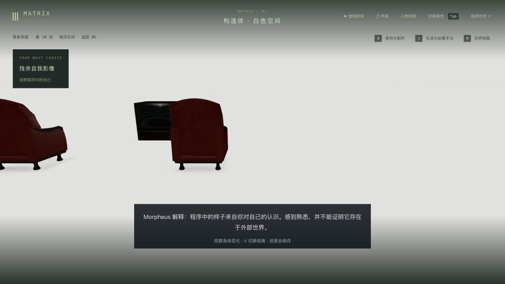
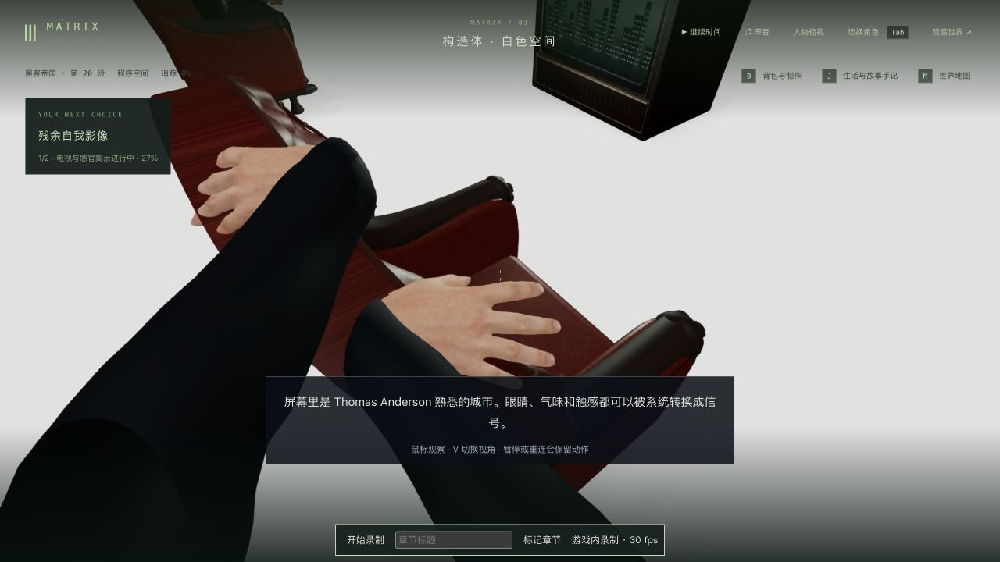

# 构造体第一人称：自检手臂、触椅与模型眼位

2026-10-12，继续 1-07。原先 V 隐藏整个人体，自检和触椅的手也消失。现仅在 Neo 的形象检查/构造体揭示中保留人体和手臂，去掉实际蒙皮的头/颈三角形、头发与眼部；加载中的替代头部也隐藏。V、结束交互及切入另一种第一人称交互能恢复正确显示规则。

固定身高/身体原点的眼位会切穿衣领，现由交付模型的注册眼位取点，保留自由转头/低头和缺少模型时的原有回退。近看衣袖内侧还出现背面剔除开口：实际服装材质为单面，现仅在这两类第一人称交互中渲染布料两面，V/离场恢复每件衣物原来的 side。不是重建服装，也不保证所有衣物接合、任意动作或每帧无穿模。

## 回归与实机

原有相关视角/实际模型基线 64/64。新增人体可见性、实际头脸移除/双手保留及眼位回归先失败；衣物内侧另有先失败记录。最初眼位测试在接管前设置了第一人称，而接管会重置视角，导致夹具错误；已改为接管后真正按 V，再对旧固定眼位复现失败、对修复通过。初次错误记录保留，不作为旧镜头复现证据。

最终相关 67/67、三包类型检查及客户端构建通过，原有大包警告保留；覆盖 V/离场恢复、转入另一种交互时头部保持隐藏、蒙皮手部/头部、布料 side、自由观察、原有后颈/椅背和多个第一人称路径。未跑最终全库/完整相机套件，先前公园 4:3 建筑师出画失败未修复。

端口 3169 / 5369。从上一轮真实自检 4.845 秒 / tick 5889 完整副本检查，修改前后状态严格 6/6；真正重启及原生冷读双视角/释放也各 6/6。这些中途记录早于最终布料内侧修正，最终布料在后面的触椅检查点复核。另用独立完整入口副本 tick 5878，原生 G 自检，观察前臂/后颈、正常步行到椅外侧、G 触椅；按 W 的锁定期没有跳过交互。等待“走向皮椅”提示的一次观察超时后读取原页面，实际已继续至走向皮椅，未据此重启或改档。

最终触椅 3.024 秒 / tick 6065 真正后台重启和原生冷读双视角/释放各严格 6/6。随后正常完成电视课程，原生选择 agency，进入 `m1_desert` 第 0 步 / tick 6084；只新增本段完成与反思，agency 只加 1，原完成/反思及实际 Neo 背包保持。完成档真正重启与原生冷读退出也各 6/6。以上六组为人物、区块、地点、事件、沙盒、模拟，日期/时间和 7 份记忆字节同样保持，没有过滤差异；[交接检查](continuation.json)、[触椅重启](chair-cold-comparison.json)、[触椅冷读](chair-reviewed-comparison.json)与[完成档冷读](completed-reviewed-comparison.json)分别记录。

正式 data/ 和前十三轮 2137 文件保持，见[保护检查](protected-comparison.json)。上一轮荒漠主线档没有回退；本轮自检/入口是独立副本。用户 5197 页面未操作，未设置临时画幅。

本地两段带音轨实录：[自检约 4.285 秒](../neo-longplay-2026-09-20/neo-2026-10-12T15-18-10-662Z.webm)、[步行/触椅约 10.315 秒](../neo-longplay-2026-09-20/neo-2026-10-12T15-27-05-367Z.webm)。均有暂停观察，且早于最终布料内侧修正，不是三部连续通关或稳定帧率证明；最终布料另有上述冷读截图。实际解码 73 / 122 帧，录制未达标，详见[媒体记录](videos.json)。原始录像和完整存档只保留本地。

没有新增依赖或素材，也没有新的性能基准；上轮帧率退步仍保留。人物相似度/原片服装、自然表演/声音、家具与白场/电视内容、服装接合和任意接触、稳定性能以及完整连续人工通关仍缺。1-07、42 组和三部曲均未高质量完成；主线真实副本已停在荒漠入口，未继续眺望或揭示。

本轮后台/客户端和临时试玩页均已关闭。完整副本、短录像及未提交的原始观察仍留在本地。
