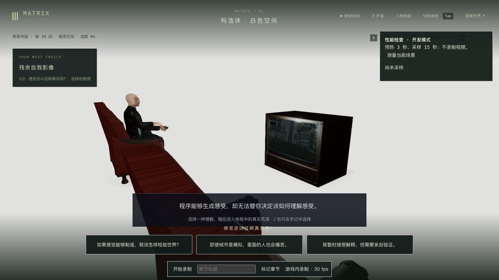
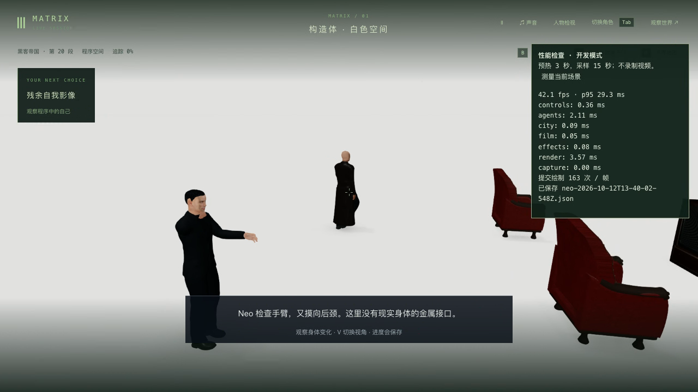
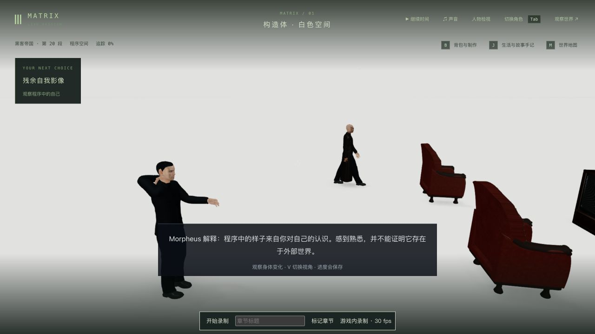

# 构造体：木壳 CRT 与 Neo 的后颈检查

2026-10-12，继续 1-07 的 `m1_construct`。电视从实心木盒改为分块木壳、独立黑色包边、圆角凸面画管、旋钮/扬声器格栅、有厚度的后盖和真实通风开口；固定构件合批，保持既有家具碰撞尺寸与课程流程。复用项目已有木材/红皮革 PBR 图片，三张贴图全部就绪后才切换，离场后的迟到图片不会重新挂回。没有新增依赖或下载素材。

参照实际查看的[构造体说明片段](https://clip.cafe/the-matrix-1999/this-is-the-construct/)和[电视课程片段](https://clip.cafe/the-matrix-1999/this-is-the-world-that-you-know/)；后者约 2.45 / 8.58 秒可见木柜后板、通风带、三角标牌与两把椅子。后板布局按这些画面制作；正面画管弧度、内部结构与尺寸仍为游戏近似，没有证明一比一电影道具精度。

## 动作、接触与回归

检查首段实录时发现自检后颈的掌心朝向相反，手指伸向喉部。新增实际交付 GLB 回归先失败；现随手臂检查到后颈的过渡翻正掌心，并抬肘绕到肩后。3.6 / 4 / 4.5 / 5 秒用实际皮肤射线确认接触位置与朝向；原有双掌触椅、Morpheus 落座脚底和遥控器指向检查保持。前臂自检全过程、衣物/手指每帧接触与自然受力仍未完整验收。

原有舱室/揭示基线 9/9；CRT 曲面/真实通风/碰撞轮廓、未就绪贴图以及后颈朝向分别有先失败记录。最终渲染/舱室/材质 13/13，剧情/界面/真实人物/镜头 9/9，共 22 项通过；三包类型检查和客户端构建通过，原有大包警告保留。未重跑最终全库，也未修复上轮完整相机套件的公园 4:3 建筑师出画失败。静态射线和有限人物姿态不保证所有位置、动作或每帧都无穿模。

## 真实存档与实机

主线使用上一轮完整真实构造体入口副本，端口 3167 / 5367，从 tick 5878 开始。原生 G 检查形象、WASD 步行到椅背旁、G 触椅，正常完成电视课程；课程时世界时间并未逐秒人工暂停，因此最初名为 `inspection-third/first` 的截图实际已到走向椅子的阶段，名为 `lesson-third` 的截图已到入屏选择镜头，不作为中途动作证据。

课程选择处 tick 6066 的真正后台重启与原生冷读双视角/释放各严格 6/6；再通过游戏内选择“agency”，正常到 `m1_desert` 第 0 步 / tick 6070，未继续眺望或荒漠课程。只新增 `m1_construct` 完成记录和这一项反思，agency 只加 1，既有完成/反思和实际 `sandbox.profiles.neo.inventory` 保持。曾用不存在的 inventories 字段做初步比较，已在发布前改为实际 Neo 背包路径并重新断言，见 [交接检查](continuation.json)。完成档真正重启同样严格 6/6。

另从完整原入口复制独立分支，端口 3168 / 5368，原生 G 与锁定期间的移动尝试复拍修正动作，停在 `image` / 4.845 秒 / tick 5889。真正重启与原生冷读双视角/释放各严格 6/6，见[中途重启](inspection-cold-comparison.json)和[中途冷读](inspection-reviewed-comparison.json)。以上比较均包含人物、区块、地点、事件、沙盒与模拟，时间/日期及 7 份记忆字节保持，没有过滤差异。页面首次导航及一次冷读按钮观察超时后检查原服务/原页面，未据此重启或改档。首次绑定变量未保存的错误也已在原页恢复绑定。

正式 data/ 与前十二轮的 1981 文件保持，见[保护检查](protected-comparison.json)。没有操作用户的 5197 页面，也没有设置临时画幅。主线和动作复拍是两份不同分支，后者不算从已完成的课程回退主线。

本地原始录像：[约 125.664 秒](../neo-longplay-2026-09-20/neo-2026-10-12T13-41-32-093Z.webm)，12.58 MB，含修正前后颈动作、步行/电视与长暂停，结束在哲学选择之前；[最终动作约 13.216 秒](../neo-longplay-2026-09-20/neo-2026-10-12T14-06-24-664Z.webm)，0.92 MB，仅独立分支的自检和暂停双视角。两段都有暂停帧，不是等长连续动作或三部通关录像；第二段测得 102 个视频包及 102 个解码帧，录制帧率也未达标。时长由视频包计算，详见 [首段](video.json) / [复拍](neck-video.json)。原始录像和完整存档只保留在本地。

## 性能与剩余项

同一真实入口、默认第三人称、1280×720 / 像素比 1.5，预热 3 秒、采样 15 秒，不录制或并行构建/测试：旧电视单次约 60.00 FPS / p95 18.7 ms / 187 次绘制，新电视 42.11 / 29.3 / 163。绘制减少但帧率退步；没有交替复测，后一报告早于后颈修复，不证明最终版本稳定性能。原始两份报告保留，不报性能通过。

演员相似度、原片短外套/西装领带、自然表演/对白/声音、精确家具和白场摄影、前段电视城市内容、第一人称可见自检手臂、任意姿态接触、稳定性能与完整连续人工通关仍缺。1-07、42 组和三部曲均未高质量完成；接下来的主线真实档已在荒漠入口。

本轮四个自建服务与三个临时参照/试玩页已关闭；完整副本与原始录像保留在本地，未设置临时画幅。
