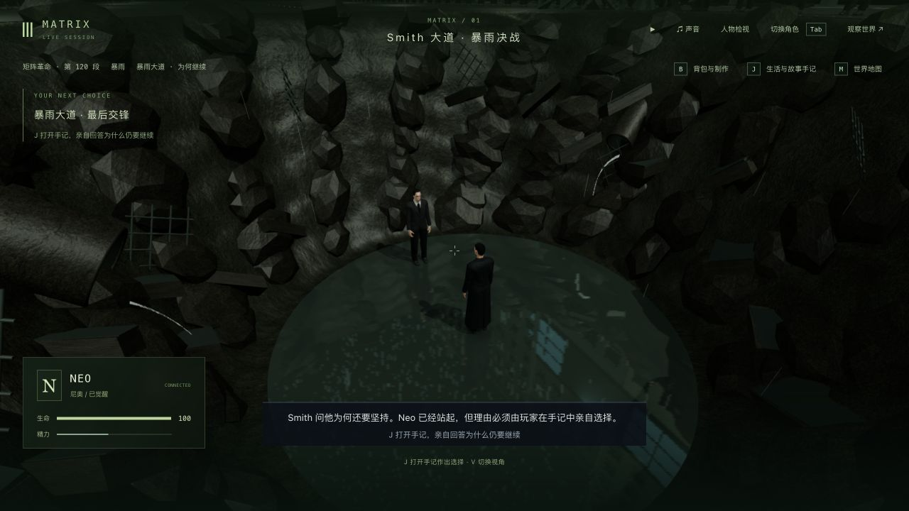
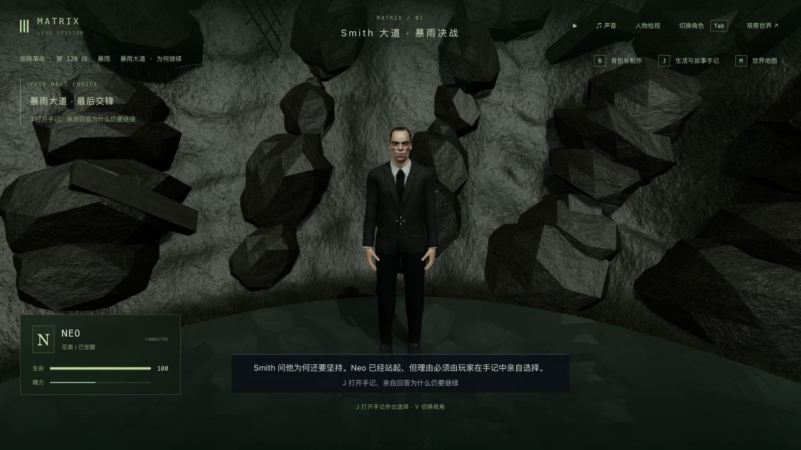
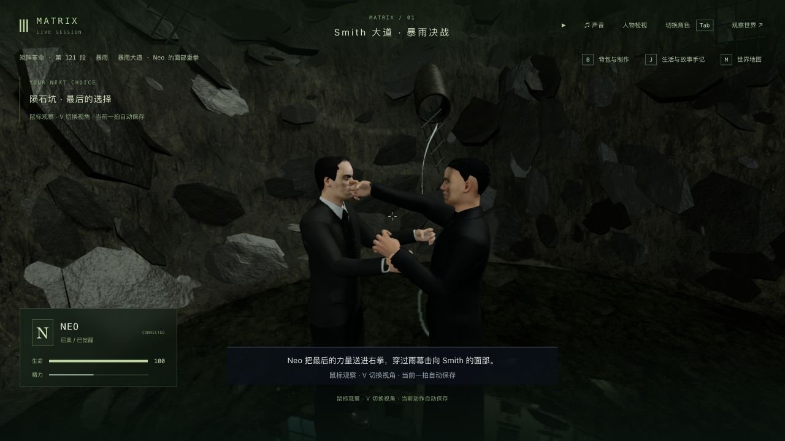
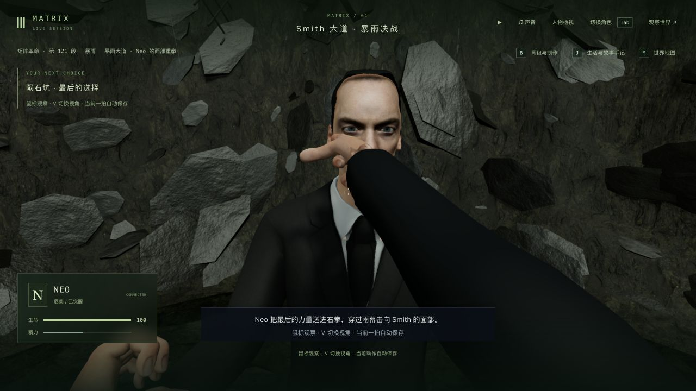
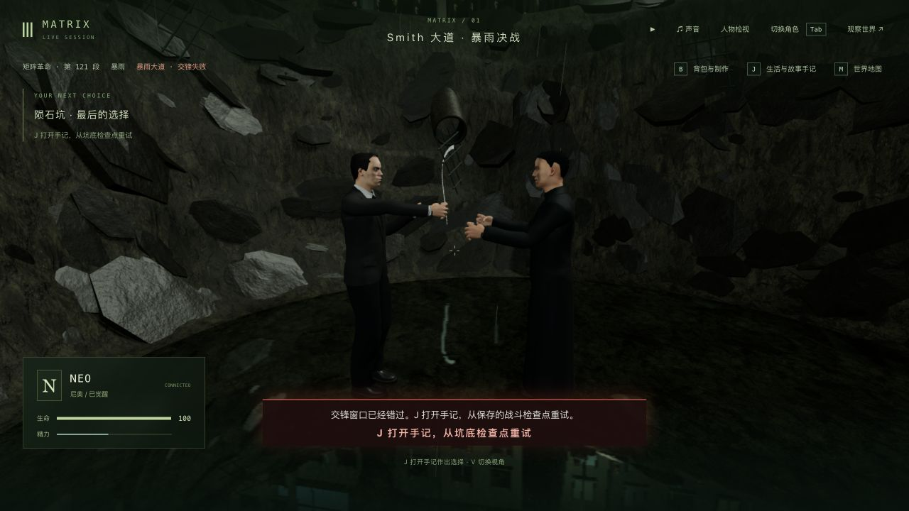
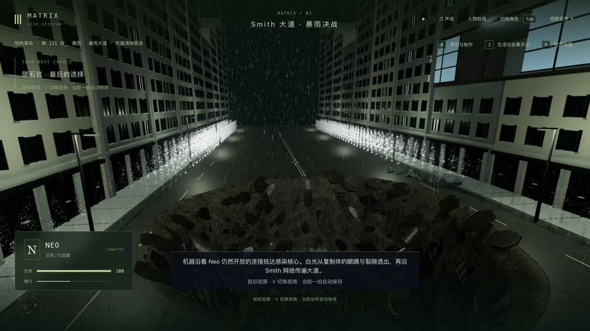
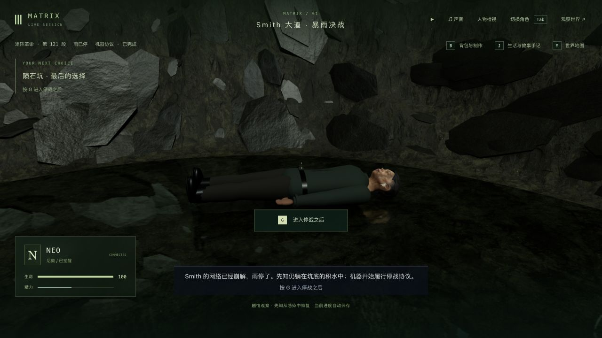

# 暴雨终局：陨石坑地表与道路碎片（2026-10-11）

本批改善 3-11 既有陨石坑的近景材质和道路断面，不新增剧情节点。三部曲仍是专用玩法补全、画面动作精修、实机验收并行；125 个节点、365 个操作步骤、70 个场景定义不等于 42 组高质量完成。

## 改动与参考

- 坑壁与浸水地面分用泥土材质，替换原先整坑共用岩石的效果；平面 UV 保持坑底贴图密度，修复纹理在中心径向挤压。材质按实际位置和高度变色，减少规则环纹。陡坡仍有平面投影拉伸，不是完整三向投影。
- 将 280 个近圆石块和 24 个箱形块改为 480 个薄片实例与 40 个较大的道路碎片，沿原地形倾斜、部分埋入；新增破碎沥青边沿。碎片共用七边形形状，仍属程序化近似。
- 限制泥壁过强的光泽，坑底反射随视角和水边衰减；继续复用原来的单次水面反射。共享地形、可玩范围、人物姿态和剧情时序保持。

新增 [Poly Haven Brown Mud 03](https://polyhaven.com/a/brown_mud_03) 的 1K 颜色、OpenGL 法线和粗糙度图，作者 Rob Tuytel，采用 [CC0](https://polyhaven.com/license)。三图原文件共 2,042,957 字节，MD5 与官方 API 相符；来源及校验在 `packages/client/public/assets/surfaces/sources.json`。已有 Seaside Rock 用于碎片和管线，Asphalt 02 用于路沿。无新代码依赖。这些是通用材质，不是电影布景扫描。

本轮复看已有本地参考：`trilogy-smith-ending-2026-10-04/reference/04-09-contact.jpg`，其来源为 [Movieclips 公开片段](https://www.youtube.com/watch?v=KfH-2VNDBIs)；另复看 `trilogy-oracle-return-2026-10-04/reference/oracle-3m19.png`、`oracle-3m24.png` 的全景，后者来源为非官方 CutsceneChronicles，出处沿用对应目录 README。本轮没有新下载整部电影，也没有重新连续观看完整三部曲。

## 实机画面

修改前同一坑底选择存档：

最终版本的反击中途真实重启后，以下是另一动作机位，不能作为同姿态前后比较：

首次材质方案实机呈现干燥泥地；随后发现近景光泽像金属箔，再限制粗糙度范围。上述最终截图均在最后修正之后。未提交的 `after-first-pass-third.png`、`after-third.png`、`after-first.png` 是中间版本，不能当作最终画面。

人物仍有僵硬姿态、欠缺受击表情；建筑、碎片分布、泥水、布料与动作仍明显程序化。真实破坏、足部水花、软组织同化、正式声音及完整连续人工验收未完成。局部射线和姿态采样不证明所有动作帧、服装、倒影均无穿模。

## 性能

原生 Codex 浏览器，1280×720、像素比 1.5、Apple M3 / ANGLE。同一暂停的 choice / tick 13426 存档与机位，预热 3 秒、采样 15 秒；测量时不录屏、不运行测试/构建，每次只开一个测试 WebGL 标签。基线使用 `0d9b40e` 的渲染器，其余客户端及隔离后端相同。

| 版本 | FPS | 帧耗时均值 / ms | p95 / ms | 绘制调用 | 三角形 |
| --- | ---: | ---: | ---: | ---: | ---: |
| 修改前 | 20.19 | 49.52 | 62.7 | 376 | 5,671,849 |
| 最终修改 | 22.95 | 43.57 | 54.6 | 379 | 5,628,905 |

原始报告为 `profile-before.json` / `profile-after.json`。三角形减少 42,944，绘制调用增加 3。**这是单次有限采样，不能据此证明稳定性能提升；约 23 FPS 仍未达标。**没有把这组结果与其他机位、其他轮次相减。

## 真实进度与保存验证

隔离后端 3158 / 客户端 5358，从上一批 `trilogy-rain-rendering-2026-10-11/ground-state` 的全部 16 文件复制，起于 shockwave 0.463 秒 / tick 13390。普通 Socket.IO 玩家按键、反思和继续命令推进；原生界面接管、V 切视角、检查后退出。没有修改剧情或坐标、没有跳段；这是混合输入回归，不是全程人工录像。

1. 接续楼内高踢、第二轮高空交锋与抓握、坠坑，到 choice / tick 13426。该暂停存档用于前后画面及性能比较。
2. 选择 agency，进入最后猛攻，故意漏闪避，失败于坑底 / tick 13430；恢复时间后正常重试，X 闪避、F 反击至 pit_punch 0.824 秒 / tick 13435，attempts 为 2。
3. 保存全量文件并真正关闭、重启后端。`counter-restart.json` 的人物、地图块、地点、事件、沙盒、模拟六组状态、世界时间与 15 份记忆全部保持。原生冷读接管、切 V 并退出后，`native-restart.json` 同样一致。
4. 继续至 vision，选择 trust，按住 G 起身、主动同化；到 purging 5.369 秒 / tick 13479，原生检查远景路沿；继续到 done / tick 13492、`m3_surrender` 第 3 步，原生检查雨停与先知恢复。`done-native-check.json` 确认接管退出后六组状态、时间和 15 份记忆保持。副本暂停且释放角色，未继续 Kid 停战或日出段。
5. `protection-and-progress.json`：主试玩八项公开状态及 204 项保护文件未变，包括主档、此前暴雨入口/冲击波/清除/完成档和既有角色资产。46 段旧完成历史、42 项选择、16 项反思、65 条手记及 9 名既有死者保持。

此前发现的“暂停时 J 重试只关闭菜单”仍未修复；这次验证使用恢复世界时间后的普通重试，不声称暂停重试已通过。

## 检查与范围

归档日志仅清理行尾空白与多余末尾空行，保留失败信息和结果。

- 修改前 `baseline.log`：30/30。
- 先写贴图密度回归，`surface-before.log`：1/2，旧极坐标 UV 在平坦坑底仍不均匀；清空战斗地面的采样检查已通过。修改后 `surface-after.log`：15/15。
- 新增实际碎片/管线的镜头射线检查，`fragment-camera.log`：1/1；覆盖横竖画幅、两种视角、八个坑底姿态的可见人物头/腕，使用实际模型关节与渲染几何。
- 最终 `related-final.log`：81/81，包含陨石坑、街道、决战、坑底、同化、室内、实际接触、镜头和先知恢复。相关夹具有一次 Oracle 异步模型警告，最终原生三个文档 warn/error 均为零，见 `native-console.json`。
- `route.log`：2/2，场景目标可达和完整电影自动路线通过。自动路线是测试夹具，不等于三部曲全部画面或全程人工验收。
- `typecheck-final.log` 与 `build.log`：三包类型检查、生产构建通过。主 JS 约 3.40 MB，大 chunk 警告仍在。没有跑最终全库。

临时服务提交前关闭，主试玩服务保留。3-11 与三部曲仍继续制作。
