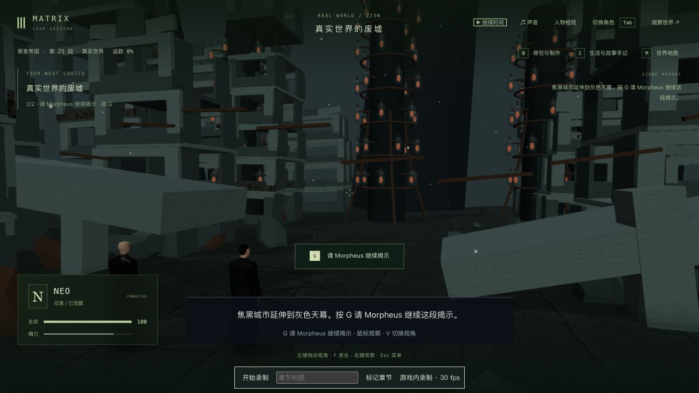
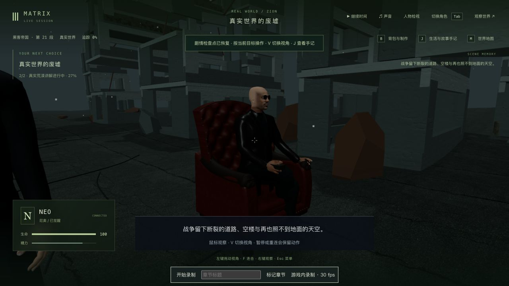

# 真实荒漠：家具延续、坐姿、接管与暂停时钟

2026-10-13，继续 1-07。对照[成片短片](https://clip.cafe/the-matrix-1999/welcome-to-quot-the-desert-of-the-real/)的约 0.94 秒俯拍与 3.76 秒坐姿：两张皮椅留在废墟里，Morpheus 坐着、交叠腿并拿着遥控器。没有观看完整原片，没有下载或嵌入电影视频。

复用构造体的皮椅，并将既有电视几何移入共同工厂，保留凸面 CRT、木壳、后盖/通风和合批。荒漠放置两张椅子与同一电视，碰撞与布景共用位置/尺寸，保留 Neo 原来的站位。中央地面修正原先的 18 厘米高度差；皮椅的木腿下移到地面，接合原有底框，座面和扶手不变。没有新增依赖或素材。

Morpheus 在等待、讲解和恢复后均保持坐姿/遥控器；实际 GLB 腿部交叠、另一脚落地，左掌接触扶手。解释时钟决定姿势，不继承浏览器加载时间或之前的跑动速度。取景先展示家具、再靠近讲述者、随后转向天际线与 Neo 的反应。宽屏和 4:3 检查了初段脸部不会落入字幕区。

灰烬位置改为时钟的解析函数，收割塔闪光也使用该时钟；不再每绘制一帧就推进。回归覆盖同一暂停时刻重复绘制以及新建场景的天气一致性。

## 验证与实际游玩范围

修改前相关基线 133/133，构造体实际模型 3/3。家具/服务端坐姿/模型、扶手接触、镜头、接管/恢复姿势、椅脚和天气均有先失败记录。实际模型仅采样 0、3.8、8、12.5 秒，并检查此前运动状态不会污染恢复姿势；不是每帧全身、布料或任意接触验收。

相关 135/135、视角/接触 8/8、额外取景 1/1，共 144 个不同回归通过；最终椅脚/天气修正后渲染 6/6、接触 4/4 复查通过。接管距离微调后专项 1/1。三包类型及生产构建通过；最后服务端/客户端修改各另有生产构建，保留既有大包警告，见[版本与检查范围](verification-summary.json)。

完整回归尝试输出 1455 项时，因继续修复接管/恢复问题而主动停止，没有最终全库通过结论。四个已出现失败是公园取景、救援垫/船上枕头的旧对象检查，以及船坞 EMP 后的交接步骤；公园在完整相机基线复现，其他三项在上一提交的对应源码副本复现。源码副本使用未改的实际角色资产和现有共享运行库；共享库本轮只修改荒漠家具，不能将这些局部复现称为完整旧版本全库基线。第一次 EMP 核对选到了同名的另一测试，之后已按失败栈改用 `dock-emp.test.mts`，旧记录保留。原始全库日志及源码副本只留本地。

端口 3170/5370。主验证完整复制上轮真实构造体完成档。原生步行到荒漠边缘、G 启动、暂停于 3.490 秒/tick 6240；真正重启以及原生双视角接管/释放后，人物、区块、地点、事件、沙盒、模拟严格 6/6，时间及 7 份记忆一致，见[重启](mid-cold-comparison.json)和[冷读](mid-reviewed-comparison.json)。修改前后只有 Morpheus 的 seated 从 false 改为 true，其余逻辑字段一致，见[升级比较](upgrade-comparison.json)。

正常继续后回到 `m1_truth_exit` 第 0 步、ready/tick 6262，未要求退出程序或继续呕吐/飞船康复。只新增 `m1_desert` 完成，原完成项、选择、反思、哲学值、Neo 背包保留，见[交接](continuation.json)。完成档真正重启和原生双视角接管/释放也各严格 6/6，时间及 7 份记忆保持，见[重启](completed-after-cold-comparison.json)与[冷读](completed-reviewed-comparison.json)。本地主验证接续档为 `completed-reviewed-state/`。

另用完整中途副本验证 Morpheus 接管：新椅子原先触发通用防穿模回退，送他到远处入口。现在从椅前约 3.525 米处接入，原生行走约 6.83 米，讲解仍冻结于 3.490 秒，见[接管结果](role-continuation.json)。这是安全落点/行走和占用冻结验证；没有制作自然起身/回座演出或 Morpheus 的独立剧情。暂停接管时跟随镜头仍很近，恢复时间并行走后回到正常距离，列为入口镜头待完善项。侧副本最终版又正常续到退出程序入口，未覆盖主验证完成档。

正式 data/ 与前十四轮 2302 份文件保持，见[保护检查](protected-comparison.json)。完整存档、记忆和原始录像只留本地。

## 实录与剩余制作

最终约 12 秒实录从 3.490 秒中途开始，包含坐姿、天际线/收割塔、反应和正常退回白场；不是完整入场或连续通关。另有约 37 秒诊断与 13 秒接续原录，前者包含长暂停，均早于最后椅脚/天气修正。`greeting.mp4` 和 `continuation.mp4` 是这两段的本地短剪，不代表最终所有改动。原录文件与解码计数见[最终媒体](final-recording-metadata.json)及其他媒体记录。没有新性能基准；录制期间有检查负载，不以录制帧数证明稳定游戏帧率。

Morpheus 仍使用现有长外衣，原片本段的西装/马甲/绿色领带尚未还原。脸型、自然表情/手势、电视内容、毁坏城市的断面/残骸/天空与收割田、声音、完整空间比例、全帧接触/穿模、稳定性能与连续人工长玩仍需制作。65 米左右的入场步行是游戏化改编，不是原片的连续动作。1-07、42 组及三部曲均未高质量完成。

本轮后台、客户端及临时试玩/参考页已关闭，未操作用户页面。完整副本、诊断录像与未提交的原始观察保留本地。
