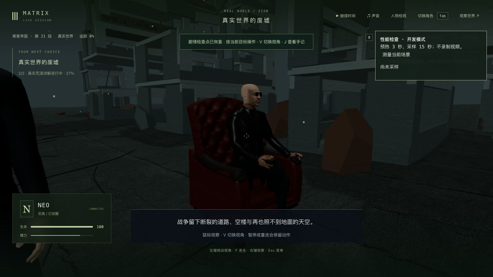
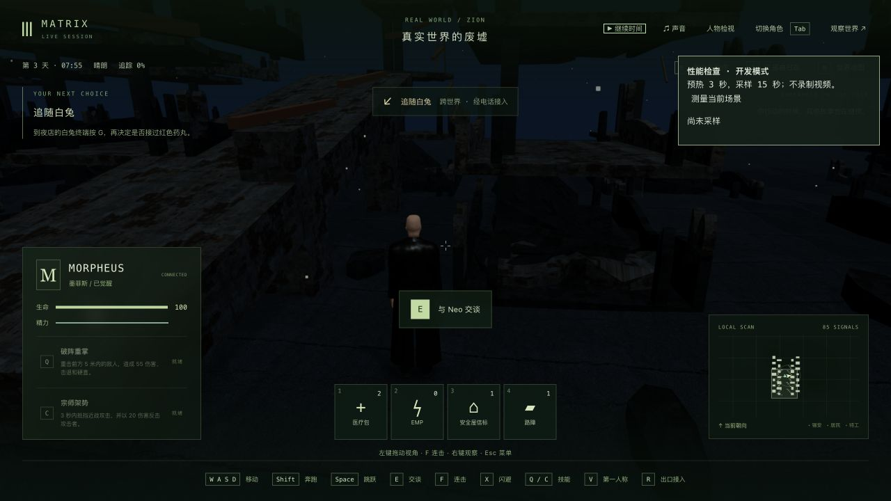
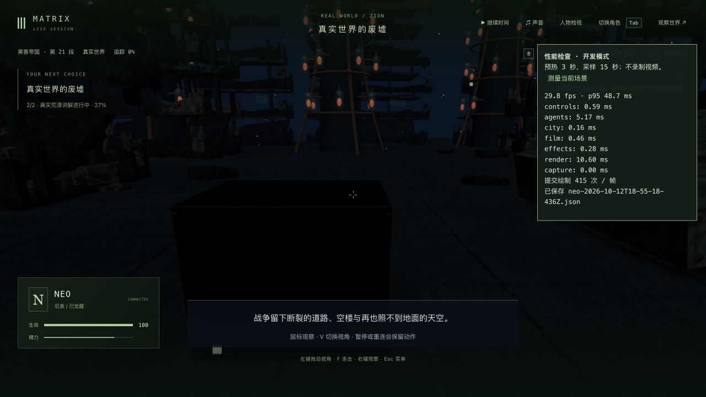

# 真实荒漠：破坏断面、路边碎块与地面高度

2026-10-13，继续第一部 1-07。核对[成片短片](https://clip.cafe/the-matrix-1999/welcome-to-quot-the-desert-of-the-real/)约 0.94 秒的实际画面：天空与废墟偏冷蓝灰，城市坍塌程度明显高于此前的整齐空楼。只观看这个公开片段，没有下载电影或声称看完三部原片。

上层楼板改为真实缺角的多边形，墙体、残柱及屋顶改为有厚度的锯齿断面，缩短部分残楼并加入落地碎块和倾倒楼板；远处的简单柱体改为同类残楼。两条连续结构核心保留楼层支撑。复用已有损坏灰泥的颜色、法线和粗糙度贴图，调整天空、雾与材料色调；没有新增素材或依赖。城市仍按材质合批，原先有索引的几何保持索引，新的断面在保留法线与 UV 的情况下合并重复顶点。

地形、楼体与 46 个路边碎块改用共享数据。中心家具区保持平整，路边高度按实际地形三角形插值，角色站立高度与画面一致；碎块增加碰撞。建筑仍使用整体矩形占地碰撞，没有制作内部探索、屋顶攀爬或精确残墙碰撞。

## 回归与实机范围

渲染基线 6/6。新增的两个行为回归在旧版本单独运行，均失败：旧楼板没有真实缺口，旧角色高度在路边也不对应可见地面。修复后全部 8/8，最终结构支撑修改后再次 8/8。检查保留楼板、破坏断面、原窗洞、中心路线、四处地形射线及四个碎块碰撞；不是任意帧、全身或所有物体无穿模证明。

相关渲染/玩家 17/17、剧情系统 129/129，三包类型及生产构建通过；最后只增加两条结构支撑后另跑渲染 8/8 和客户端生产构建。版本边界见[验证摘要](verification-summary.json)。本轮没有重跑全库；上一轮中断的全库尝试和四个已复现失败仍保留在[家具记录](../trilogy-desert-furniture-2026-10-13/README.md)，不报告全库通过。

端口 3171/5371。研究存档完整复制上轮真实讲解中途档，暂停时刻为 3.490 秒、tick 6240。共享地形更新后真正重启，六组公开状态、时间和 7 份记忆均一致，见[重启比较](cold-comparison.json)。随后在原生界面实际接管 Morpheus、用移动键走到路边；最终本地坐标约 (14.277, -29.932)，坡面抬高 0.252945 米，角色保存的站立高度与共享计算误差为零，讲解仍停在 3.490 秒，见[站立结果](bank-verification.json)。早期 `bank-walk.png` / `bank-walk-final.png` 仍在平地，不作为坡面通过证据。

最后正常接回 Neo、检查双视角，再释放角色；研究副本暂停于 tick 6302。研究行走期间世界时间和 NPC 事件正常前进，不能把最后研究副本称为原档六组完全未变。用于后续剧情的主副本仍在 `m1_truth_exit` 第 0 步、ready/tick 6262，八份文件与上一轮完成档完全一致，未用较早研究副本覆盖它，见[存档范围](state-scope.json)。正式 data 与既有证据 3252 个保护文件未变，见[保护检查](protected-comparison.json)。完整存档、记忆及原始世界 JSON 只留本地。

## 性能与未完成项

所有采样均来自原生页面的性能按钮，预热 3 秒、采样 15 秒；1280×720、像素比 1.5，未录制视频。采样时没有运行测试或构建，固定在 Neo 的 3.490 秒讲解画面。保留各次实际结果：

| 版本与采样范围 | FPS | p95 帧时 |
| --- | ---: | ---: |
| 初始旧版本 | 59.84 | 19.5 ms |
| 新破坏几何初版 | 29.50 | 42.1 ms |
| 保留索引后 | 32.11 | 36.7 ms |
| 临时旧 DesertRenderer + 新场景灯光/共享地形 | 30.32 | 39.5 ms |
| 新建浏览器标签后的新版本 | 32.37 | 37.0 ms |
| 最后结构支撑版，Morpheus 行走检查之后 | 29.80 | 48.7 ms |

报告分别为 `before-performance.json`、`after-performance-initial.json`、`after-indexed-performance.json`、`old-geometry-new-light-performance.json`、`after-fresh-context-performance.json` 和[最终报告](final-performance.json)。第四项只替换渲染器，不是完整旧版本；第六项经历了角色行走，公开世界位置与初始样本不同。初始结果后来未复现，不能把所有退步归因于新几何，也没有证明索引处理改善了稳定帧率。最终 415 次绘制/帧、约 133 万三角形/帧包含阴影和遮挡等重复绘制，不能当作唯一模型面数。**性能未通过。**

原片城市布局/尺度、废墟堆积与构图、收割田和桥梁仍是程序化近似，光照也仍需继续调整。人物脸型与本段西装/马甲/绿色领带、自然起身/回座、表情/表演、声音、完整物理接触与连续人工通关仍未完成。Morpheus 自由接管仍会显示通用“追随白兔”提示，需要另补符合该角色的目标。本轮没有新录像或新增剧情完成项；1-07、42 组及三部曲均不标高质量完成。
