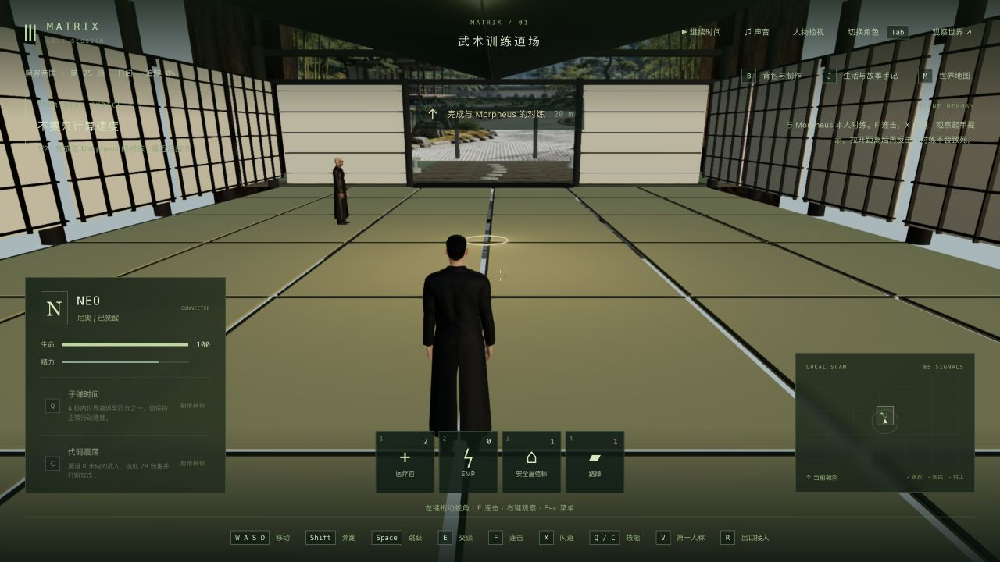
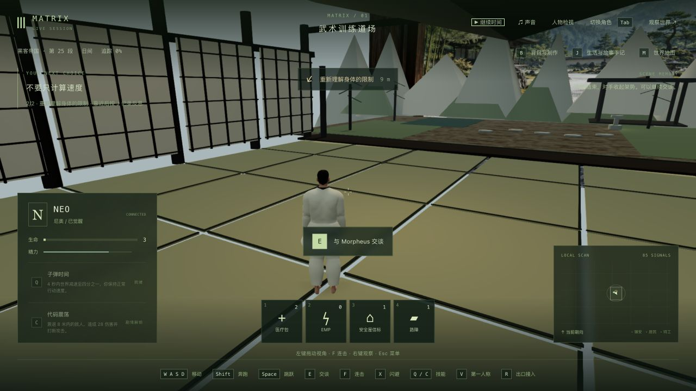
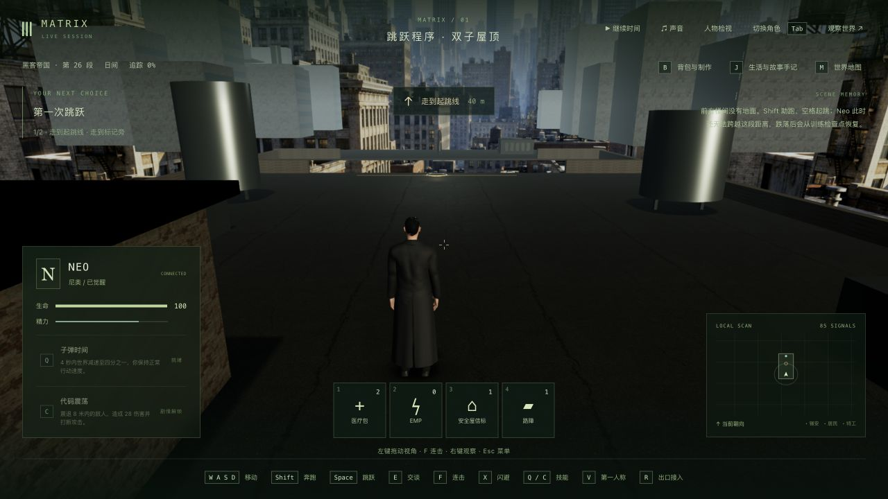

# 道场训练服、攻防与续玩

2026-10-13，第一部道场的局部制作与实机检查。Neo 改为浅色训练服、深色交叠领；Morpheus 使用深色训练服、浅色领边。两人都有实际蒙皮的上衣、交叠领、贴合腰带和裤腿，以及裸露胸口/脚部；城市长外套、鞋子和墨镜在道场隐藏，离场恢复。使用已有 CC0 身体、角色 morph 和 46 骨骨架，没有替换脸、头发或新增运行时依赖。

服装对照了 [训练程序介绍片段](https://clip.cafe/the-matrix-1999/i-know-kung-fu-s3/)、[对练后的问答](https://clip.cafe/the-matrix-1999/how-did-i-beat-you/)、[后段对练片段](https://clip.cafe/the-matrix-1999/what-are-waiting-for-s3/)的局部画面，以及 [美国摄影师协会的原片道场剧照](https://theasc.com/articles/flashback-the-matrix)。未下载或声称看完完整电影。三段连击、限时反击和手记选择是现有游戏改编，不是逐招复制整场电影演出。

## 修正与验证

新衣物来自 `scripts/build-dojo-costumes.py`，追加进两份现有 GLB。所有旧节点、网格、材质、访问器、贴图引用、骨架、元数据及原二进制前缀均逐项保持，见 `original-asset-preservation.json`。最终作者脚本逐字节重建两份已交付 GLB，见 `reproducible-assets.json`。每套训练服增加五个蒙皮表面；Neo 增加 64,720 三角形、2,739,224 字节，Morpheus 增加 63,114 三角形、2,666,856 字节。总资产含休眠衣物，不能当作当前画面的绘制量。Morpheus 的身体图使用已有缓存的 CC0 系统素材包，原档 SHA-256 验证后提取；Neo 复用已有全身图。早期误用只烘焙头/手的图导致脚部发黑，已修正。

腰带最初使用固定椭圆，部分埋进衣服；最终从实际上衣表面采样并继承骨骼权重。脚底按实际蒙皮表面接地。两人各在防守、出拳、踢腿、闪避四种姿势检查脚底和腰带，脚底误差限制 .015，腰带检查限定躯干表面；一次射线先命中了闪避中的袖子，诊断确认后修正夹具，记录保留。有限姿势和采样不保证所有人物接触均无穿模。

对练双方增加持续防守姿态，攻击/闪避仍使用原来的动作与服务端判定；结束后恢复普通姿态。出拳夹具改为按实际帧推进，避免把攻击启动帧或被 dt 上限截断的时刻当作接触时刻。早期衣物的 bumpMap 每帧恢复再覆盖，导致材质反复失效；先失败回归确认六帧六次变化，再统一材质选择，最终暂停帧保持材质版本。

实际 DOM 命中检查发现闪避按钮继承 `pointer-events:none`，点击落到画布。补按钮命中及录制栏避让，红/绿记录分别为 `CANVAS/none` 与 `BUTTON/auto`。原生检查还发生多次操作超时，保留失败记录；没有通过修改角色位置、计时或攻击范围完成验收。临时输入日志已从源码移除。

最终相关测试 **48 个不同测试全部通过**：动作/战斗/训练渲染 35 项，人物/相邻患者与第一人称恢复/下载/道场剧情 13 项；三包类型编译与生产构建通过。没有跑最终全库。基线、先失败、夹具诊断与最终日志保留。作者工具使用已有 numpy 环境；没有修改 package.json。

## 实机与存档

从上一轮完整 tick 7177 / `m1_dojo` 第 0 步副本开始，使用原生浏览器普通操作走过入场、漏闪避受击、成功闪避、错过反击窗口、距离不足的攻击、靠近后完成刺拳/直拳/正蹬、走到反思位置、选择“先观察重心和距离，再尝试突破”，再正常接到 `m1_jump` 第 0 步。后段检查使用游戏已有 0.5× 设置，结束恢复 1×；包含多次暂停，不是无暂停连续通关。失败后的三次攻击相距约 5.27 单位，未产生远程近战；对准并靠近后才结算三次命中。最终对练状态记录三个命中、一个反击窗口重置、完成，Morpheus 活着。

最新完整副本为 `completed-state/` 或 `cold-runtime-state/`，**tick 7873，暂停且角色释放，屋顶训练未开始**。只新增 `m1_dojo` 完成和 `m1_dojo:1 = agency`，agency 5 → 6；旧完成记录和反思保持。生命在下一训练场按既有规则回满，本轮未改该规则，也不声称自然推进的全部人物数值/记忆不变。见 `progression-summary.json`。

完成档用编译后的生产服务端真正关闭再启动，六组公开游戏状态、tick/时间、七份重启前记忆保持；服务提示 `llmStatus` 从 degraded 到 ready 单独记录。原生冷接管、V 双视角、释放后另六组/时间/七份记忆保持，见 `completed-cold-comparison.json` 与 `cold-native-comparison.json`。

早期录像 `../neo-longplay-2026-09-20/neo-2026-10-13T01-23-26-274Z.webm` 为 **295.595 秒失败/诊断实录**，含长暂停、错误距离和材质修复前版本；最终成功路线没有新连续录像。其记录开销下平均 8.45 FPS/p95 213.9 ms 不支持最终稳定性能通过；本轮未做最终无录制帧率基准。完整存档、世界快照、原始录像和作者候选只留本地。

正式 data 和此前 **3593** 个保护文件未改。临时页面及端口 3176/5376 已关闭；作者候选和独立副本不属于正式试玩存档。

## 尚未完成

人物相似度、准确衣物剪裁/褶皱与自然布料、手掌/拳脚实际对手接触、完整电影两轮对练、落地/墙面动作、第一人称徒手动作、对白/口型、道场空间/材质/庭院、稳定性能和连续人工验收仍缺。此轮交付局部服装、架势、界面修复和实际路线验证；整个训练组、42 组与三部曲均未高质量完成。下一制作入口为屋顶跳跃训练，不能把走到入口当作跳跃完成。
