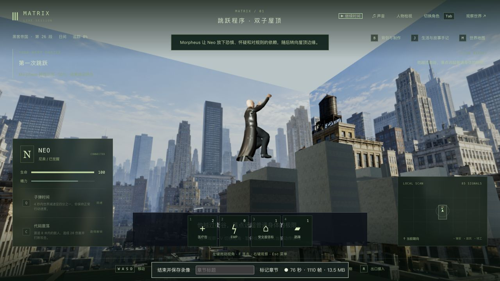
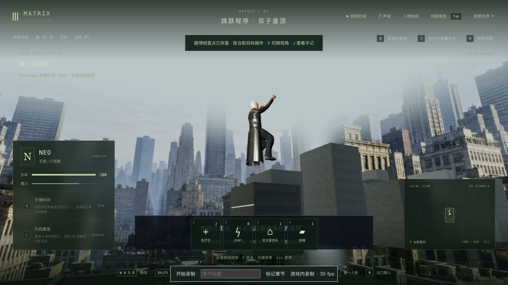
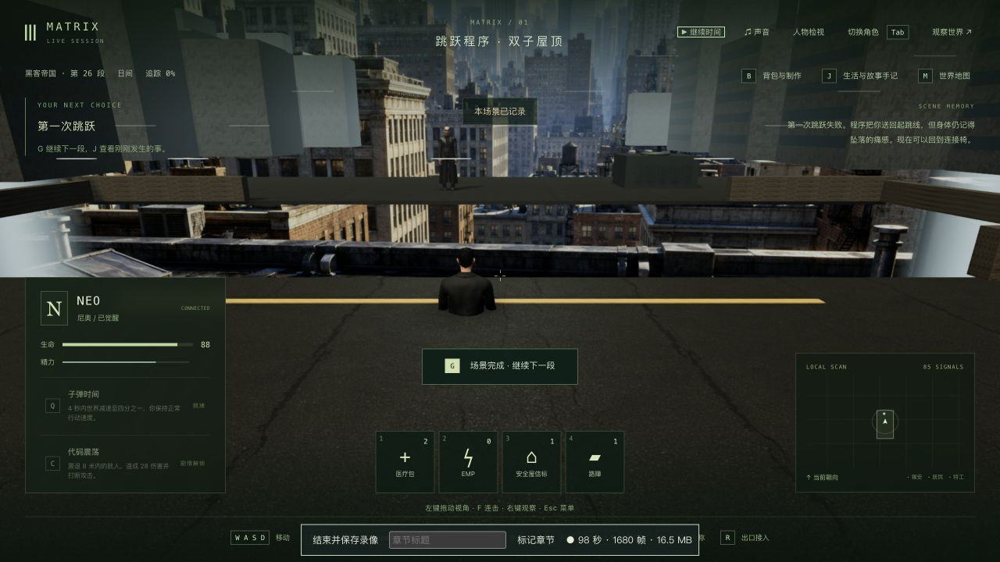

# 屋顶跳跃示范与真实续玩

2026-10-13，第一部训练的局部制作。三部主线定义已接入，125 节点、365 步骤、70 场景不是高质量完成数。本轮没有完成整场电影演出。

## 改动与参考

Morpheus 在近侧屋顶等待，按 G 后实际加速助跑，以连续水平速度和抛物线跃过楼间，屈膝落地、站稳后看向 Neo。演示从 4 秒调整为 6 秒，姿势只读保存的时钟，不继承旧跑动/受击或在暂停时继续播放。死亡或被占用的导师不会被复活、抢占或继续演示。

旧四秒存档按进度比例迁移一次，已看完的演示保持完成，并更新导师姿势。旧入口的导师改为近侧站位，这是明确的版本升级，不声称升级前后人物站位完全不变。普通 Neo 跳跃的重力及既有跌落恢复规则没有修改。

训练日光目标加入场景坐标系，避免太阳朝远处世界原点水平照；保留既有阴影分辨率。屋顶远景天空/侧缘渐隐，并关闭贴片阴影与深度写入，修正腾空取景时的硬接缝。近处建筑仍是简化几何。

原片参考为 [Free your mind 片段](https://clip.cafe/the-matrix-1999/and-im-here-free-mind-s1/)。实际核对约 4.94 秒的起跳、10.16 秒的靴子落到混凝土边缘、13.13 秒 Neo 的反应；未下载或声称看完完整电影。六秒节奏、路径、镜头与回头属于游戏演出，不是逐帧复制。

## 实际游玩与读档

入口来自上一段完整八文件存档：tick 7873、`m1_jump` 第 0 步、暂停/1×/角色释放。没有修改位置、计时或完成字段通过实机验收。

原生操作走到起跳线并 G 启动示范，在 3.011 秒暂停、释放角色并真正关闭/重启生产服务端；冷接入后切换 V 双视角，释放后状态比较保持。再正常续完示范，用 Shift/W/空格实际起跳、重力跌落，生命值 100 → 88，恢复到训练检查点。G 接到红衣女子训练入口，尚未开始下一场。

本地完整存档 `completed-state/`、`runtime-state/`、`cold-runtime-state/` 为 **tick 8046，`m1_red_dress` 第 0 步，暂停/1×/全部角色释放**。只新增跳跃完成，旧完成记录、六项反思及生活选择保持；下一训练场按既有规则恢复 100 生命值。正常时间流逝期间精力、社交、手记等会改变，不声称正常游戏全状态不变。见 [续玩摘要](progression-summary.json)。

中途真正重启与原生冷接管/双视角/释放，以及最终源码的完成档真正重启与原生双视角/释放，六组公开状态（人物、沙盒、事件、阶段、地点、区块）、tick/时间和七份重启前记忆保持。服务提示 `llmStatus` 的 degraded → ready 单列。见 [中途重启](cold-mid-comparison.json)、[中途原生冷读](cold-native-mid-comparison.json)、[最终重启](final-cold-comparison.json)及[最终原生冷读](final-native-comparison.json)。正式 `data/` 及此前 **3717** 个保护文件未改，临时页面和 3177/5377 端口已关闭。

## 验证与未完成项

先保留站位/死亡、助跑、保存姿势、日光、旧时钟/演员姿势、远景阴影的失败回归，再修复。最终动作/训练渲染/剧情 **159/159**，相关真实人物资产 **8/8**，共 167 项不同检查通过；其中真实 GLB 六个助跑/落地时刻的靴底误差小于 .035。最终三包类型检查及共享/服务器/客户端构建通过，未跑本轮最终全库。原生页面捕获到的 error 日志为零，不保证所有操作无错误。

本地录像 `../neo-longplay-2026-09-20/neo-2026-10-13T02-55-41-059Z.webm` 为 142.144 秒（走到起跳线至示范中途，远景修正前）；`../neo-longplay-2026-09-20/neo-2026-10-13T03-02-17-759Z.webm` 为 128.440 秒（冷续示范后段、跌落与下一场入口）。均含长暂停，不是连续六秒示范或三部曲通关录像；第二段出现一次暂停按钮超时，经实际界面恢复。含录制开销的平均帧率约 27.6 / 27.9 FPS、p95 约 106 ms，不能证明稳定性能通过。完整快照、存档和录像只留本地。

准确人物与 Neo 的短夹克、电影建筑/屋顶道具、自然动作/布料、落街回弹、船员反应、拔线后口中出血、对白/口型、稳定性能和全程人工验收仍缺。第一次跌落仍是既有提前恢复样板；有限靴底采样也不保证任意动作无穿模。整组训练、42 组与三部曲保持未完成。
