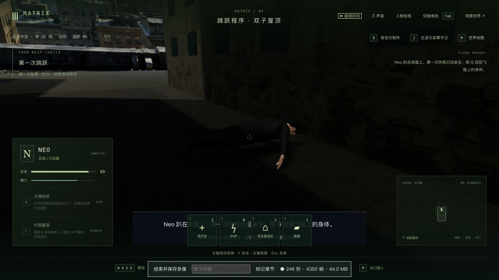
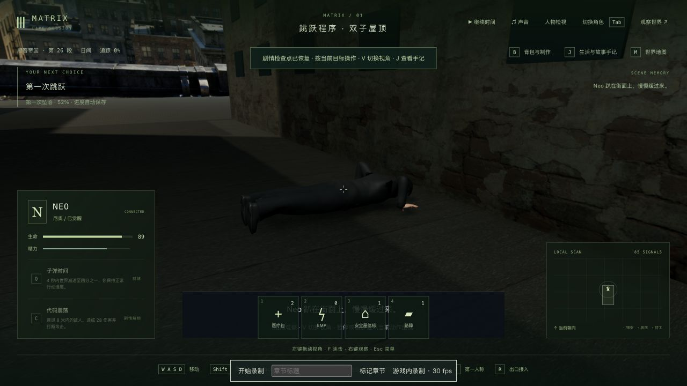
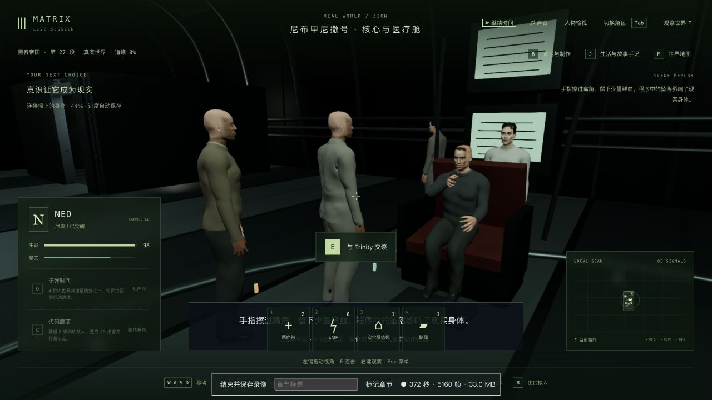

# 首跳失败、街面回弹与现实身体

2026-10-13，第一部训练的局部制作。新增 `m1_jump_return`，共 **126 节点、367 步骤、70 场景定义**；42 组与三部曲仍未高质量完成。

## 改动

Neo 不再掉下约八米就被传送回屋顶。普通玩家输入实际起跳；跌到屋顶以下后，保存初始位置、下降速度与朝向，沿玩家移动使用的同一重力到达街面，再发生街面下陷、回弹、面朝下趴伏与恢复。失败路径的水平运动在街谷内限位，保护训练不致死，撞地扣 12 点且保存结算标记，冷读不会重复扣血。轨迹、保护与节奏是游戏改编，不是自由布料/刚体模拟或原片逐帧复制。

街面视觉和物理高度改为一致；新增实体楼身、合批窗格及共享墙体边界，避免跌到另一栋楼下时被抬回楼顶。道路通过保存进度驱动顶点变形和法线变化，回弹后恢复；身体接触计算采用同一变形函数。重力常量从会初始化地图的城市模块移到纯常量文件，移动与坠落共用，没有新运行时依赖。

回到连接椅的身体后，G 主动检查嘴角并听 Morpheus 说明模拟体验、身体后果和矩阵中的死亡风险；拇指实际到达嘴角，嘴角/手指的少量血可见。J 提供 agency / care / trust 三种原创反思，选择进入持久手记与分数。返船保留当时伤势；现有自然恢复仍会继续，不能把扣血后的数值永久视为 88。

实机发现早期仅最低顶点接地，会把身体架在垂下的手臂上。先保留失败回归和实际网格诊断，再改为躯干/头脚接触、双掌定位和皮肤厚度净空。坠落前半段补保存时钟驱动的失衡动作，第一人称保留实际眼位和鼠标方向。连接椅镜头调整为 Neo 与 Morpheus。有限检查不保证任意人物/衣物接触均无穿模。

参考 [公开 Jump Program 片段](https://www.youtube.com/watch?v=k9Nh0Fvoe9k)、[首跳准备片段](https://clip.cafe/the-matrix-1999/free-my-mind/)及[船员反应片段](https://clip.cafe/the-matrix-1999/everybody-falls-the-first-time-right-trin/)。核对了面朝下趴伏、服装及船员；没有下载或声称完整观看三部电影，公开播放器的跳转/画面时序不用于宣称逐帧对齐。对白为中文概述与原创回答。

## 原生续玩与读档

从前轮的完整八文件入口开始，tick 7873、屋顶第 0 步、暂停/1×/角色释放。通过普通奔跑、G、空格输入实际进入坠落，保存的初始下降速度为 **−13.25**，坠落中途 **0.36 秒**，撞地前生命 100。实录及中途状态在本目录，未修改位置、计时或完成字段通过实机验收。

正常落街、返船、检查、听取说明、J 选择 agency，再 G 接到红衣女子第 0 步。完成后的本地 `completed-state/`、`runtime-state/`、`cold-runtime-state/` 为 **tick 8382、暂停/1×/角色释放，下一场训练尚未开始**。只新增 `m1_jump`、`m1_jump_return` 完成及 `m1_jump_return:1 = agency`，agency 6 → 7，旧完成、反思和生活选择保持。见 [续玩摘要](progression-summary.json)。

坠落 0.36 秒、擦血 **5.335 秒**及完成档的真正生产重启，原生冷接管/双视角/释放，六组公开状态、tick/时间与七份重启前记忆保持；模型服务提示 degraded → ready 单列。见 [坠落重启](fall-cold-comparison.json)、[坠落原生冷读](fall-native-comparison.json)、[擦血重启](return-mid-cold-comparison.json)、[擦血原生冷读](return-mid-native-comparison.json)、[完成重启](completed-cold-comparison.json)及[完成原生冷读](completed-native-comparison.json)。早期坠落双视角检查早于后续第一人称方向修正，不当作最终该镜头全范围验收。

趴伏中途升级重启严格为 **5/6**，仅沙盒里的等待提示改为正确的“慢慢缓过来”，其余五组、时间和七份记忆保持，见 [明确升级差异](prone-upgrade-differences.json)。没有把该比较写成完全不变。正式 `data/` 和此前 **3811** 个保护文件未改；临时页与 3178/5378 端口已关闭。

## 检查与仍缺内容

最终剧情/动作/训练渲染 **162/162**、相关真实人物资产 **9/9**（171 项不同检查）、三包类型与生产构建通过；未跑最终全库。检查实际 GLB 接地、脸朝向、双掌、拇指触口、擦拭后血迹在皮肤外可见及离场恢复；道路检查包含真实街面位置、楼身边界和变形/回弹绑定。先失败记录、循环导入错误及浮点夹具修正保留。最终冷读页没有捕获到 error 日志，不代表所有操作都无错误。

五份本地录像范围和元数据见 [录像索引](recordings.json)，均在 `../neo-longplay-2026-09-20/`。前几份包含修正前的静止手臂、趴伏悬空和旧镜头，全部含长暂停；最后一份覆盖冷续问答、反思与下一场入口。不是完整连续电影训练或三部通关录像。含录制/并行检查开销的平均帧率约 20–43 FPS，p95 48–192 ms，没有最终稳定性能基准。完整世界快照、八文件存档和原始录像只留本地。

Neo 短夹克、准确人物相似度、原片城市/船舱空间、自然受力/布料/手指表演、实际拔线与船员反应演出、对白/口型、声音、任意碰撞和稳定性能仍缺。血迹与回弹是局部样板，不作为完整电影还原验收。本轮交付缺失的实际衔接、动作与保存恢复，整组训练、42 组和三部曲保持未完成。
