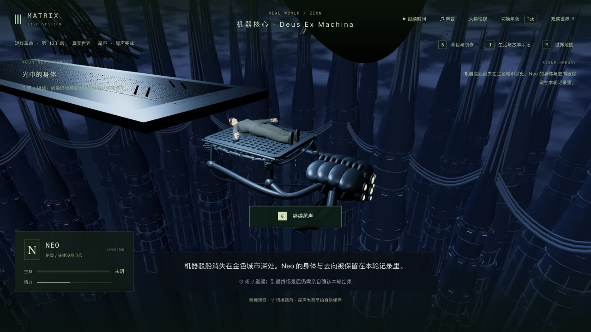
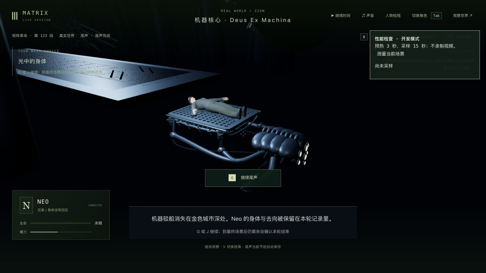
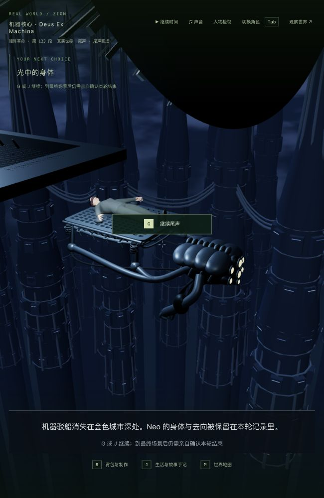

# 3-10 / 3-12：机器城外景纵深

2026-10-11，基于 `e1dfc87`。本轮给机器核心外的空背景增加三层、100 座机械塔体、分段环箍、管线、运行灯及冷蓝色云层/雾光。原有 18 组悬空柱体被替换，城市构件使用五批实例与一批合并管线；没有新增贴图、人物资产、依赖或存档字段。

参考上一轮原生查看并保存在本地的 [Lon Marshall 结局片段](https://www.youtube.com/watch?v=qTnBVDKuNdI) 1:09：运输机器后方是密集冷蓝色工业城市。此来源为非官方上传；本轮复看了该局部参考画面，没有重新核对整部电影。新城市仍是程序化近似，塔型重复、材质与布景比例均不代表电影资产精度。电影截图没有提交。

## 实际画面

最终正常游戏界面：

修改前同一检查点：

宽/窄窗口、V 切换和第一人称转头均使用原生界面检查。补亮背景后发现机器集体还在台下显示一个普通人形；现在该地点由场景中的机械集体表示，隐藏重复人形，不修改持久角色的身份、生命、位置或剧情。

`after-third-narrow.png` 保留发现重复人形的中间版本；`final-first.png` 和 `final-first-narrow.png` 保留最终第一人称实际画面。金色感知和机器核心本体依旧明显粗糙。

## 验证与存档

- 修改前相关基线 40/40，后处理基线 3/3。
- 城市缺失、重复人形、远景参与接触阴影均先失败后修复，保留 `city-red.log`、`collective-avatar-red.log`、`occlusion-red.log`。另保留中间城市外缘侵入镜头保留范围、切换后材质参数未完全恢复的失败记录。
- 最终相关回归 **86/86**：城市几何范围与绘制预算、冷读一致性、感知恢复、GPU 资源释放、实际 GLB 托架接触、运送与谈判镜头、后台同步、尾声规则、首页及实体身体显示、后处理阴影恢复。有限姿态/视线采样不能证明所有连续帧无穿模。
- 最终客户端构建（包含 TypeScript）通过，JS 3,419.87 kB / gzip 1,038.42 kB，既有大包警告保留。服务器/共享包源代码未改；本轮没有全库测试、完整电影自动路线或新长录像。
- 只重看上一轮完整的真实 `done-restarted-state` 副本：Neo / `m3_neo_carried` 第 1 步 / done / tick 13656，全程暂停。没有推进、跳转或改写剧情检查点。
- 两次真正停止/重启独立后台，以及最终原生双视角退出，六组公开状态、时间与 15 份记忆保持。分别见 `restart-comparison.json`、`final-restart-comparison.json`、`final-native-comparison.json`。最终重启后的原生接管/退出另通过 `final-cold-native-comparison.json`，最终控制台无 warning/error。并非只刷新页面模拟重启。
- 最新剧情仍使用上一轮 `trilogy-neo-carrier-2026-10-11/verified-state`：Sati / `m3_reset` 第 0 步 ready / tick 13688，未开始醒来。本轮旧场景复看不替换该最新进度。

主试玩 3155 / 5355 保持暂停 / tick 10432，六组状态和时间保持；227 项受保护文件全部未改，包含最新 Sati 副本、源检查点、主档及人物资产。独立验收服务已关闭，完整测试副本和原始记录留在本地，未提交世界/记忆原文。

## 性能与准确边界

Apple M3，1280×720，第三人称，相同真实暂停检查点；预热 3 秒、采样 15 秒，不录制视频，测试/构建完成后测量。所有原始报告保留，不删掉退步或无效对照。

| 版本 | 像素密度 | FPS | 帧时间 p95 | 每帧绘制 | 每帧三角形 |
| --- | ---: | ---: | ---: | ---: | ---: |
| 修改前 | 1.5 | 51.28 | 29.7 ms | 589.00 | 937,349 |
| 第一版城市，窗口切换后 | 1.0 | 59.31 | 21.3 ms | 434.53 | 1,503,991 |
| 第一版城市，真实重启 | 1.5 | 37.03 | 37.7 ms | 434.00 | 1,503,923 |
| 第一版城市，稳定加载复测 | 1.5 | 42.41 | 31.3 ms | 436.00 | 1,504,179 |
| 远景改为漫反射光照 | 1.5 | 44.01 | 29.9 ms | 434.00 | 1,503,923 |
| 最终：远景略过接触阴影通道 | 1.5 | 56.42 | 24.6 ms | 428.00 | 1,191,283 |
| 最终：真实重启后复测 | 1.5 | 48.22 | 30.2 ms | 428.00 | 1,191,283 |

曾将 59 FPS 误当成同条件改善；复核发现像素密度变化后立即更正，该行不用于提升结论。最终远景采用漫反射光照，并略过 1.8 米范围的屏幕空间接触阴影；城体的颜色绘制与深度遮挡仍保留，近景身体、托架和机器仍有接触阴影。此选择降低远景金属反射与细小接触阴影精度。对应单项失败、画面和报告均保留。

最终相同密度两次为 56.42 和 48.22 FPS，后一次低于旧版单次 51.28 FPS；不能把较高的一次当成稳定性能提升。

本轮只验证局部完成后的暂停机位。动态运送、谈判和整部游戏的稳定帧率仍未验收，不能据此声称稳定 60 FPS。

## 仍需制作

城市布局/比例、塔型与材质、运输机器、人体/衣物/自然动作、完整失明感知、电影级照明及声音仍不达标；这不是电影场景精确复刻。本轮没有新的谈判实机流程、动态运输长玩、失败重试或终战至日出的完整人工通关。42 组和三部曲继续制作，不标记高质量完成。
