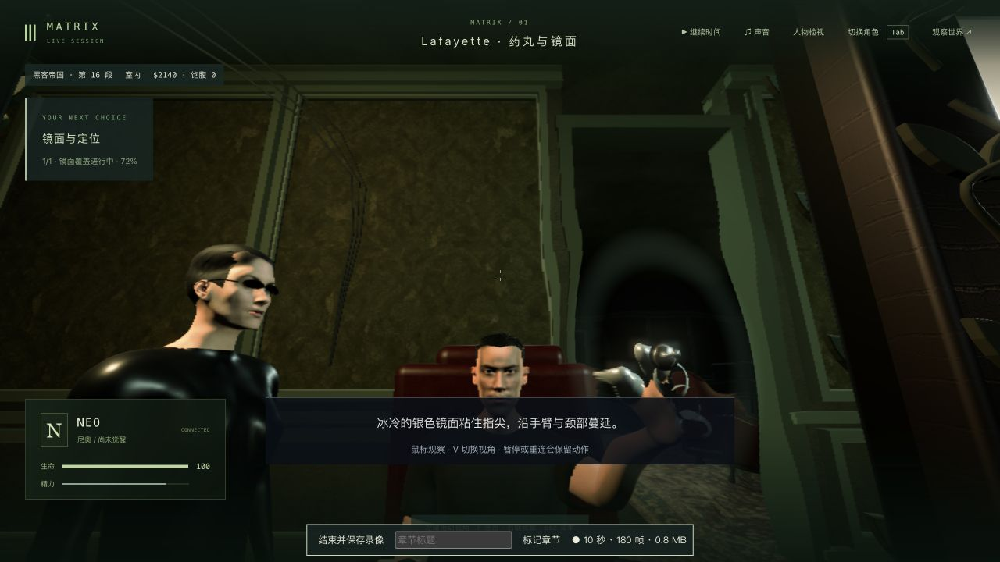
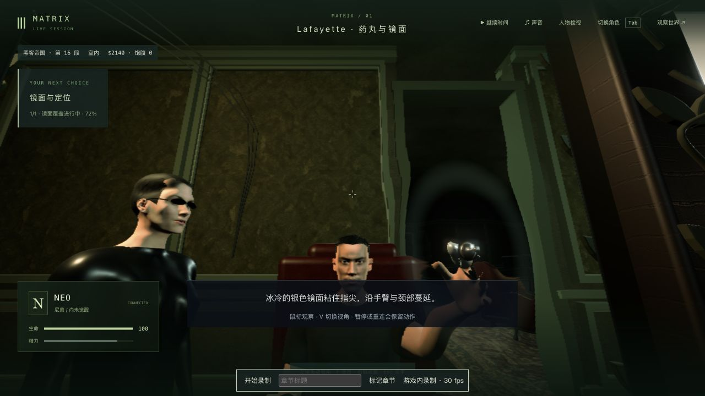
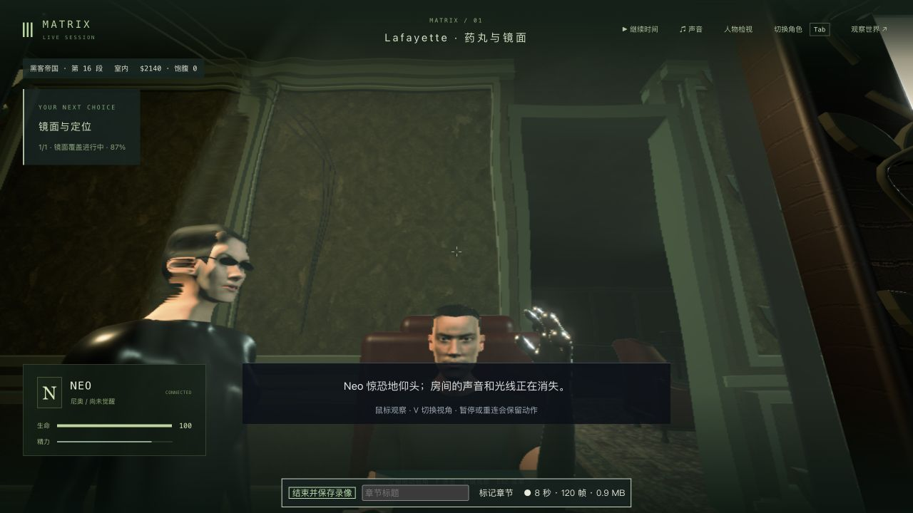
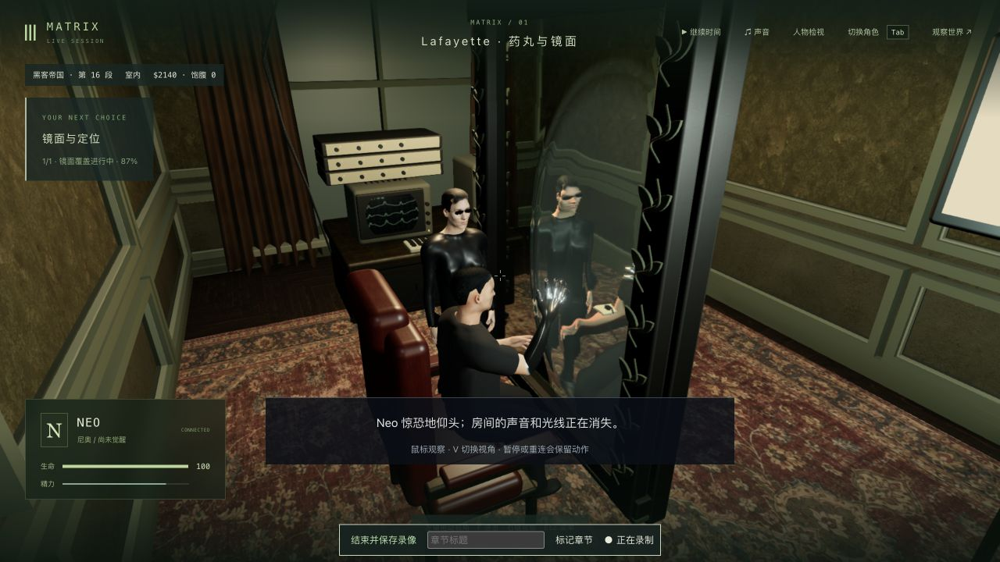
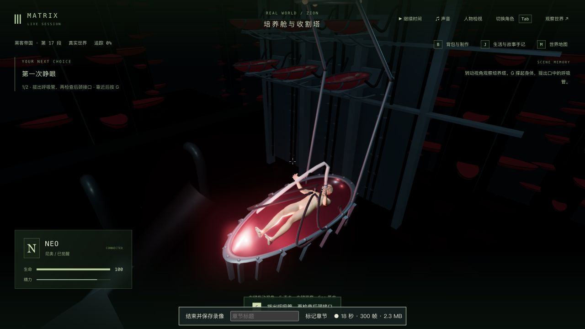

# Lafayette 触镜：银液传播与金属响应

2026-10-12，基于 `d20432a`。本轮只制作 1-06 的银液效果：接触的食指/中指先沾上银液，银液向掌根传播，再从其余手指根部向外覆盖；降低银液的漫反射和粗糙度。三部曲仍在补玩法、制作画面与逐段验收，未完成整体验收。

## 原片依据和实际改动

参考 [Warner Bros. Entertainment 官方片段：Neo Starts to Wake Up](https://www.youtube.com/watch?v=vqG6-Z2bGX4)。原生浏览器确认官方频道，查看约 00:15 的中景及 00:20 的收手近景：食指/中指是反光的银液，拇指仍露皮肤。本轮没有查看该短片之外的完整三部曲，也没有把电影画面替代游戏渲染；参考截图仅留在本地，不进入游戏资产或本次提交。

旧代码给右手五个指尖相同的覆盖起点，在本轮实际暂停时刻会同时出现五处银斑。新代码沿既有真实蒙皮权重区分接触手指与非接触手指，保持腕、臂、头和全身的既有时序。测试采样实际 Neo GLB：修复前拇指尖平均到达进度约 0.042，修复后约 0.477；修复后食指/中指尖约 0.041 / 0.066，掌根约 0.340，其余指尖随后覆盖。

银液金属度由 0.62 调整为 0.98，粗糙度由 0.08–0.16 调整为 0.035–0.08，更新着色器缓存版本。使用已有环境光照和反射，不增加房间立方体反射捕获、纹理、依赖、几何或渲染通道。银液目前仍是既有顶点覆盖场与表面位移，并非真实流体；环境反射也不是银液对当前房间的实时完整倒影。

## 实机对照

以下均为原生游戏截图，1280×720。覆盖初起暂停于 tick 5276，`mirrorTime = 3.863`、银液进度约 0.091；同一保存时刻修改传播顺序后复看。两次重新接管的相机有轻微插值差异，不是逐像素固定机位比较。

| 原传播：五个指尖提前沾银 | 修正：接触手指先沾银 |
| --- | --- |
|  |  |

整手覆盖暂停于 tick 5280，`mirrorTime = 6.006`、银液进度约 0.562。此时再单独修改材质响应，原生复看及真正重启后冷读。

| 原材质 | 最终材质冷读 |
| --- | --- |
|  |  |

本轮仅检查这些暂停时刻及普通续玩中的双视角。未增加自然手指动作、口型、布料或人物相似度制作；有限模型接触回归与截图不能证明所有动画帧都无穿模。

## 原生续玩、保存和真正重启

入口整体复制前轮 `trilogy-lafayette-room-2026-10-12/final-mirror-native-state/`，含完整 world 和 7 份记忆。入口 tick 5275、触镜前约 3.142 秒。沿用该检查点上游的记忆修复与来源限制，不宣称其最初历史瞬间完全原生一致；本轮未拼接不同目录的 NPC 记忆，也未直接改写人物、位置、剧情步骤、生命值或故事时钟。

输入来自原生页面的“继续 Neo 的剧情存档”、V、录像和观察者按钮。辅助脚本只通过普通玩家协议在自然到达指定时刻时暂停，再读取已释放角色的公开世界和本地保存文件。暂停脚本不是剧情跳转，也没有注入完成状态。

| 检查 | 实际结果 |
| --- | --- |
| 初起传播修改前后 | [六组状态均相同](after-order-comparison.json)，暂停时间和 7 份记忆保持 |
| 初起真正重启，未接管 | [5/6 相同](cold-liquid-comparison.json)，只有 Neo 临时 `currentAction` 被启动清理 |
| 初起原生接管、双视角后释放 | [6/6 相同](cold-native-liquid-comparison.json)，动作恢复，时间及 7 份记忆保持 |
| 后段材质修改前后 | [6/6 相同](material-comparison.json)，时间及 7 份记忆保持 |
| 最终材质真正重启，未接管 | [4/6 相同](cold-material-comparison.json)，Neo 临时动作清理、模型服务由 degraded 变为 ready；故事时间保持 |
| 最终材质原生冷读、双视角后释放 | [5/6 相同](cold-native-material-comparison.json)，人物恢复；唯一差异为模型服务运行提示，时间及 7 份记忆保持 |

构建完成后原生继续最后一段触镜，自然进入 `m1_pod` 第 0 步 / tick 5284，培养舱入口已查双视角；未按 G 拔呼吸管。结束时世界暂停、全部角色释放。完整本地检查点和原始 world/记忆留在本目录的隔离副本中，不提交这些状态数据。

## 测试与失败记录

- 修改前已有镜面接触/反射/采样范围：21/21；人物资产中名称匹配 mirror/silver 的实际执行用例：6/6。这是相关基线，未声称全库基线。
- 首次新测试是夹具错误：要求某个骨骼权重超过 0.85，但实际拇指掌关节最大权重只有约 0.751。检查真实 GLB 后，改为采样主要受该关节控制的顶点（权重大于 0.5），保留每个区域的样本数量检查。原始错误见 `liquid-before.raw.log`，不计为产品问题的复现。
- 有效复现见 `liquid-reproduced.raw.log`：旧生产代码因未接触拇指提前沾银失败；修改传播后 1/1 通过，见 `liquid-order-after.raw.log`。
- 最终 9 个相关测试文件 **114/114**，0 失败、0 跳过：完整 character-asset，加 mirror-liquid/contact/reflection/region/guide-renderer、lafayette-renderer/camera、pill-view，见 `final-tests.raw.log`。未运行最终全库。
- `npm run typecheck` 与三包 `npm run build` 通过，见 `typecheck.log`、`build.raw.log`。类型输出仅归一化末尾空白，原始 `typecheck.raw.log` 留在本地。客户端仍有 500 kB 分块提示，最终主 JS 3,431.99 kB；本轮没有解决该既有问题。
- 原生浏览器两次最终银液材质检查没有捕获到 error 日志；保存/重启和最终转场已实际验证。
- [保护检查](protected-result.json)：正式 data 87 个文件、前轮房间 247 个文件、前轮合批 151 个文件，共 **485** 个文件逐个 SHA-256 一致，无新增、删除或修改。3159/5359 的本轮服务已停止，参考及验收页已关闭，用户游戏页未操作。

## 本地录像与准确范围

录像保存在项目既有 `output/gameplay/neo-longplay-2026-09-20/`，不加入本次提交。[实际媒体检查](video-audit.json)由 ffprobe 包时间戳生成；录像器显示的“30 fps”是采集上限，不是实测帧率，录制中的渲染统计也不是无录制性能基准。

| 本地文件 | 范围 | 实际视频包 / PTS 范围 | 字节 |
| --- | --- | --- | --- |
| [20-32-22 实录](../neo-longplay-2026-09-20/neo-2026-10-11T20-32-22-368Z.webm) | 旧传播、触镜前到初起，双视角和暂停；录像器时长 44.517 秒 | 815 / 44.259 秒 | 8,880,823 |
| [20-35-53 实录](../neo-longplay-2026-09-20/neo-2026-10-11T20-35-53-408Z.webm) | 新传播、旧材质，初起冷读到整手覆盖，双视角和暂停；114.817 秒 | 1,639 / 114.474 秒 | 16,480,893 |
| [20-40-44 部分记录](../neo-longplay-2026-09-20/neo-2026-10-11T20-40-44-416Z.webm) | 最终材质的暂停冷读，被生产构建热更新中断，缺结束 JSON；只作部分记录 | 791 / 53.072 秒 | 9,149,596 |
| [20-43-58 最终实录](../neo-longplay-2026-09-20/neo-2026-10-11T20-43-58-109Z.webm) | 构建后最终版本，整手覆盖后正常进入培养舱入口，双视角和暂停；33.893 秒 | 536 / 33.701 秒 | 5,230,490 |

四份文件均能被 ffprobe 读取到 1280×720 VP9 视频及 Opus 音轨。上述录像含暂停和检查等待，前三份各有明确的中间版本/中断边界；不是新的连续 P0 通关录像。本轮没有新的无录制 FPS 对照或稳定性能验收，不能用录像统计宣称帧率提升。

## 仍需制作

人物相似度、手型/自然全身表演、真实银液流动与房间反射、准确电影布景/摄影、声音和稳定帧率仍未达标。完整 P0 成功/被捕与红/蓝双路线连续人工验收、后两部未补齐的专用玩法及三部曲完整连续人工通关继续制作。42 组剧情、125 节点、365 步骤、70 个场景定义的覆盖范围不等于成品数量，本轮不提升整组或三部曲完成状态。
