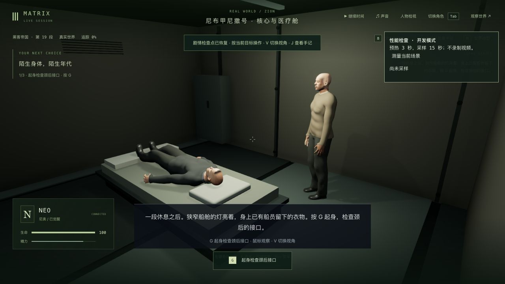
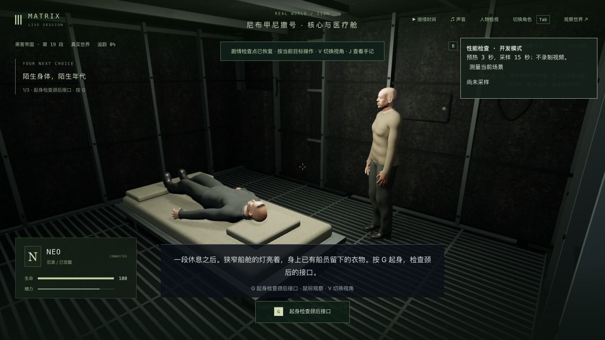
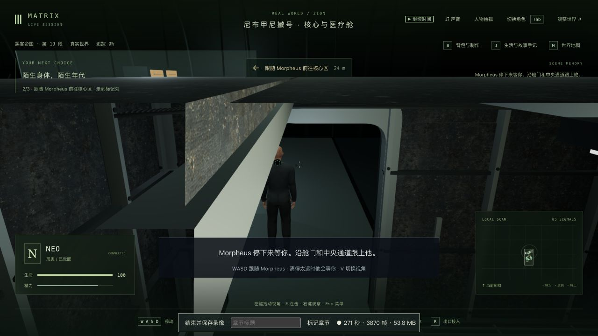
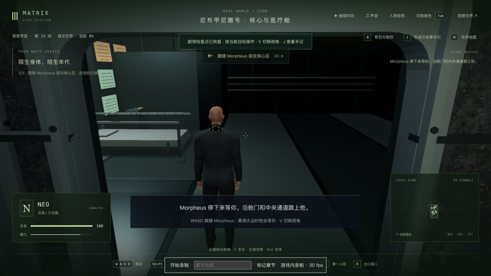

# Neo 苏醒舱室：钢板、舱门、床铺与镜头净空

2026-10-12。继续 1-07。平整墙盒改为有厚度的分块舱壁、接缝/支柱、检修盖、成束电缆和顶梁；增加弧形压力舱门、实际金属格栅与柔和边缘的棉布床铺。保留床位、起身动作、柜体和带路路线，舱壁浮雕受共享碰撞尺寸约束。按材质合并静态构件，纵向格栅实例化；贴图与几何由独立舱室组件管理，晚到图片不会重新挂回已释放的场景。

成片参照为实际查看的[Neo / Morpheus 舱室片段](https://clip.cafe/the-matrix-1999/morpheus-whats-happened-me/)，以及[Neo 近景](https://clip.cafe/the-matrix-1999/morpheus-whats-happened-to-me/)。可以核对旧金属表面、检修盖、并线和床上织物；局部镜头不证明完整平面、尺度或格栅布局，本轮这些仍是游戏改编。

## 素材与实现

使用内置 image_gen 新生成两张表面图，均已实际接入游戏：[磨损钢板](../../../packages/client/public/assets/film-materials/neb-cabin-painted-steel-v1.png)与[旧棉布](../../../packages/client/public/assets/film-materials/neb-cabin-cotton-v1.png)。完整最终提示词和生成方式见[素材记录](../../../packages/client/public/assets/film-materials/neb-cabin-surfaces-v1.json)。实际输出均为 1254×1254，总计约 7.35 MB；尺寸与 SHA256 见[资产验证](assets.json)。使用底色与近似微小凹凸，没有独立扫描法线/粗糙度；未用电影帧作为贴图。没有新增包依赖。

## 先失败、接触与回归

原有舱室/恢复/材质加载基线 16/16。新增测试先复现缺少实体舱壁与表面加载规则；首次结构检查发现端柱超出碰撞范围，已收回。实机格栅被旧甲板遮盖，射线测试先失败，随后切开对应的旧甲板，格栅顶部与落脚平面一致。床面、连接椅、接口/手掌及 Neo / Morpheus 实际交付皮肤和毛衣的有限步行姿态均检查。

正常出门后，第三人称在顶部穿过新顶梁，`roof-camera-before.log` 对实际出舱位置复现了遮挡。现按共享顶部净空缩短跟随距离并约束平滑过渡中的镜头高度，宽窄画幅回归通过，原位置已实机复拍：

最终场景/剧情/材质 19/19、实际人物接触 5/5、相关镜头 7/7，合计 31 项通过；三包最终类型检查及共享/最终客户端构建通过，原有大包告警保留。完整相机基线为 193/194，最终 194/195；两次均仅公园对话的 4:3 建筑师出画用例失败，失败坐标相同，尚未修正。没有全库全绿结论。人物穿门采样主要覆盖门中心的五个步行姿态，镜头另检查真实偏置位置；不保证任意动作、每帧或所有接触均无穿模。

## 正常游玩与读档

独立端口 3166 / 5366，完整真实舱室入口副本 tick 5616 / 第 0 步。原生 G 起身，WASD 绕床、穿门、沿中央通道到椅前；Morpheus 完成带路后，原生 G 明确同意接入，正常进入 `m1_construct` 第 0 步 / tick 5878。没有改写存档跳转剧情，也没有开始构造体的形象检查、电视课程或荒漠揭示。

一次等待构造体标题的辅助 UI 观察超时，未重启或改档；下一次实际界面确认接入已经成功。最终完整入口档恢复新布局[6/6](layout-transition-comparison.json)；构造体入口[真正后台重启](completed-cold-comparison.json)及[原生冷读双视角/释放后](completed-reviewed-comparison.json)，人物、区块、地点、事件、沙盒、模拟均严格 6/6，日期/时间/刻度及 7 份记忆字节保持，未过滤差异。正式 data/ 与前十一轮目录的 1868 文件保持，见[保护检查](protected-comparison.json)。用户 5197 页面未操作。

两段带音轨本地录像：首段约 [447.245 秒](../neo-longplay-2026-09-20/neo-2026-10-12T11-25-56-538Z.webm)，91.56 MB，含修正前出舱遮挡；后段约 [265.265 秒](../neo-longplay-2026-09-20/neo-2026-10-12T11-58-00-308Z.webm)，30.24 MB，从修正后的出舱位置继续，经过步行/主动接入到构造体。两段均有长暂停检查，不能称为同等长度的连续动作或全程人工通关。1280×720、VP9/Opus；流式 WebM 没有容器时长，时长来自最后视频包时间，包数不当作解码帧数，见[媒体验证](videos.json)。原始录像留在本地。

## 性能与剩余制作

同一入口、默认第三人称、1280×720 / 像素比 1.5 / Apple M3，预热 3 秒、采样 15 秒，未录制或并行跑构建/测试。单次旧版 27.66 FPS / p95 43.2 ms / 396 次绘制；新布局初版 24.53 / 46.1 / 411，床铺合批后 23.70 / 50.4 / 393。合批没有证明帧率改善，整体出现退步；未做交替复测，最后采样早于出舱镜头修复，不作为最终版本稳定性能证明，原始三个报告均保留。

人物相似度、服装破损、自然表演/口型/声音、准确舱室空间与完整船员介绍仍缺；后续核心与构造体布景需继续制作，公园取景失败与性能继续保留。1-07、42 组及三部曲仍未高质量完成。

本轮后台、客户端和临时试玩/参照页已关闭，没有设置临时画幅。真实副本和原始录像仍保留在本地。
