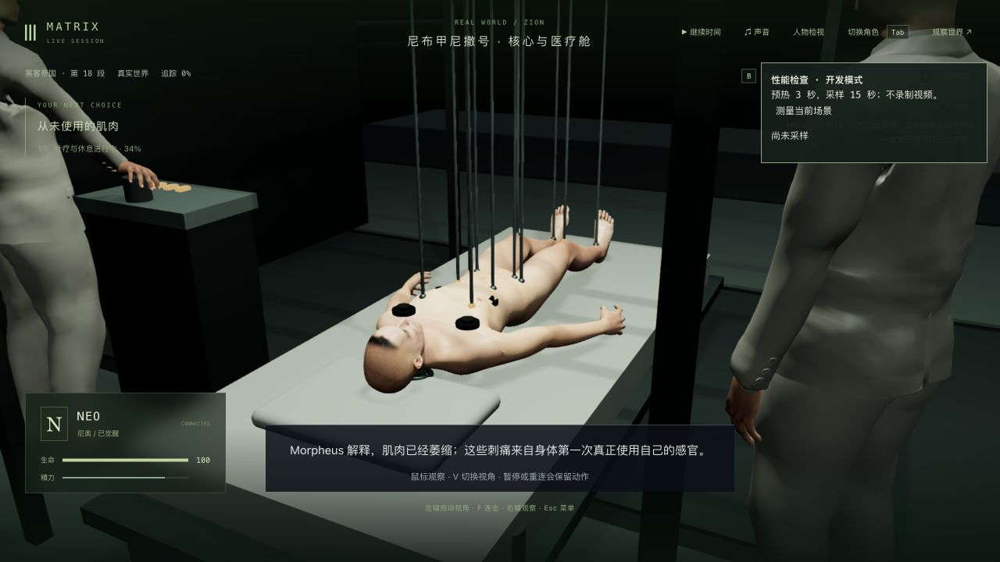
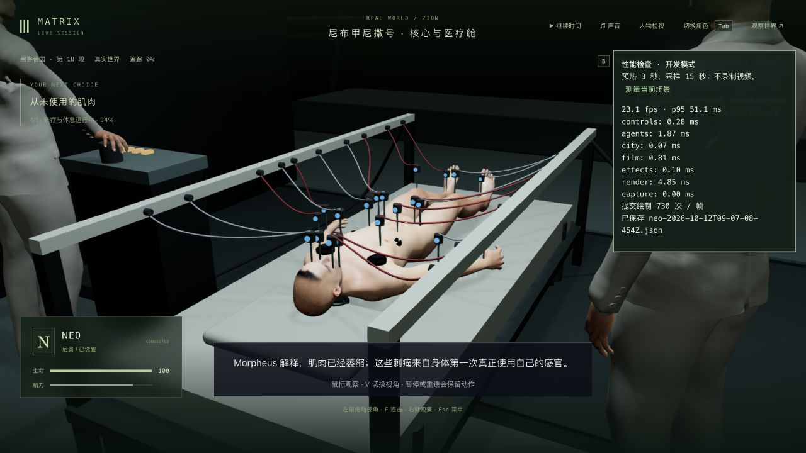
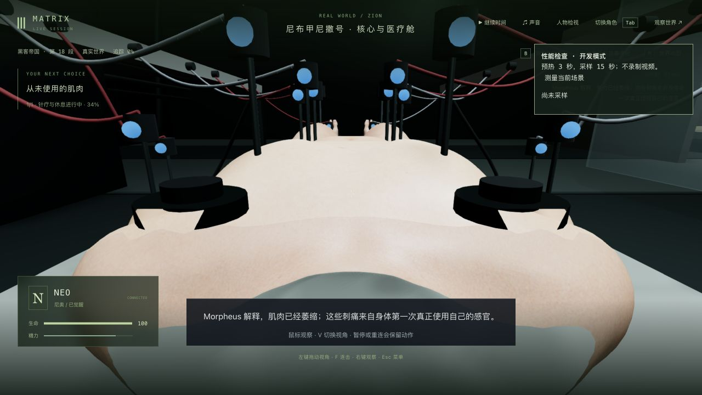

# 医疗针疗装置与患者视角

2026-10-12。本轮继续 1-07 的康复局部：悬空长针架改为 20 个贴肤短针、黑色接头、蓝灯与红灰细导线，覆盖脸颊、躯干和手臂。导线接向身体同侧并自然下垂，两批实例绘制；设备移到床边，碰撞同步使用低设备的尺寸。床垫、枕头与 Dozer 的操作旋钮接触沿用原有数据，医疗照明略向冷蓝调整。

实际查看的[康复成片片段](https://clip.cafe/the-matrix-1999/he-still-needs-a-lot-of-work/)显示了短针、黑色接头、蓝灯、细线以及 Dozer 在床边操作。该页面是 Clip.Cafe 的短片段，未下载或嵌入影片；设备比例、针位数量、G 主动开始与 12 秒的恢复过程仍是游戏改编，不能据此称为完整成片还原。

## 实机发现与修正

- 初版导线交叉并向上拱起，已改为同侧接线和下垂；床边设备初次挡住船员路线，后来挡住第三人称的身体视线，已按真实通行与镜头检查调整到床缘。支柱和白条的共面顶面造成闪烁，改为支柱支撑白条底面。
- 第一人称原来将自由观察压缩到天花板附近，同时隐藏整个人体。现保留鼠标观察、显示躯干和手脚，使用模型的患者眼位。旧眼位位于注册脸皮后方，患者眼位投射到实际表面外。
- 穿衣遮罩误删裸身手腕皮肤，按头骨权重删面又切掉了颈部。患者使用独立可释放的索引缓冲，保留完整手腕和下颈，只裁掉下颌以上的自身头部。可见脸皮被裁除时，针位仍使用完整交付几何采样，没有改变当前显示几何。

## 验证范围

相关基线为床/灯光/路线 **7/7**、实际患者接触 **2/2**。最终针疗/实际模型 **10/10**、相关镜头 **9/9**、患者/剧情/舱室 **15/15**，合计 **34 项**通过；三包类型检查通过，共享/服务器构建与最终客户端构建通过，既有大包告警保留，未跑最后全库，无新增依赖。长针、导线拱起、受限观察、人体隐藏、近似眼位和下颈丢失都有先失败记录。最初肩部坐标夹具采用错误的资产尺度，随后假设了该皮肤没有使用的 neck 权重，两项夹具失败均保留且不计通过；最终按实际导出皮肤验证 **25,728** 个头骨之外的三角形，并用原模型射线核对下颈。

实际几何检查覆盖 **3.8、4.073、5.8 秒**：20 个针尖对实际脸颊/躯干/手臂皮肤的接触，接头高度、导线各三个位置的净空，暖加载/冷加载及隐藏脸部后的冷加载针位。有限姿态和射线采样不证明每帧、每条导线全长度或任意接触均无穿模。

真实完整针疗中途档为 **tick 5617 / 4.073 秒**，由原生 G 正常开始治疗后暂停得到。独立端口 3164 / 5364；真正后台重启立即、界面刷新/角色释放，以及宽窄双视角退出的严格比较，均保持人物、区块、地点、事件、沙盒和模拟状态 **6/6**，另核对时间/日期/刻度与 **7 份记忆**字节；没有过滤差异。一次辅助抓取早于后台监听，连接被拒绝，随后确认服务就绪再成功抓取，没有因此重启服务或改存档。

人物相似度、Dozer 专属服装、自然受力/表情/口型/对白、休息与照料的细致演出、精确船舱比例和材质仍需制作；患者近景比例、针线密度和连续整组人工验收也未达最终要求。本轮属于局部制作，1-07、42 组与三部曲目标保持未完成。

## 正常游玩、录像与性能

另取此前完整真实医疗等待档的副本，**tick 5591 / elapsed 0 / started false**，以原生界面继续时间并按 G，正常完成针疗至 **m1_cabin 第 0 步 / tick 5616**。舱室 elapsed 0 / started false，没有起身或继续下一段；未改存档推进剧情。录制中的 V 发生在针疗已完成之后，检查的是舱室双视角；医疗双视角来自此前保留的真实暂停中途档。

舱室完成档真正重启立即 [6/6](whole-cold-comparison.json)，时间与 7 份记忆字节保持。医疗中途的真正重启见 [比较](medical-final-cold-comparison.json)，最终宽窄/双视角退出 [6/6](medical-final-reviewed-comparison.json)，无录制性能采样后再释放 [6/6](medical-performance-comparison.json)。这些是独立完整副本的局部检查，不是从日常生活连续人工通关。

[本地原始录像](../neo-longplay-2026-09-20/neo-2026-10-12T09-11-19-347Z.webm)：约 **121.21 秒**、1280×720、1,908 个捕获帧、带音轨、约 **16.81 MB**，见 [元数据](video-metadata.json)。含较长的暂停检查；真实针疗运行约 12 秒，不能当作连续两分钟动作或整组长玩。录像留在本地。录制期渲染统计包含编码开销与等待，不作为稳定帧率证明。

最终同一医疗中途档、默认第三人称、1280×720、像素比 1.5、Apple M3，预热 3 秒/采样 15 秒、无录制且未同时运行构建/测试：[报告](performance-final.json)为 **23.07 FPS / p95 51.1 ms / 730 次绘制 / 1,064,087 三角形每帧**。旧报告为 19.12 FPS / p95 64.2 ms / 548 次绘制，但旧采样期间成片参考页仍打开，没有交替或冷启动性能复测，不能据此宣称性能提升。新增可见针位提高了绘制次数，后续还需合批和资源优化；性能未达标。

正式 data/ 与前九轮目录的 **1589 文件**增加/删除/内容均保持，见 [保护检查](protected-comparison.json)。

舱室冷读后原生双视角/退出的 [比较](whole-cold-reviewed-comparison.json)仍为 6/6，时间和 7 份记忆保持。本轮后台/客户端与检查页已关闭，临时画幅已恢复。
