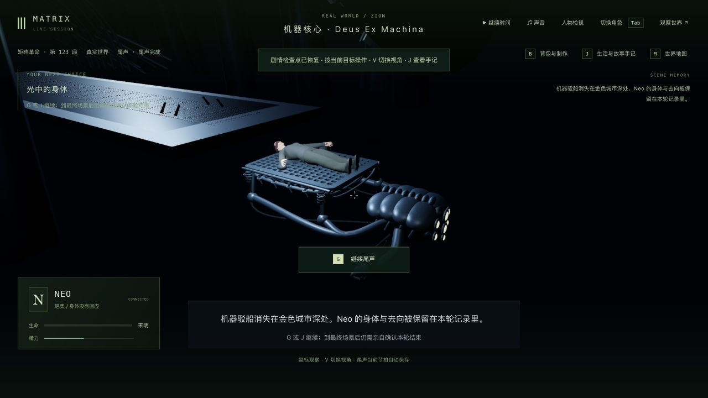
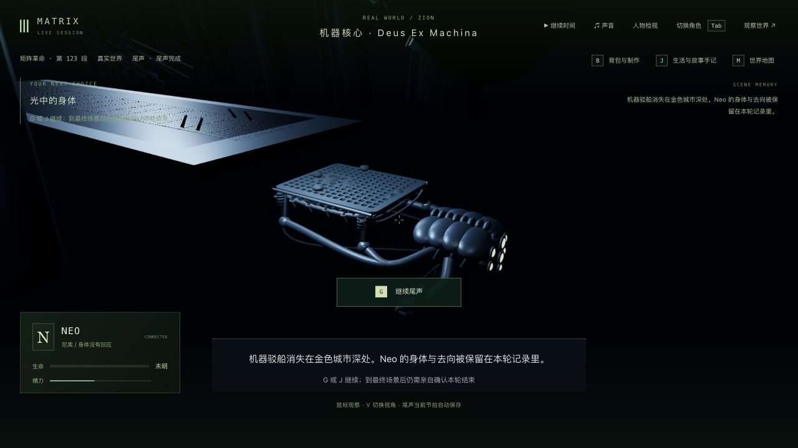
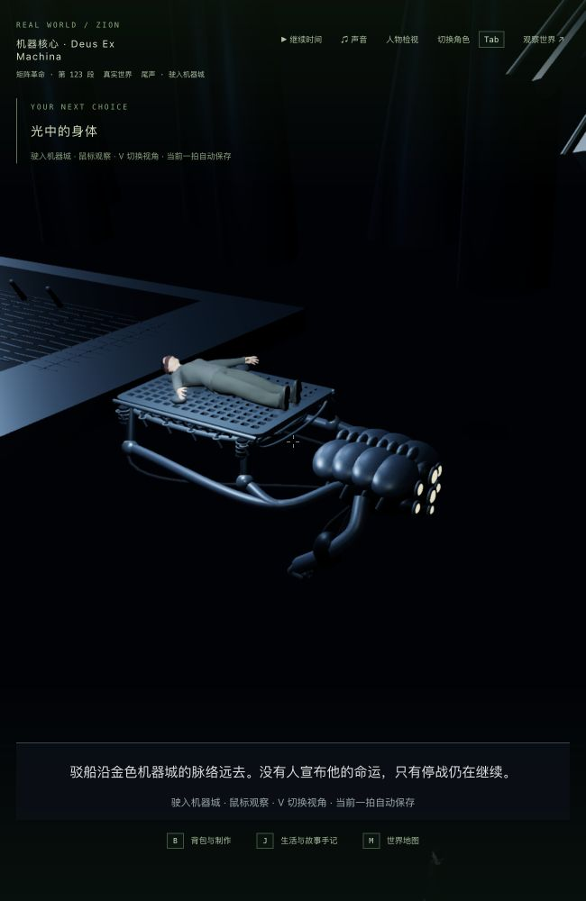
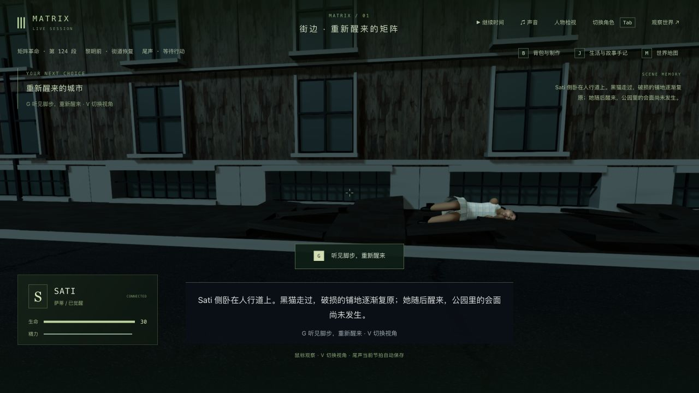

# 3-12：Neo 运输机器与结束后续档

2026-10-11，基于 `fad8756`。本轮替换托架下方的椭圆底座，补多目运输机器、分层外壳、弯曲肢体、拖曳支架和悬垂管线；四处支架按实际 Neo 模型拟合，继续使用原有保存轨迹和金属材质。第三人称随托架转移拉开取景，留出字幕区域。没有新增依赖、人物资产或存档字段。

参考实际查看的 [Movieclips 结局片段](https://www.youtube.com/watch?v=KfH-2VNDBIs&t=354s)，以及 [Lon Marshall 上传的结局片段](https://www.youtube.com/watch?v=qTnBVDKuNdI) 1:09 的整体运输轮廓、1:14 的机器正面和 1:24 的 Neo 近景。后一个不是官方上传。本轮只核对这些短片中的可见结构，没有逐镜头核对整部电影；机器结构仍是程序化近似，不能视为精确电影资产。参考画面仅留在本地验收目录，没有纳入提交。

## 实机发现并修复

- 完成运送再打开游戏，首页和角色卡片错误提示“重建”。现在识别当前运输尾声已结束的 Neo，显示“继续剧情”。沿用服务端已有的观察与交接，不恢复生命或把他送回公寓。
- 运送完成会将 Neo 标记为 disconnected。原渲染规则把现实身体也隐藏，形成空托架；以前的模型测试没有使用这个真实终态。现在只保留机器核心中具有运输动作的 Neo 身体，第一人称仍隐藏本地身体，普通断开的矩阵角色仍隐藏。
- 中间取景方案把相机抬高后，9:16 视角被机器核心的实体肋骨挡住。最终保持原高度，通过水平拉远和目标偏移容纳机器；检查实际表面顶点与头、胸、骨盆视线。

修正后，真实重启的完成状态：

修正前的真实问题画面，身体已经消失：

首页同一存档的修改前后见 [错误提示](landing-before-fix.png)、[修正后](landing-after-fix.png) 和 [角色卡片](roster-after-fix.png)。

## 验证

- 修改前运送、尾声、机器核心及镜头基线 38/38；首页基线 18/18。新增机器、取景、首页提示、断开后实体身体分别先失败后修复，见对应 `*-red.log`。中间顶点检查还曾因测试没有更新蒙皮绑定矩阵而误报，修正测试后重新执行，没有把它算作游戏修复。
- 最终相关回归 **272/272**：实际 GLB 的身体与托架接触、七处支撑、接口退离、四叉承托、机器与身体分离、物理光学镜片可见；暂停/冷读/阶段同步；双视角及宽窄画幅；尾声交接、首页/卡片与身体不可复活。使用真实断开终态重新执行了接触检查。有限顶点和时间采样不证明所有连续帧无穿模。
- 最终客户端类型检查、生产构建通过。JS 3,413.07 kB / gzip 1,036.76 kB，既有大包警告保留。服务器/共享包源代码未变；本轮没有重跑全库、完整电影自动路线或新增性能测量。
- 原生界面检查了运输中途与离场的 1280×720、650×1000 双视角；完成后检查首页、角色卡片、第三/第一人称及真正重启后的身体。最终控制台没有 warning/error。

## 实际路线和存档

完整复制前一轮真实 `trilogy-ceasefire-witness-2026-10-11/verified-state`，在独立 3158 / 5358 中使用普通玩家协议与原生界面混合推进，没有改写检查点或传送：

| 检查点 | 实际状态 |
| --- | --- |
| 起点 | Neo / `m3_neo_carried` / 第 0 步 ready / tick 13628 |
| 转移中途 | transfer / 2.636 秒 / tick 13645；真正停止并重启服务 |
| 离场中途 | departing / 2.614 秒 / tick 13651 |
| 运送完成 | done / 第 1 步 / tick 13656；真正停止并重启服务 |
| 最终 | Sati / `m3_reset` / 第 0 步 ready / tick 13688；暂停、无角色占用，尚未开始醒来 |

转移中途重启保持人物、场景、剧情、时间与 15 份记忆，严格公开比较为 **5/6**，唯一差异是外部模型服务 `llmStatus: degraded → ready`。随后原生接入/退出比较 6/6。离场和完成状态的原生退出比较均 6/6；完成状态真正重启比较也是 6/6。见 `restart-comparison.json`、`cold-native-comparison.json`、`departing-native-comparison.json`、`done-native-comparison.json`、`done-restart-comparison.json`。

原生界面从完成状态恢复时间、点击“继续尾声”，正常交接 Sati。保留原有 49 段完成记录、45 个选择、18 个反思、70 条手记、Neo 背包、10 个既有死者及 15 份记忆，只新增本段完成与一条手记。Neo 保持 disconnected、生命 0、相同的离场位置/朝向/世界，未复活。

严格比较整份 Neo 动作对象并不相同：已有交接逻辑把 done 动作的 total 从 14.401 改为 0，startedAt 从 13656 改为 13657；所以 `continuity.json` 中完整动作比较仍为 false。位置、朝向与无回应状态相同，详见 `continuity-details.json`。不将这次正常剧情交接表述为整份状态完全相同。

用户主试玩 3155 / 5355 仍暂停在 tick 10432，六组状态和时间未变；211 项保护文件全部一致。独立验收服务已关闭，主服务保留。完整最新 16 份存档留在本地 `verified-state/`，没有提交世界/记忆原文。

## 尚未完成

机器轮廓、表面与关节仍明显简化，人物/服装/自然身体姿态、机器城密度与电影照明仍不达标；离场背景过空、第一人称金色感知仍粗糙，缺正式声音与稳定帧率验收。没有本轮新长录像，也没有从终战连续人工玩到公园并确认新循环。三部曲继续补玩法、画面和验证，42 组及 3-12 均不标记为高质量完成。
