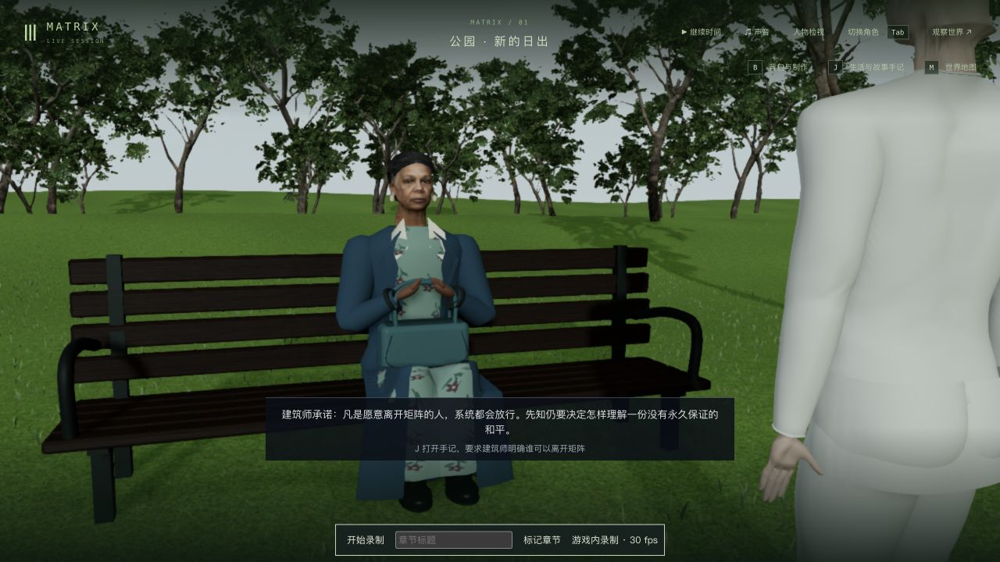
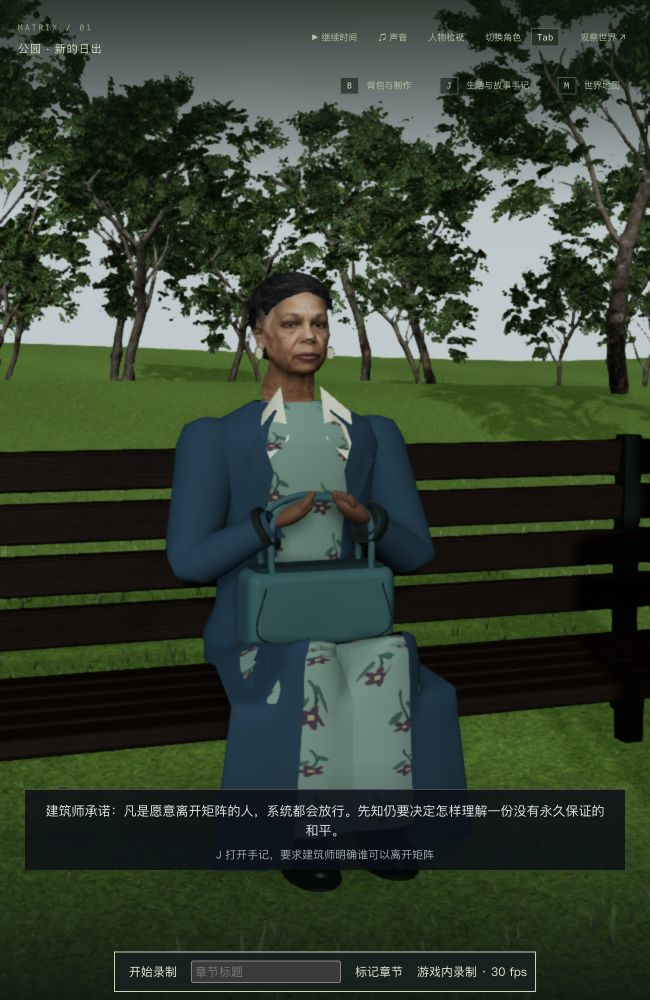
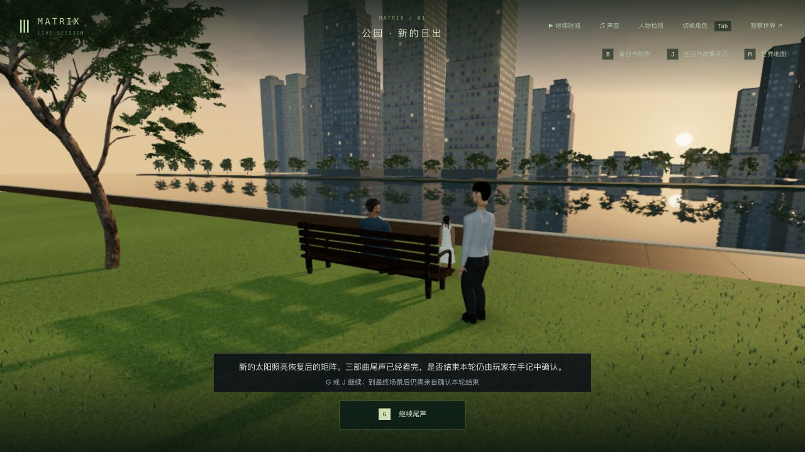

# 公园对话取景、尾声布局与坐姿接触

2026-10-11；起点代码 `9e15be0`。这是 3-12 的局部制作与验证，三部曲整体仍未完成。

## 本轮改变

- 建筑师到场后，保存时间 3.8–5.4 秒平滑推向先知近景；选择期间保持近景，离场切回全景，来访与日出沿用多人取景。宽屏中建筑师作为前景，窄屏聚焦先知；鼠标环绕及 V 第一人称保留。实际模型的头部投影由画面高度约 4.2% 增至约 13.5–14%。
- 公园演出启用专用 HUD，保留上方手记入口，字幕和 G 操作固定在下方。1280×720 与 650×1000 均检查；普通模式横/窄窗口间距为 13.5 / 19.5 像素，录制模式为 11.5 / 17.5 像素，不再挡住人物。
- 近景暴露旧坐姿的膝盖穿裙。裙面原先只按水平截面绕腿，未覆盖高于腰部的弯曲膝盖；补上方覆盖，手袋底面再按实际裙面支撑，两手随现有 IK 接触提手。

没有修改剧情推进规则、存档字段、场景资产或音乐。构图参考沿用上一轮本地公园片段（[来源页面](https://www.youtube.com/watch?v=HXV4mom9CGo)约 35 秒的交谈构图）；没有据此声称重新完整观看三部原片，原片画面未提交。

## 实机与存档范围

1. 完整复制上一轮 `verified-state`，在 done / tick 14157 重看尾声 HUD；人物、剧情、时间和 15 份记忆保持，严格六组中 simulation 仅外部 `llmStatus: degraded → ready` 不同，见 `done-hud-state-check.json`。源档未改。
2. 独立复制上一轮较早的 `choice-state`（16 个文件），从 choice / tick 14031 验证近景；这不是回退主档或覆盖最新源档。原生横/窄窗口、鼠标环绕和 V 检查后，六组公开状态、时间、15 份记忆完全一致，见 `choice-native-check.json`。
3. 正常停止、重启独立后台，再比较六组公开状态、时间及 15 份记忆，全部一致（`choice-restart-check.json`）。随后通过原生入口冷读，实际近景恢复。
4. 原生 J 选择“自由需要让愿意离开的人真正拥有出口”，继续建筑师离场，再按 G 迎接 Sati / Seraph，到日出及 done / tick 14215。辅助脚本只通过普通暂停消息停在离场 2.308 秒、日出 3.104 秒和 done，没有改状态或强推阶段。
5. 正常退出后保存 `verified-state`；普通模式再次冷读、检查双画幅、退出后六组状态、时间及 15 份记忆保持（`final-native-check.json`）。第 1 轮、Neo 仍失联，未确认最终通关或开启下一轮。

主试玩保持暂停 tick 10432，完整公开状态相同；主数据、两份源档、人物及公园资产的 250 项保护哈希全未变，见 `protected-after.json`。独立服务使用 3158 / 5358，不操作主服务。

## 真实画面

近景与裙面修复后的横屏：

窄窗口先知、手袋及裙面：

普通游戏尾声的按钮位于字幕下方：

其他检查：`choice-first-person.png`、`choice-orbit.png`、`leaving-wide.png`、`sunrise-wide.png`、`normal-done-narrow.png`；录制模式布局为 `final-done-wide.png` / `final-done-narrow.png`。布局测量保存在 `hud-final-*.json` 和 `hud-normal-*.json`。

## 测试与失败记录

- 修改前相关基线 44/44（`baseline.log`）。先复现旧远景头部过小（`camera-red.log`）与缺少公园布局状态（`hud-class-red.log`），原生旧按钮遮挡见 `before-done-narrow.png` / `hud-red.json`。
- 第一版近景仍压住手袋，见 `interim-handbag-obscured.png` / `handbag-red.log`；调整取景后补充真实模型投影、前景/布景遮脸射线、暂停/冷读、镜头推进和 V 检查。宽屏按钮第一版只有 7.5 像素间距，记录在 `hud-wide-spacing-fail.json`，最终增至 11.5 像素。
- 膝盖穿裙见修改前 `choice-narrow.png` / `knees-red.log`。旧测试跳过腰部以上腿面，现扩大检查并保留上衣覆盖。最初按错误顺序抬裙仍未覆盖膝盖，并影响手袋支撑（`knees-first.log`）；修正顺序并依据实际裙面托住手袋。
- 最终人物接触/镜头 10/10（`contact-camera.log`），界面/尾声状态/公园相关 41/41（`final-related.log`），共 51/51。`npm run build -w packages/client` 含 TypeScript 检查，通过；仍有既有的大 JS 包警告（`client-build.log`）。未跑最终全库。

三份失败日志提交时仅去除行尾空白，原样 `*-raw.log` 副本保留本地。

## 局部录像与未完成项

[本地局部实录，约 3 分 24 秒](../neo-longplay-2026-09-20/neo-2026-10-11T15-43-06-702Z.webm)，包含对话选择、离场、来访、日出及验证停顿；原生 UI 录制，1280×720、有音轨。`recording.json` / `video-probe.json` 保留元数据，原视频和完整世界/记忆副本仅留本地，不加入这次提交。录像从 choice 开始，未录入到场推近或三部曲连续流程。

本轮没有新的无录制帧率基准；录像统计含录制开销与多个镜头/暂停，不能作为性能达标依据。人物相似度、衣物/自然表演、电影空间、声音与稳定性能仍缺，完整连续人工游玩和 42 组高质量验收未完成。几何回归仅覆盖有限时刻、方向及顶点采样，不能声称所有动画帧均无穿模。录制工具保存后的长文件提示在窄窗口略超宽，普通游戏不显示该工具；本轮未改录制工具。
