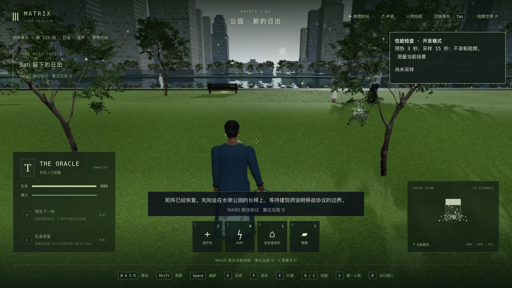
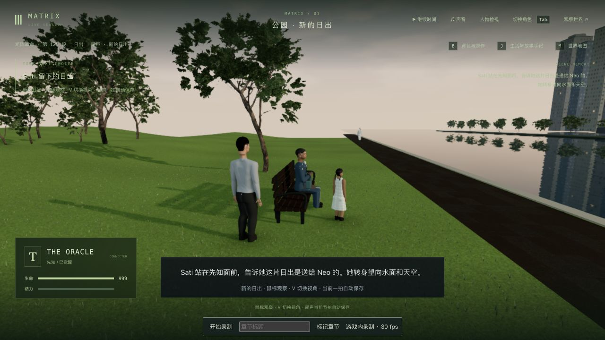
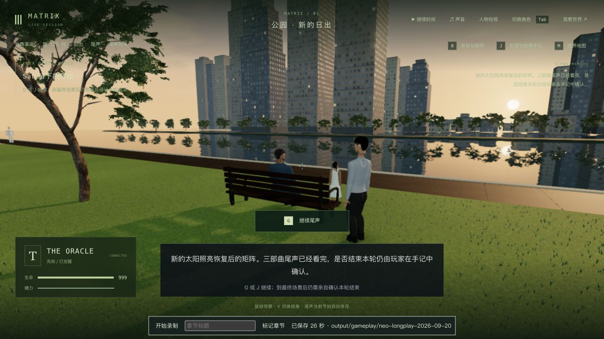

# 3-12：公园草地、水面与日出中途读档

2026-10-11，基于 `f60e8c7`。本轮只修改 `SunriseGardenRenderer.ts` 的两种材质，没有改变地形、碰撞、人物、剧情时序、存档字段或依赖。

草地原先把来源粗糙度图乘以通用的 0.8，产生大片湿亮高光。原生同机位先查看旧画面，再暂时移除粗糙度图验证原因，最后保留原颜色、法线和粗糙度纹理，将最终粗糙度限制在 0.88–1，并加入轻微的大尺度草色变化。水面保留实时倒影，增加视角相关的反射强度与较暗水色，减小涟漪扰动。

对照见[旧草地](before-ready.png)、[临时哑光诊断](diagnostic-matte.png)，以及靠近长椅时的[旧水面](before-water-side.png)与[新水面](final-water-side.png)。水边两图的性能面板显示不同；不能当作全画面逐像素比较。草地局部高光统计保留在 `lawn-pixel-comparison.json`，只辅助画面观察，不是整场质量指标；最初取错区域的结果另存 `lawn-pixel-initial-roi.json`。

本轮原生查看了 [CutsceneChronicles 上传的尾声片段](https://www.youtube.com/watch?v=HXV4mom9CGo)约 35 秒的先知/建筑师构图，并重看此前本地已核对的最终公园全景。上传者非官方；本轮跳转至后段时曾停在缓冲旧帧，未将该帧作为日出证据。电影参考帧没有加入提交。对话取景仍比原片远，天空、城市、植物、水面与人物仍是近似，不能称作电影级还原。

## 实际游玩与保存

完整复制上一轮 `trilogy-sati-street-2026-10-11/verified-state` 的世界和 15 份记忆，在独立 3158 / 5358 服务中通过原生 WASD、G、J 与菜单操作推进。观察脚本只读取阶段并发送普通暂停消息，没有跳步或编辑人物位置。

| 检查点 | 实际状态 |
| --- | --- |
| 起点 | The Oracle / `m3_dawn` 第 0 步 ready / tick 13719 |
| 步行到长椅前 | 第 1 步 ready / tick 14016；保存实际来向 |
| 落座中途 | sitting / 1.340 秒 / tick 14018 |
| 建筑师到场、等待选择 | choice / 第 2 步 / tick 14031 |
| 原生选择离开的权利，建筑师离开 | promise / 第 3 步 / tick 14114 |
| Sati 与 Seraph 到场后的日出中途 | sunrise / 3.142 秒 / total 27.975 / tick 14144 |
| 重启后继续日出及先知回答 | done / 第 4 步 / total 34.657 / tick 14157 |

在日出 3.142 秒释放角色、保存后，真正停止并重新启动验收后端。人物、地图、事件、剧情、世界时间和 15 份记忆保持一致；严格六组公开比较为 **5/6**，唯一变化是外部模型服务 `llmStatus: degraded → ready`，见 `sunrise-restart-comparison.json`。随后原生接管、切换双视角、退出的比较为 **6/6**；日出终态再次接管/退出也为 **6/6**。

既有 51 段完成记录、45 个选择、18 个反思、72 条手记、Neo 背包、10 个死者及 15 份记忆保留。正常游玩新增 `m3_dawn` 完成记录、`agency` 选择/反思及两条手记；Neo 仍 disconnected、生命 0，位置与动作对象未变。`journey.finished` 仍为 false，结局仍为 open；本轮没有确认最终通关，也没有启动新循环。详见 `continuity.json`。

最新完整 16 份存档位于本地 `verified-state/`，暂停且没有角色占用。用户主试玩 3155 / 5355 仍暂停于 tick 10432，六组状态与时间未变；234 项保护文件全部一致，见 `integrity.json`。仅关闭了本轮验收服务和临时浏览器页。

## 验证与限制

- 修改前相关基线 **31/31**。最终公园、尾声、实际人物接触、相机、植被/地形/照明/天际线回归 **42/42**；客户端类型检查与生产构建通过。没有重跑全库。已有大包警告保留：JS 3,423.17 kB / gzip 1,039.50 kB。
- 高光问题依赖真实 GPU 材质，现有 Node 几何测试不能复现画面；本轮用修改前、临时诊断和最终原生截图验证，没有用仅检查材质常量的测试代替渲染验证。实际浏览器最终没有 warning/error。
- 原生检查了落座、到场、选择、人物离开及日出；日出中段与终态有 1280×720 和 650×1000 的局部检查，终态双视角均保存。中段第一次窄窗口第一人称截图误抓到尺寸切换过渡，仅 650×366，已标为 `sunrise-mid-narrow-first-resize-transition.png`，不作为该项通过证据。
- 新材质不改人物或几何；既有实际 GLB 接触与地形测试通过仍只代表有限姿态采样，不证明所有连续帧无穿模。
- 最终日出终态无录制、预热 3 秒后采样 15 秒：1280×720、像素比 1，**30.05 FPS，p95 46.7 ms，547 次绘制/帧**。性能仍未达稳定流畅目标。入口旧版 23.27 FPS 的像素比为 1.5，草地修改后 30.68 FPS 为 1，二者不能用于宣称性能提升。最早一份采样期间打开过参考视频，也不作为受控对照；原始报告均保留。

电影对话的近景/人物表演、城市与植被精度、自然水面、正式声音仍需制作。窄窗口终态的“继续尾声”按钮覆盖部分人物上方画面，见[实际窄窗口](dawn-done-narrow-third.png)，列为下一步镜头/HUD 修正项。本轮没有从终战连续人工通关，也没有覆盖完整三部曲或新循环；3-12 与整体目标继续制作。

## 本地录像

- `sitting-and-architect.webm`：93.623 秒，包含实际落座和建筑师到场，其余为暂停与视角检查。
- `choice-to-sunrise.webm`：83.674 秒，包含原生选择、建筑师离开、G 迎接、两人到场及半段日出，中间有检查停留。
- `sunrise-after-restart.webm`：26.011 秒，包含重启后的余下日出和先知回答，其余为停留。
- `paused-menu-attempt.webm`：99.283 秒，诊断失败尝试。手记打开时点击其后方的时间按钮没有恢复运行，选择未写入；退出菜单、确认主界面的世界已运行后，重新选择成功。此录像不作为成功游玩证据。

以上均为局部实录，录制之间有暂停和重启；保留原始帧率/尺寸/录制开销元数据，没有包装成连续通关视频。原片参考帧、视频、世界与记忆原文只留在本地；提交包含代码、说明、游戏截图、测试结果及少量比较/录像元数据。
