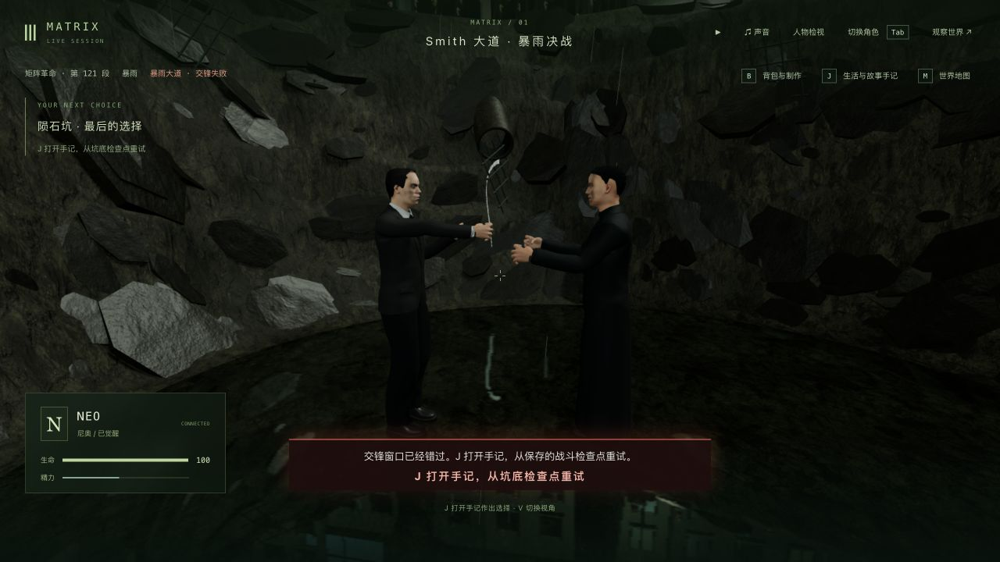
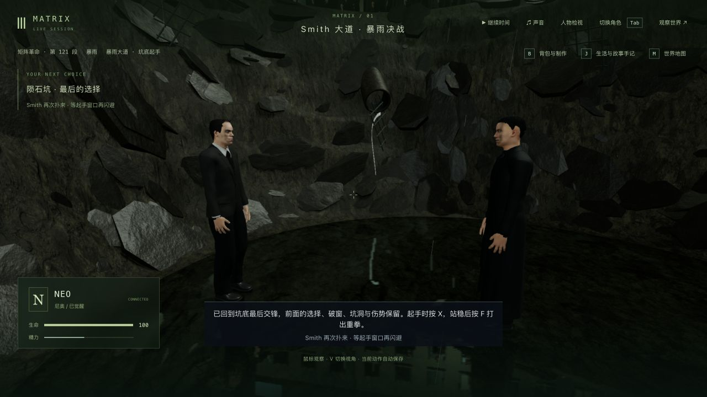
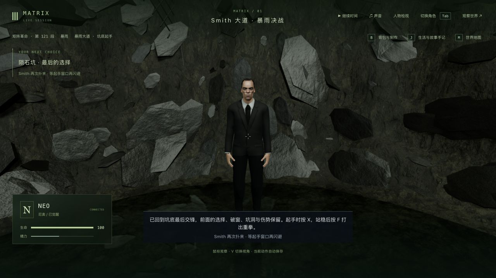
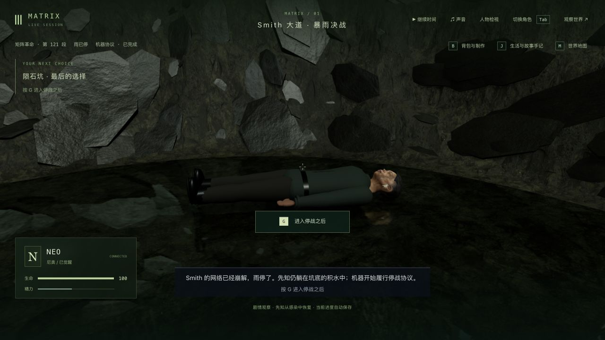

# 暂停中的剧情重试与即时存档（2026-10-11）

修复此前 3-11 实机反复记录的“暂停时 J 重试只关闭菜单”。这是失败恢复流程的修复，不增加剧情或电影级美术完成数。

## 原因与行为

服务器原先在暂停时拒绝所有 `sandbox_action` 和 `player_action`，重试也被提前拒绝，未到达已有的检查点恢复逻辑。现在仅允许暂停时的 `life / film:retry` 走原有角色权限和剧情恢复逻辑；攻击、用药、剧情推进及其他交互继续被暂停拦截。

重试后世界保持暂停，不代替玩家启动倒计时；恢复结果立即写入存档，避免等待一个不会到来的模拟刻。服务器返回暂停提示，界面的暂停按钮改为直接显示“▶ 继续时间”。终战样式仍隐藏普通通知，所以此次没有将该通知当作实机可见反馈，而是检查按钮文字和实际检查点变化。

没有修改战斗阶段、失败判定、角色模型或存档格式，也没有增加依赖。

## 原生界面与真实存档

来源为前轮 `trilogy-crater-surface-2026-10-11/failed-state` 的全部 16 文件：Neo / `m3_surrender` 第 0 步，坑底漏闪避失败，tick 13430 / attempts 1。复制到本目录 `runtime-state`，使用独立后端 3158 和客户端 5358；没有改世界、坐标或跳剧情。

1. 修改前编译版本：原生接管、J 打开手记、点击“从坑底检查点重试”，仍停在 failed。`before-native-retry.json` 证明六组公开状态、时间、15 份记忆完全未变，画面为 `before.png`。
2. 部署修复后，同一个失败存档保持六组状态、时间和记忆，见 `deploy-check.json`。原生点击同一个按钮，进入 pit_warning / elapsed 0，attempts 变为 2，tick 仍为 13430，世界仍暂停。
3. `retry-boundary.json` 在再次暂停、退出或关闭后端之前直接核对磁盘：重试已写入，沙盒与公开状态一致，时间和 Neo 伤势保持。`retried.png` 是按钮文字修改前的中间界面，不能作为最终 UI。
4. 关闭并真正重启隔离后端。`restart-check.json` 六组状态、时间和 15 份记忆一致；原生冷读、V 切换两个视角、释放后，`native-restart-check.json` 同样一致。
5. 从这个已恢复检查点发送普通玩家输入，继续时间，X 闪避、F 反击到 pit_punch 0.825 秒 / tick 13434；随后完成领悟、trust 反思、起身、同化，到 purging 5.255 秒 / tick 13478，再到 done / tick 13491、`m3_surrender` 第 3 步。原生检查雨停与先知恢复，退出后 `done-native-check.json` 保持六组状态、时间及 15 份记忆。没有进入 Kid 停战或日出。
6. `protection-and-progress.json`：271 项保护文件与主试玩八项公开状态保持；47 段旧完成历史、43 项选择、17 项反思、67 条手记和 9 名既有死者保持。最终副本暂停、角色释放，临时服务已关闭，主试玩服务保持运行。

这是原生界面与普通玩家协议结合的回归，未录制全程人工视频。本轮从已有真实失败档开始，没有把测试夹具当成实机剧情进度。

## 自动验证与失败记录

- 修改前基线 `baseline.log`：server-startup、sandbox、smith-finale、smith-pit 四个文件 38/38。
- 先写两个真实服务器回归，旧代码 `retry-before.log` 为 0/2，均因暂停重试被拒绝而失败。
- 第一次修复后 `retry-after.log` 为 1/2：坑底通过；地面夹具把失败状态放在入口，后续开始战斗因距离不符被拒绝。修正测试夹具为实际失败姿态位置，未为此修改生产战斗逻辑。最终 `retry-final.log` 2/2。
- 新回归覆盖地面/坑底检查点、暂停时即时写盘、重启后继续、时间/物品/选择/旧死亡保留，以及攻击/用药/推进和观察者越权重试不改状态。
- 最终服务器及剧情相关 `related.log` 66/66，包括 server-startup、story-sync、player、sandbox、smith-finale、smith-pit。随后唯一生产改动是暂停按钮文案，界面既有测试 `player-ui.log` 18/18。
- 三包类型检查与构建通过；最终按钮文字修改后再次客户端类型编译和构建通过，见 `typecheck.log`、`build.log`、`client-build-final.log`。最终客户端 JS 3,405.03 kB / gzip 1,033.99 kB，已有大包警告仍在。
- 最终检查点和结束界面的原生 warn/error 均为空，见 `native-console.json`、`done-console.json`。未跑本轮最终全库、整条电影路线或新性能测量。

日志归档仅去掉行尾空白与多余文件尾空行；原始字节副本保留在本地忽略目录 `raw-logs/`。完整运行世界、记忆和辅助回放文件保留本地，未随证据提交。

## 剩余制作范围

暂停重试问题已修复并实机验证。人物相似度、自然动作与受力、服装、场景材质/破坏、雨水、声音、稳定帧率和整组连续人工通关仍不足；本轮不提高画面还原的验收等级。三部曲 42 组、125 个节点、365 个步骤和 70 个场景定义仍需按制作方案完成，不标整体完成。
