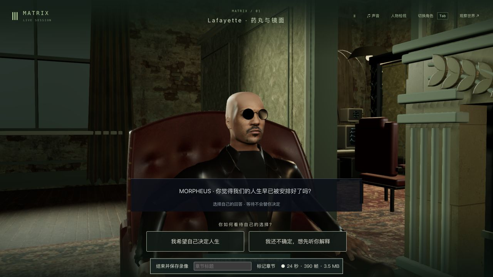
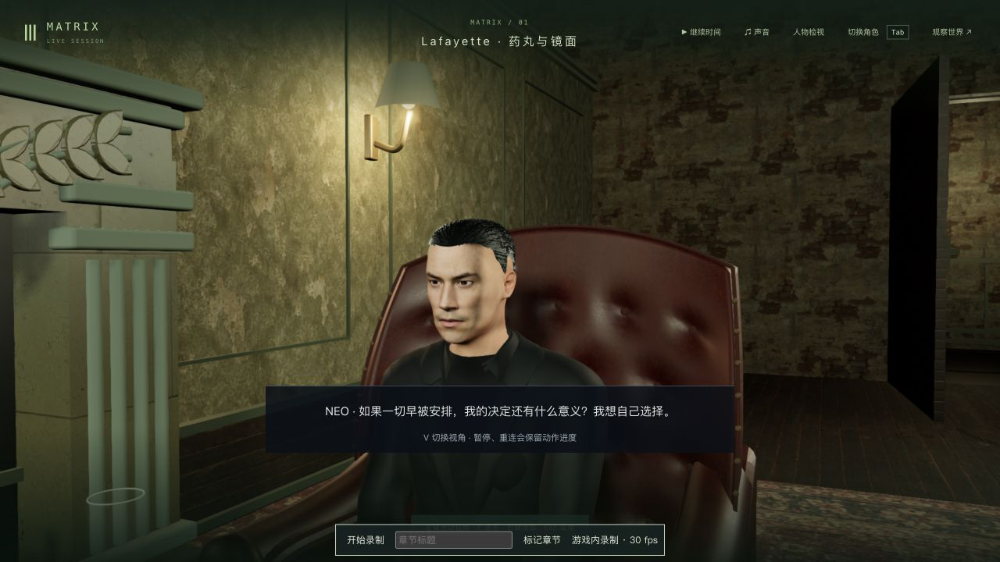
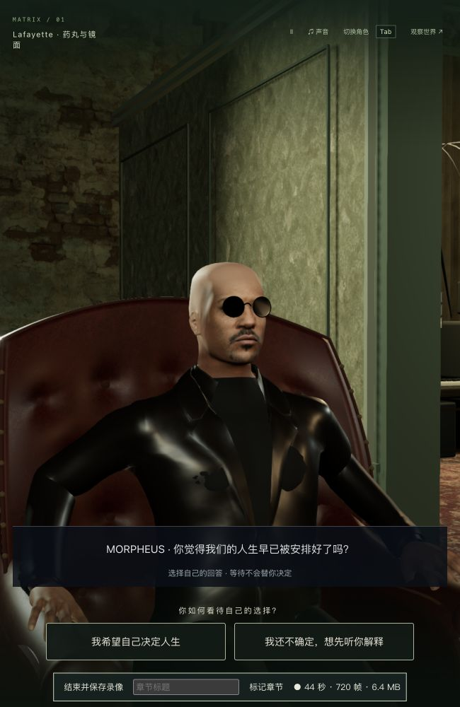
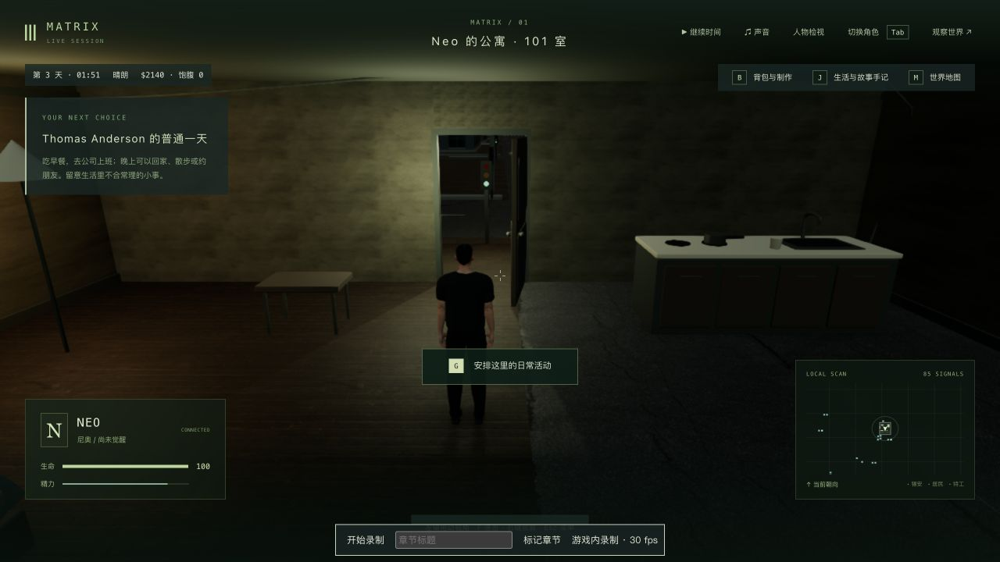

# 药丸前的哲学对话与动作读档

2026-10-12；起点代码 `dcd305c`。本轮补 1-06 的缺失玩法，并验收局部动作与存档。三部曲和 1-06 的高质量制作均未完成。

## 本轮改变

- 坐下后先交谈，再递药。Morpheus 提出命运问题，Neo 必须选择自己的回答；之后明确追问日常异常、矩阵和认知边界，最后才出现红蓝药丸。等待、提前选药或重复按 G 均不能跳过回答。
- 两种回答保存到本轮反思、生活选择、哲学变化及手记。读档和重试保留未说完的句子与动作时间，不重复计分。已有 offering / choice 存档按旧流程继续。
- 第三人称按说话者切换近景；双方有保存时间驱动的轻微前倾、点头与手势。V 第一人称使用实际头部骨骼位置，长对白结束后不再强制重置转头方向。字幕、回答、G 和录制工具在横屏及窄窗口分开排列。
- 实际后台重启暴露 Neo 坐姿丢失：启动时清掉临时玩家动作，但此前没有从药丸时间线重建姿势。现在加载房间时以零时间步恢复双人演出；占用或死亡的演员不被重排，世界时钟和剧情不推进。

交谈的因果与双人构图参考 [Movieclips 的原片药丸片段](https://www.youtube.com/watch?v=zE7PKRjrid4)，实际查看约 0:42 / 0:52 的 Neo / Morpheus 镜头；另核对 [Wachowski 剧本](https://www.screenwriter.ch/demandit/files/M_BFNO38KLSZ567NYSJ29/dms/File/The_Matrix.pdf) 的会见、命运与矩阵解释。剧本是草稿，细节以影片为准。中文字幕为游戏改写；两项信念回答及可游玩的蓝色日常分支是游戏设计。没有新增口型、配音或电影人物资产，原片参考截图只保留本地。

## 实机与存档范围

1. 从此前真实办公室签字存档 `trilogy-p0-success-route-2026-10-03/source-store.json` 独立复制世界，通过普通玩家输入完成电话、隔间、窄台/维修梯、第二次来电、桥下轿车、赴约、十三层楼梯、1313 敲门和握手，停在皮椅前 / tick 4483。`approach.mts` 使用公开玩家协议，不改世界字段或直接推进阶段；这段是控制器输入检查，没有本轮完整原生 P0 长玩录像。
2. **来源边界**：该签字世界副本没有同时期完整 NPC 记忆，使用旧 P0 验收临时目录保留的 7 份较晚记忆文件。不能据此声称整个历史 NPC 世界来自一个一致时刻。后续本轮暂停、重启比较使用完整当时副本，逐份核对这些文件。主存档及此前第三部验收副本未改。
3. 原生接入 Neo、按 G 落座，等到命运问题，选择“我希望自己决定人生”。停在 beat 1 / 1.282 秒 / tick 4670，退出接管并真正停止、重启后台。最初比较只有 agents 不同，Neo 的 currentAction 被清空，见 `answer-restart-comparison.json`；修复后在尚未接管时六组公开状态、时间和 7 份记忆全部一致，见 `answer-restart-fixed-comparison.json`。
4. 冷读后检查 1280×720 / 650×1000、第三/第一人称和拖动转头；原生按钮依次追问，再选择红药。喝水 6.604 秒 / tick 5232 真正重启，六组状态、时间和 7 份记忆一致（`drink-restart-comparison.json`），重新接管时水杯与姿势保持。继续放杯、起身，到 `m1_mirror` 第 0 步 / tick 5319，Morpheus 开始带路，旧完成记录、金钱、证据、选择与手记保留（`red-result.json`）。本轮没有继续走完镜面或培养舱。
5. **独立蓝色分支**完整复制真实皮椅前 `entry-state`，没有回退或改写红色结果。原生落座，选择“我还不确定，想先听你解释”，其中一次追问从 J 手记继续，再实际服用蓝药，回到 `neo_apartment` / tick 4849。金钱、证据、旧选择和手记保持，新信念只计入一次（`blue-result.json`）。世界正常运行期间新增两份 NPC 记忆，终态共 9 份。
6. 蓝色终态真正重启，再从首页继续 Neo；公寓生活恢复。重启及接管/退出后的六组状态、时间和 9 份记忆全部一致（`blue-restart-comparison.json`、`blue-native-comparison.json`）。

演出中途暂停的辅助脚本只发普通 pause 消息，不接管角色或编辑状态。验证服务使用 3158 / 5358，完整世界和人物记忆副本留在本地。执行中发生会话中断，原进程和临时标签已结束；确认端口无监听后才重新启动独立验证服务，主服务未由本轮重启。119 项保护文件两次哈希检查保持，见 `protected-after.json`。

## 实际画面

最后版本的命运问题与明确回答：

Neo 的反向近景：

窄窗口回答布局：

蓝色药丸后冷读回到日常：

`morpheus-answer-final-wide.png`、`red-drink-restored.png` 和 `red-mirror-handoff.png` 记录反向镜头、杯子读档及红色交接；第一人称与转头等额外检查截图留在本地。仅检查有限保存时刻，不能据此声称全帧、全部方向都无穿模。

## 测试与失败

- 改动前基线 27/27（`baseline.log`）。`conversation-before.log` 先复现旧流程直接跳到药丸；改动后等待 Neo 的明确回答。
- `look-before.log` 复现长对白第一人称转头被重置，`look-after.log` 为修复结果。实际后台的坐姿丢失见上述原始比较；先写 cold-loading 回归并失败（`cold-before.log`），随后修复并通过（`cold-after.log`）。
- 第一轮扩大检查为 41/50，暴露命令被通用 act 检查挡住、测试 GLB mock 生命周期冲突及旧瞬时递药断言（`regression-first.log`）。已修正，失败原始日志保留本地。中途近景仍偏远，最终收紧取景；旧画面未作为最终截图。
- 最终 `tests/pills.test.mts`、`tests/pill-view.test.mts`、`tests/lafayette.test.mts`、`tests/film-journey-ui.test.mts` 合计 **51/51**（`regression-delivery.log`）。包括等待/提前操作、双方占用、死亡、暂停/断线/重试、冷加载、旧药丸存档、红蓝结算、手记/HUD、真实发货 GLB 的头部/手持杯接触及双画幅投影采样。
- 电影路线自动结构测试 **1/1**（`full-route-delivery.log`）。该测试使用测试世界及控制器验证衔接，不是原生浏览器三部曲完整通关，也不验收每一场渲染。
- 三包 `npm run typecheck`、shared / server / client 构建通过；最终 server / client 构建日志为 `build-server-cold.log` / `build-client-delivery.log`。客户端仍有既有大 JS 包警告。未跑本轮最终全库。

提交中的失败日志仅移除行尾空白和文末空行；如有变化，原始副本以 `*-raw.log` 留在本地。

## 局部录像与未完成项

| 实录 | 实际覆盖 |
| --- | --- |
| [红色对话，约 5 分 45 秒](../neo-longplay-2026-09-20/neo-2026-10-11T16-47-45-754Z.webm) | 冷读 Neo 回答中段、两次追问、选择解释、取红药至喝水暂停；包含验证停顿 |
| [红色恢复后，约 46 秒](../neo-longplay-2026-09-20/neo-2026-10-11T16-55-29-943Z.webm) | 喝水冷读后放杯、起身和追踪室带路交接 |
| [独立蓝色路线，约 3 分 6 秒](../neo-longplay-2026-09-20/neo-2026-10-11T16-59-31-674Z.webm) | 从落座、另一信念回答、J 追问到选蓝药、服药和返回公寓；含双画幅检查 |

三段均由原生 UI 录制，有 VP9 / Opus 音视频轨道。元数据和实际文件包时间检查见 `*-recording.json` / `video-probes.json`；视频、完整世界/记忆及原片参考只留本地。另有约 2 分 28 秒的早期落座录像，其较宽取景不是最终版本。

没有新的无录制性能基准。上述三段录制统计约 18.06 / 22.85 / 21.63 FPS，含录制开销、暂停和不同镜头，不能证明稳定流畅；录制目标 30 fps 也不是实际帧率。人物相似度、口型/配音、自然手势与起身重心、准确房间/壁炉尺度、正式声音、全部接触帧及 P0 完整连续人工验收仍需制作。42 组关键情节的高质量验收及三部曲整体目标保持未完成。
