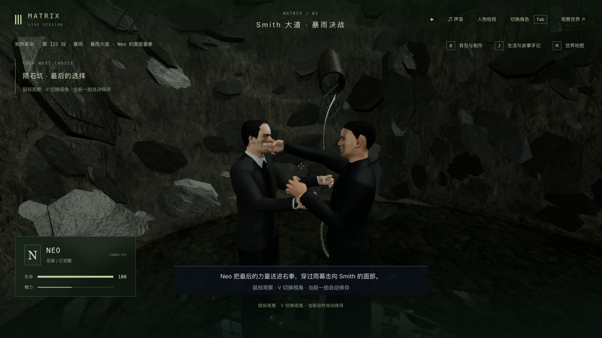
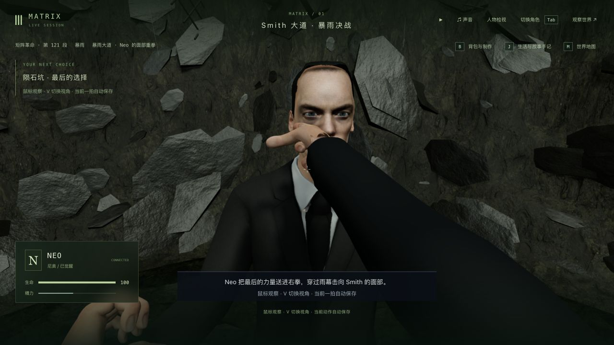
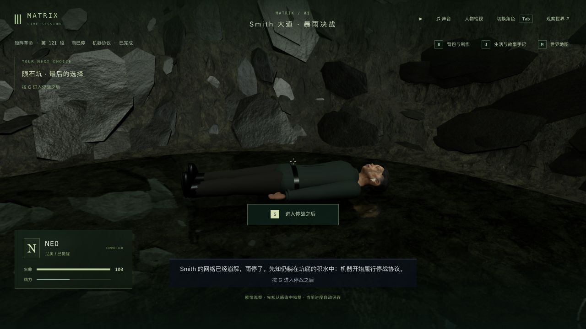

# 暴雨终局：最后一拳的局部脸颊形变（2026-10-11）

本批仅补 3-11 坑底反击的局部受击表现，不新增剧情节点。三部曲仍处于专用玩法补全、场景动作制作和实机验收并行阶段；125 个节点、365 个步骤、70 个场景定义不等于 42 组高质量完成。

## 改动与参考

- 为主 Smith 的实际头部网格建立私有形变，最后一拳压入时局部脸颊凹陷，收拳后恢复；增强头部偏转与侧倾。形变权重来自已保存的动作时间，中途冷读不会重新播放。
- 拳头接触目标随同一脸颊形变更新。法线只叠加变形带来的差值，保留眼周、另一侧脸颊和后脑原有明暗。原始角色资产、街道人群和同化替身不共享这份形变；退出演出时恢复原几何。
- 复用现有 Three.js、骨骼、角色资产和演出生命周期，无新依赖或美术文件。没有改写手指握拳、眼睑、嘴部或完整身体编排。

本轮实际复看已有 `trilogy-rain-combat-2026-10-06/reference-face-impact.png`、`reference-after-counter.png`、`reference-smith-pressure.png`，参考沿用该目录说明和 [Movieclips 公开片段](https://www.youtube.com/watch?v=KfH-2VNDBIs)。本轮打开远端片段未成功，没有重新连续观看完整片段或下载三部曲。现有参考只支持本次局部动作方向，不能作为逐镜还原验收。

## 最终实机

以下是最终代码下反击 0.824 秒、tick 13435 的真实后端重启后画面，使用 Codex 原生浏览器接管并切换 V：

`before-third.png` / `before-first.png` 直接复制自前轮 `counter-restored-*.png`，对应 a55de9f 的同一动作时间和存档，不是本轮重新拍摄的基线。`impact-first-pass-*.png` 是失败的大范围形变及全头法线重建版本；`after-*.png` 是法线已修正、形变仍过宽的中间版本，均不能当作最终画面。

## 失败与修正

1. `impact-before.log`：新增检查先得到 0/1，旧代码只有刚性头部转动，没有真实脸颊压缩。
2. 初版检查把部分受颈部影响的顶点算作纯头部，颈部转动造成约 0.00019 的局部坐标差；改为只测完全由头骨驱动的实际皮肤，并要求超过 1000 个顶点。初版 `impact-after.log` 的 3/4 不是最终结果。
3. 初版实机眼窝发黑。`normal-before.log` 的 0/1 复现未受击部位法线被整体重建改坏，随后只添加几何法线差值，保留原作者明暗。
4. 另一侧脸颊仍被过宽形变影响；`opposite-cheek-before.log` 为 0/1。试移接触射线后又落在真实脸部之外，`out-of-face-ray.log` 为 0/5，保留失败。该文件复制自本地误命名的 `contact-final.log`，后者不是最终通过日志。
5. 最终恢复真实脸面原接触点，收窄作用区域并减小压缩深度；相应验收为可见压缩大于 0.035、局部总位移小于 0.07，同时保持上眼周、后脑和另一侧脸颊的形状及明暗。最终 `cheek-final.log` 为 5/5，较广相关 `related-final.log` 为 83/83。

## 真实续玩与存档验证

隔离后端 3158 / 客户端 5358，从前轮 `trilogy-crater-surface-2026-10-11/counter-restored-state` 全部 16 文件复制，起于 `m3_surrender` 第 0 步、pit_punch 0.824 秒 / tick 13435。使用普通 Socket.IO 玩家输入及原生界面；没有改坐标、改剧情、跳段或导入编造状态。这是混合输入回归，不是全程人工录像。

1. 原生接管与双视角复看后释放角色。`native-before-restart.json` 的六组公开状态、时间及 15 份记忆与来源一致。
2. 真正关闭并重启隔离后端。`impact-restart.json` 确认人物、地图块、地点、事件、沙盒、模拟六组状态、时间与 15 份记忆保持；原生冷读、切 V、退出后，`impact-native-restart.json` 再次一致。
3. 普通玩家输入接续收拳、Smith 还击、倒地领悟，选择 trust，起身并同化；到 purging 5.283 秒 / tick 13479，再到 done / tick 13492、`m3_surrender` 第 3 步。原生检查雨停与先知恢复，释放角色后 `done-native-check.json` 六组状态、时间与 15 份记忆一致。没有继续 Kid 停战或日出。
4. `protection-and-progress.json`：主试玩八项公开状态未变，239 项保护文件全部保持；47 段旧完成历史、43 项选择、17 项反思、67 条手记及 9 名既有死者保持。最终副本已暂停且角色释放，两个临时服务已关闭；主试玩服务保持运行。

本轮没有重新人工制造战斗失败和重试，来源档已是前轮真实重试后的反击中途。此前“暂停时 J 重试只关闭菜单”仍待修，不能报为本轮通过项。

## 验证范围

| 检查 | 最终结果与边界 |
| --- | --- |
| 修改前相关基线 | `baseline.log` 48/48，仅当时所选四个文件 |
| 脸部与接触专项 | `cheek-final.log` 5/5：真实皮肤形变、冷读一致、恢复/释放、拳面和拇指接触、动作边界 |
| 最终相关回归 | `related-final.log` 83/83：crater、avenue、finale、pit、ending、interior、contact、camera、Oracle 恢复九个文件 |
| 类型检查与构建 | `typecheck-final.log`、`build.log` 三包通过；客户端 JS 3,405.02 kB / gzip 1,033.99 kB，仍有大包警告 |
| 原生界面 | 最终反击和结束画面日志均无 warn/error，见两个 native-console JSON |

拳面多时点采样的最大穿入量约 0.03183，包含既有 Smith 胸部还击接触，处于现有小幅软接触容差内；拇指在 0.72、0.95、1.02 秒三点采样为 0。有限采样不证明所有动作帧或服装都无穿模。相关测试出现一次 Oracle 模型替身未提供详细头部的回退警告，测试仍通过；原生最终画面没有该控制台警告。

本轮未跑最终全库、整条电影自动路线，也未新增性能测量。日志归档仅去除行尾空白和多余文件尾空行；原始字节副本保留在本地忽略目录 `raw-logs/`。整套运行世界和记忆副本留在本地，未加入此次提交。

## 仍未完成

演员相似度、眼睑与嘴部受击表情、自然握拳和身体受力、服装褶皱、完整连续搏斗、岩壁与建筑资产、雨水/同化效果、正式声音和稳定帧率仍不足。实机依然可见程序动作与粗糙人物；局部脸颊形变不代表完成电影级表演。3-11、42 组和三部曲整体继续制作。
