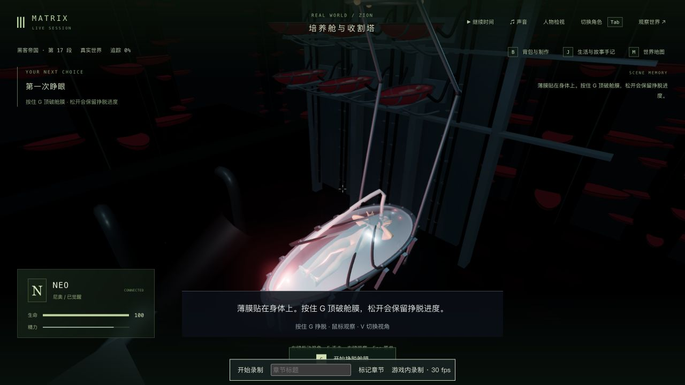
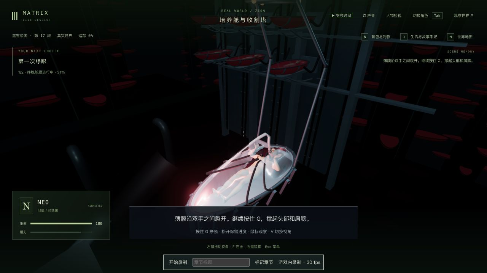
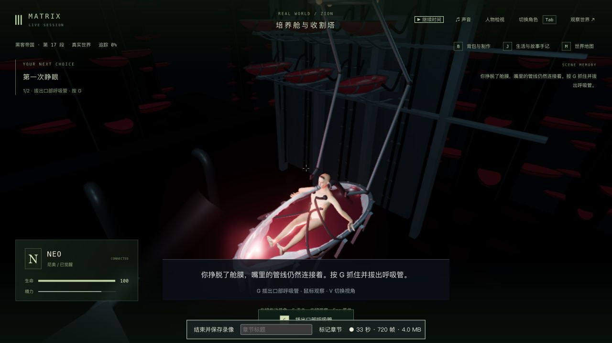
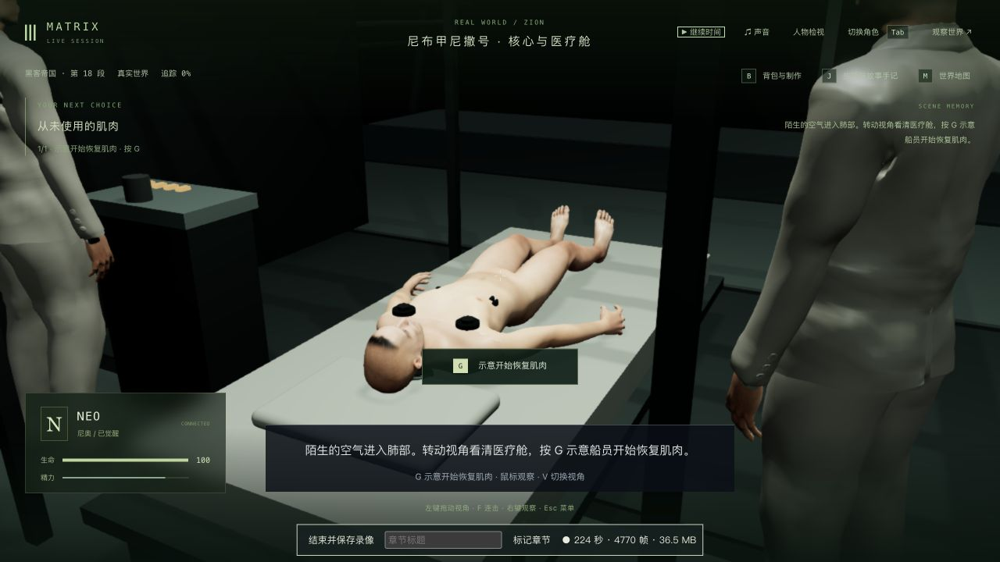

# 培养舱：主动顶开薄膜，再拔呼吸管

2026-10-12，基于 `8a728b8`。本轮补 1-07 的培养舱入口：Neo 从薄膜下开始，持续按 G 顶膜、抬起头肩、推开残膜；松手保留挣脱进度。完成后另按 G 自拔口管，保持坐起，再按 G 检查后颈，接住原有断线、落水与救援。本轮没有完成整组 1-07，也不把三部曲标为完成。

## 原片依据与制作范围

原生浏览器查看 [Neo Wakes Up Scene](https://www.youtube.com/watch?v=rChuqcbdf4U)，频道为 JoBlo Movie Clips，**不是 Warner 官方频道**。实际观察约 00:15 膜下头部与双手、00:20 半坐起和破膜边缘、00:25 双臂推开残膜、00:30 口管与双手、00:35 低头近景。本轮没有观看完整三部曲，没有下载电影，也没有把影片像素用作游戏资产。此前两支触镜短片不包含培养舱，不能作为本段画面依据。

新增 `emerge` 保存阶段，5.2 秒有效按住 G 才完成；暂停、松手和释放角色不累计。主动继续后进入带 `emerged` 标记的拔管阶段，避免身体再次躺下。旧拔管及断线存档保留旧路线，不要求补做新阶段。重试仍沿用原有生命值/效果恢复规则，不能据此宣称重试保留所有伤势。

薄膜是两片连续索引网格，共 1,666 个顶点、3,072 个三角形。按保存进度和实际头部/手掌位置拉伸、开缝、折向舱沿；复用缓冲，相同暂停姿态不重复改写。不是物理撕裂或流体模拟。手指压平并扩大真实接触区域，修正早期掌面和弯指穿膜。所有修改复用已有依赖与人物资产，没有增加素材包或迁移保存格式。

## 实机与正常续玩

入口完整复制前轮 `trilogy-mirror-liquid-2026-10-12/final-pod-state/`，包含 world 和 7 份记忆，tick 5284、`m1_pod` 第 0 步。沿用上游检查点已有的记忆修复与来源限制，不宣称其最早历史是未经修复的原始连续电影开局。本轮未拼接记忆、改写人物/位置/剧情/生命值或注入完成状态。

操作来自原生游戏界面：接管 Neo、持续 G、V、继续/暂停世界、录像及正常退出。辅助脚本只使用普通玩家暂停协议、读取公开世界及保存文件。实际从 tick 5284 续到 `m1_recovery` 第 0 步 / tick 5449，Neo 等待玩家主动开始康复；未继续针疗、舱室或构造体。

| 培养舱入口：完整薄膜 | 持续输入 1.63 秒：31% 挣脱 |
| --- | --- |
|  |  |

| 完成挣脱后等待拔管 | 新路线拔管：保持坐起 |
| --- | --- |
|  |  |

新膜入口、挣脱中途、拔管及断线已检查第三/第一人称；中途真实冷读另检查 650×1000 窄窗口。截图是实际游戏画面。第一人称口管近景比例仍偏大；背景收割塔、机器、船员与船舱仍粗糙，不能把这些画面当成电影级验收通过。

## 保存与真正重启

`capture.mjs` 在暂停且角色释放后保存公开 world、记忆哈希与完整检查点；`compare.mjs` 严格比较 agents/chunks/locations/events/sandbox/simulation 六组，不滤掉差异。完整 world、记忆和运行副本仅留本地。

| 对比 | 严格结果与边界 |
| --- | --- |
| 旧生产入口 → 新生产冷读 | [4/6](initial-cold-compare.json)：Neo 临时动作和新章节说明不同；跨版本，不能作为同版本冷读证明 |
| 1.63 秒挣脱 → 同配置真正重启 | [4/6](mid-cold-compare.json)：Neo `currentAction` 被启动清空，模型服务 degraded → ready；剧情、位置/朝向、时间和 7 份记忆保持 |
| 冷读 → 原生重新接管、双视角后退出 | [5/6](mid-native-exit-compare.json)：Neo 临时动作由空恢复；冻结时间和 7 份记忆保持 |
| 最初中途保存 → 上述原生退出 | [5/6](mid-restored-action-compare.json)：全部人物及剧情与原保存相同，仅模型服务提示不同；不报六组全通过 |
| 正常医疗舱入口 → 真正重启 | [4/6](medical-cold-compare.json)：临时动作清空、模型服务提示变化；剧情、时间与 7 份记忆保持。本轮未再接管医疗舱冷读继续康复 |

正常游玩 tick 5284 → 5312 → 5449 会让 NPC 交谈、思维与记忆自然变化，不将实走前后差异冒充冻结或冷读失败。最后暂停、全部角色释放；3159/5359 临时服务停止，参考/验收页关闭，临时画幅恢复。正式 data 和前轮银液/房间/合批目录共 637 个保护文件逐个 SHA-256 检查，未改动，见 `protected-final.json`。

## 测试和失败记录

本次提交中的 `.log` 副本只去除行末空白和末尾空行；未改动测试内容或结果。原始 `.raw.log` 保留本地，可核对原始输出。

- 修改前四个相关文件 **174/175**，已有追踪室测试用过期坐标穿过共享隔墙。读取实际引导路线后，测试改走 `MIRROR_GUIDE_ROUTE` 的真实门道，没有修改生产墙体去迎合旧夹具。
- 新挣脱与实体薄膜用例先 **0/2**，见 `emergence-before.log`；新增阶段/实体膜后通过。HUD/手记另先复现错误指令，见 `ui-emergence-failure.log`。
- 真实掌面接触先失败，见 `palm-contact-before.log`；入口腕部跳变先失败，见 `entry-pose-before.log`。真实手指皮肤检查发现 1,428 个穿膜采样，压平手指后仍有 1,110 个；扩大接触形变区域后通过，保留 `hand-surface-before.log`、`hand-surface-flat.log` 与 `hand-surface-after.log`。
- 最终四个相关文件：film-story、film-journey-ui、pod-renderer、pod-connection-contact **181/181**，0 失败/跳过，见 `related-final.log`。之后仅扩展接触测试：13 个旧拔管、3 个断线、5 个挣脱、3 个新拔管姿态，共 24 个实际管线姿态，单用例 **1/1**，见 `extended-feeds.log`；生产代码未再变化。有限姿态采样不能证明所有动画帧都无穿模。
- 三包类型检查和生产构建通过，见 `typecheck-final.log`、`build.log` 及最后服务器/客户端重建日志。最终客户端主 JS 约 3.44 MB，仍有既有分块体积提示。本轮未跑最终全库，也未做新的无录制 FPS 测量。
- 保留诊断边界：首次测量脚本抢在 shared 构建完成前运行，缺新导出；首次 UI 名称正则匹配 0 测试；首次中途冷读捕获在服务就绪前连接失败，其比较没有输入文件。它们不计入产品复现或通过数量；真正就绪后的捕获与严格比较以上表为准。

## 本地原始录像

[3 分 46 秒原生实录](../neo-longplay-2026-09-20/neo-2026-10-11T21-30-57-422Z.webm)，配套 [录像器元数据](../neo-longplay-2026-09-20/neo-2026-10-11T21-30-57-422Z.json)。原文件保存在项目既有录像目录，不复制或转码，不加入本次代码提交。

最终构建完成后开始录制，从 **31% 挣脱的真实冷读** 继续顶膜、主动拔管、后颈断线、落水、救援登船，到医疗舱等待点；包含暂停观察和 V 切换。不是从培养舱起点开始的整段录像，也不是三部曲完整连续通关。

录像器时长 226.280 秒、1280×720、有音轨、4,809 个捕获帧、38,616,577 字节。ffprobe 可读取 VP9/Opus，最后视频包时间戳约 226.066 秒；流式 WebM 没有封装总时长。元数据中的 49.06 FPS / p95 37.3 ms 含录制开销和暂停，不作为稳定帧率或性能提升证据。

## 未完成项

自然撕膜与肌肉受力、接触形变、电影级口腔/干呕/拔管表演、第一人称空间比例、人物相似度/服装、机器与船体的准确尺度/材质、船员照料和医疗动作、面部口型/对白与声音、稳定帧率和完整连续人工验收仍缺。42 组剧情、125 个节点、365 个操作步骤与 70 个场景定义是覆盖数量，不是成品数量；当前是专用玩法补齐、场景/动作精修与验证并行，也不是全部完成后统一从头逐镜精修。
