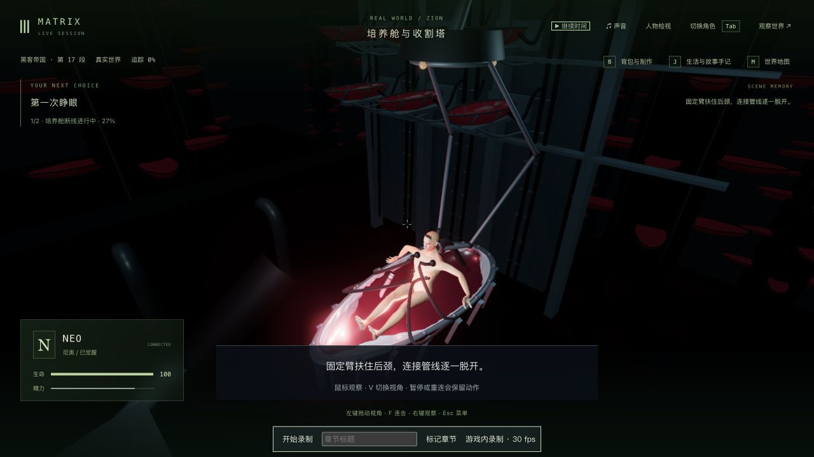
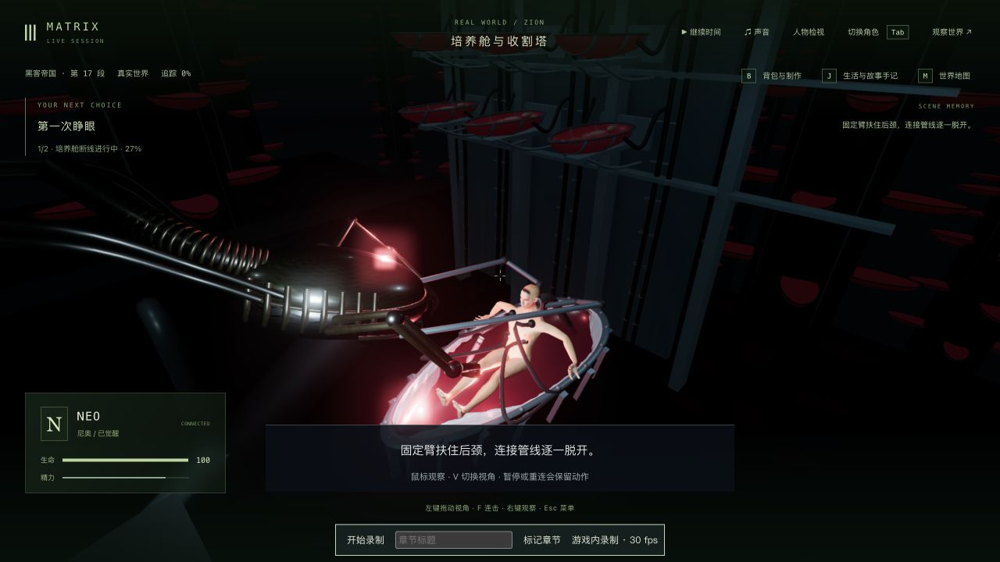
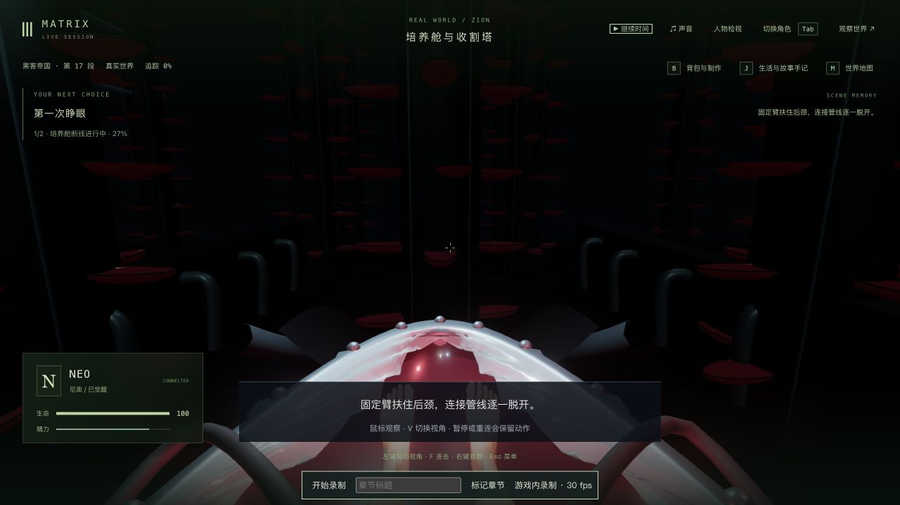
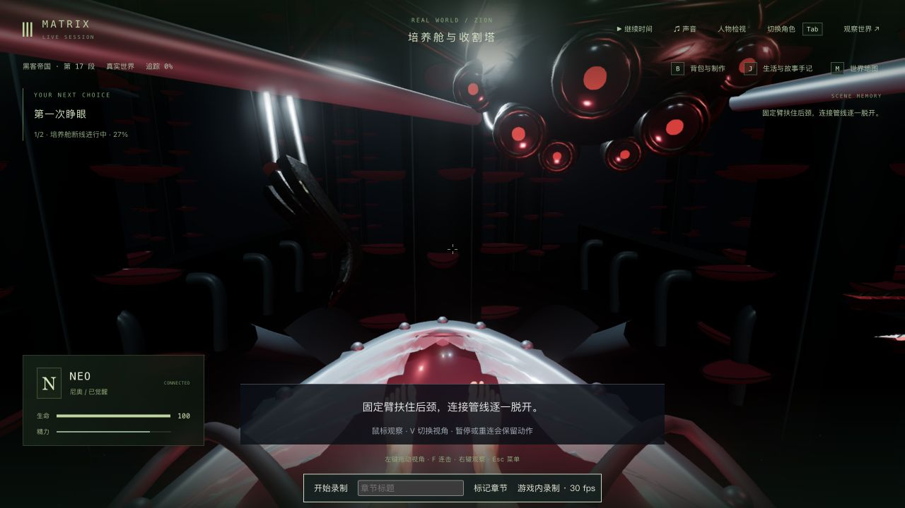
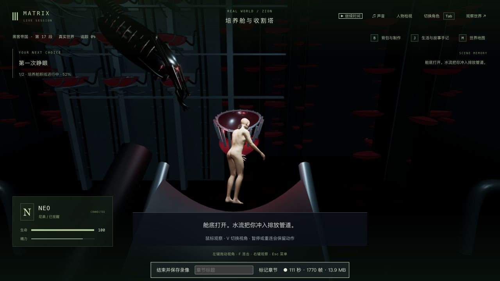

# 培养舱维修机器：入场、传感器与撤离

2026-10-12，基于 `4d932f8`。本轮只继续制作 1-07 的维修机器：重做机头、观察镜片、分节尾部和侧爪，接住原有颈部锁扣、拔线、排水和飞船救援。1-07 与三部曲均未达到完整制作验收要求。

## 原片依据与实现

原生浏览器查看 [Neo Wakes Up Scene](https://www.youtube.com/watch?v=rChuqcbdf4U)，频道为 JoBlo Movie Clips，并非 Warner 官方频道。约 01:27 的宽镜头用于核对蓝灰色长机壳、多目红色传感器、分节尾部和密集机械结构；约 01:35、01:45 用于核对 Neo 颈旁的夹持与连接关系。没有观看完整三部曲、下载电影或将影片像素放入游戏资产。

旧机器是圆盘与长直杆，在此存档的 Neo 默认眼位中机头不可见。新增独立 `PodMaintenanceRenderer`：机器由前侧靠近，机头朝实际 Neo 眼位转动；七个深色镜片保留小红光，蓝灰外壳及金属骨架复用已有 `metal_plate` 表面材质。侧爪开合、夹臂和退场依据保存的断线时钟重建，不依赖之前渲染过的帧；挣脱与拔口管时隐藏，断线后离开，飞船救援爪仍为原有独立装置。原颈部夹持点不变，机械臂起点改为实际机器连接处。

第一次实机版本出现整片发亮的红镜片、过于光滑的外壳，随后调整为深色玻璃内的小红光，并给外壳增加表面细节。`after-maintenance-*` 是该中间版本；以下 `final-maintenance-*` 与实录均为最终版本。没有增加依赖、演员模型或保存字段。

## 实机画面与续玩

入口完整复制前轮 `trilogy-pod-emergence-2026-10-12/mid-native-exit-state/`，tick 5312、`m1_pod` 第 0 步、挣脱 1.63 秒，包含 world 与 7 份记忆。沿用上游存档的来源和记忆修复限制，不宣称源自未经修复的完整电影开局。本轮没有修改人物、位置、生命值、剧情或注入完成状态。

第一条独立副本通过原生按住 G、拔口管、检查后颈，停在 tick 5404 / 断线 2.431 秒，拍旧版与最终新版同存档双视角对照；整个对照中世界暂停。随后在相同服务配置、相同数据目录真正重启，冷读并重新接管 Neo，再检查双视角。

| 旧版第三人称 | 最终第三人称 |
| --- | --- |
|  |  |

| 旧版 Neo 眼位 | 最终 Neo 眼位 |
| --- | --- |
|  |  |

650×1000 窄窗口也检查了双视角，文件为 `final-maintenance-first-narrow.png` / `final-maintenance-third-narrow.png`；默认窗口截图为 1280×720。近景仍有机壳和传感器沿画幅边缘裁切，不能据此宣布任意自由观察视角都已验收。

为实际验证最终模型完整入场，另从本轮 `initial-entry-state/` 完整复制 `approach-runtime-state/`，保留第一条副本的暂停检查点。原生接管 Neo 后从 tick 5312 正常持续 G 完成挣脱，另按 G 拔口管、检查后颈；机器入场在 tick 5397 / 2.515 秒暂停检查，退场在 tick 5401 / 4.724 秒暂停检查，再继续排水、按 G 请求救援、吊入飞船并进入医疗舱。最终 tick 5508 / `m1_recovery` 第 0 步等待开始康复，未开始针疗或后续舱室。辅助脚本仅使用普通暂停协议、公开世界读取与完整文件复制，不发送移动、技能或剧情完成消息。

[本地实录：新版机器入场至医疗舱](../neo-longplay-2026-09-20/neo-2026-10-11T22-13-50-464Z.webm) 为最终版本，录制器时长 166.871 秒、1280×720、2,513 个采集帧、24.12 MiB，带 Opus 音轨与 VP9 视频。录像从 31% 挣脱开始，包含暂停/双视角检查，没有后台重启或整段 1-07、三部曲连续通关。没有新开局或新循环证明。

## 回归、保存和性能范围

- 修改前两份相关测试文件为 **34/34**，见 `baseline-tests.log`。新增机器入场/眼位标准先失败 **0/2**，见 `machine-before.log`；失败原因是旧实现没有新的独立具名机器，不能将其称为旧机械臂穿模复现。
- 最终两份相关测试文件为 **36/36**，见 `final-tests.log`；覆盖实际 Neo GLB 的传感器眼位、夹持、九个接近/保持/撤离时刻的臂杆表面射线采样、中途恢复及新加载模型。实例矩阵也参与恢复比较。有限时间点与四个径向采样不证明所有机壳、侧爪、人物与服装在任意帧均无穿模。
- 三包类型检查与三包生产构建通过，见 `final-typecheck.log` / `final-build.log`；构建仍有既有的大包体积提示。本轮没有跑全库，前轮 181 项结果不重复算作本轮测试。
- 同存档最终画面对比保持六组公开状态、时间和 7 份记忆，见 `final-inspection-comparison.json`。真正重启立即比较为 **4/6**：Neo 的 `currentAction` 启动清空、模型服务 `llmStatus` 从 degraded 变 ready；时间、剧情与记忆保持。原生重新接管/退出后人物恢复，严格比较 **5/6**，仍保留服务状态差异，见 `cold-inspection-comparison.json` / `cold-reviewed-comparison.json`。没有过滤字段或报全通过。
- 正式 `data/` 与前轮挣脱、银液、房间和合批记录共 **794 个文件**没有更改、增加或删除，见 `protected-after.json`。原始世界、记忆、完整副本及日志留在本地，不入远端。
- 机器自身几何预算为 21,548 个可渲染三角形、17 个 Mesh 对象、12 份唯一几何、5 种材质；12 条侧臂杆和 4 个关节使用两批实例，同一套三张金属贴图共享。见 `machine-budget.json`；这些是离线几何计数，不是实际 GPU 显存、绘制调用或稳定帧率测量。
- 本轮没有新的无录制性能对照。录像记录 5,956 次渲染回调、平均 35.69 FPS / p95 133.4 ms，含录制、暂停、检查和不同场景；采集约 15.06 帧/秒。这不能证明关卡达到稳定流畅度。浏览器本轮最后错误/警告检查为空。

## 继续制作的缺口

机体仍为程序化近似：实际电影比例、精密关节/锁扣/收线、皮肤受力和干呕、Neo 握颈反应与自然落水、衣物/身体照护、船体空间、正式声音、第一人称构图、稳定性能及整组人工连续验收仍未完成。三部曲是主线框架连接后继续补玩法、制作画面并分段验证，不能视为全部完成后只剩美术精修。
