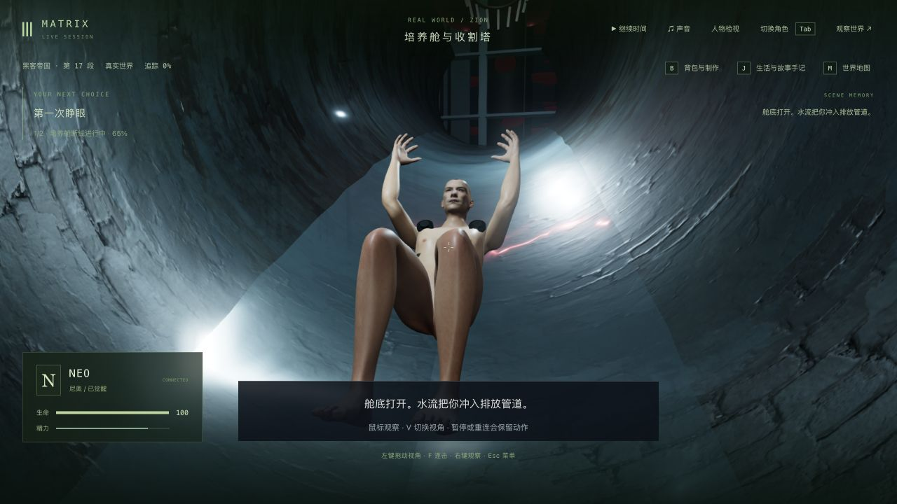
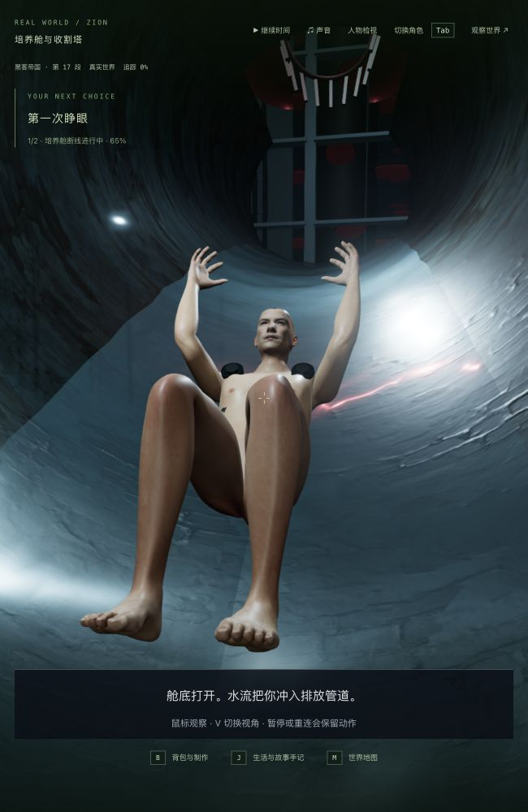
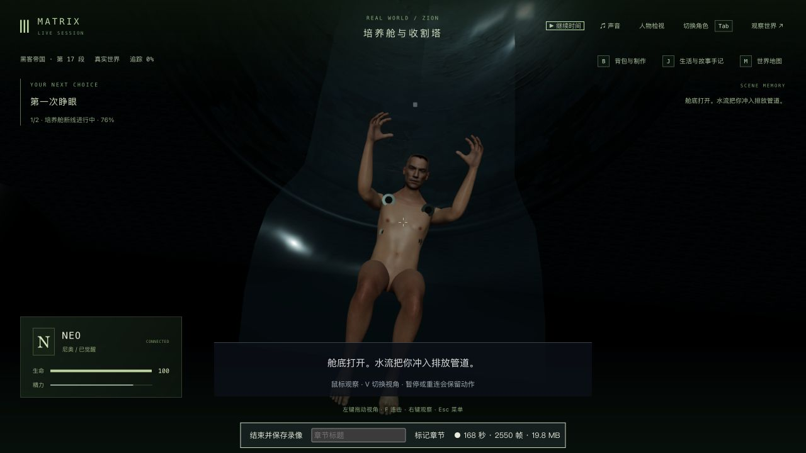
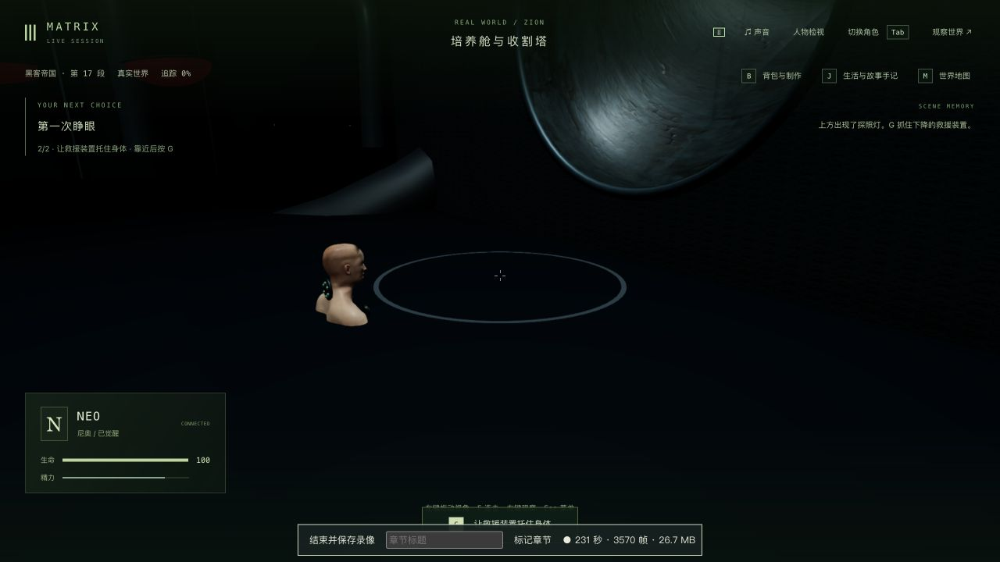

# 培养舱：封闭圆管、排放出口与落水

2026-10-12，基于 `0741d3d`。本轮制作 1-07 的排放空间、身体接触与取景，正常续接飞船救援和医疗舱。三部曲仍在制作；这不是整组 1-07 的电影级验收。

## 原片与实际改动

原生浏览器核对 [Neo Wakes Up Scene](https://www.youtube.com/watch?v=rChuqcbdf4U) 约 02:07 的圆形壁孔、水流和蜷身排放。频道为 JoBlo Movie Clips，并非 Warner 官方频道；本轮没有观看完整影片。电影画面没有被用作游戏纹理。

旧露天槽改为有实体顶壁的圆管，培养舱底分两片打开，下方入口留真实开口；出口墙也有真实圆孔及厚壁、金属孔沿。管身下半圆与身体支撑共用截面和纵向环定义，出口厚度与背缘也参与接触校正。轨迹先入管、沿坡冲出，再降至原有浮水/救援终点，保持救援交接坐标。

复用项目已有的 Poly Haven CC0 `damaged_plaster` 三张 PBR 贴图，来源和校验见 [材料记录](../../../packages/client/public/assets/film-materials/README.md)。管壁采用灰蓝湿面、局部照明及简化间接光；没有新增依赖或下载电影资产。身体和镜头在真实管内移动，出管镜头穿过圆孔，保留自由第一人称观察，没有隐藏管壁来规避遮挡。

水流更新既有缓冲，出口下方有喷溅及细碎水纹，排水结束后渐隐；废水池改为浑浊不透明水面，浮起时主要露出头颈。水面与粒子仍是保存时钟驱动的视觉近似，不是完整流体、刚体或接触形变。暂停时复用相同缓冲和姿态。

## 失败与回归

- 修改前培养舱两文件 **42/42**，见 `baseline-tests.log`；新增封闭管道/真实壁孔及开舱底/保存水流两项先失败 **0/2**，见 `pipe-before.log`。
- 出口检查扩大至完整裸身及头手，发现只计算管身会遗漏厚壁与圆环背缘。增加实际出口接触范围，检查 4.0–8.6 秒的 **47 个时刻**。最初采用统一圆柱余量的孔沿断言过于保守，随后按圆环的实际截面判断，保留原始诊断日志在本地。
- 较晚滑落时刻曾通过，但扩大到入管早期后，4.6 秒最深仍穿地约 **0.751** 个游戏单位，4.8 秒约 **0.396**。见 `inlet-floor-before.log`。提前接触权重，并在落地之前只向上校正，修复后见 `inlet-floor-after.log`。不以较窄的通过结果证明整个入管过程无穿模。
- 出口镜头原先被限制留在孔内，6.4 秒距身体焦点仅 **2.447** 个游戏单位；新增回归先失败，见 `outlet-camera-before.log`。镜头现在沿孔中心跟出，检查观察距离、管内/圆孔范围及对真实管壁/出口墙的视线遮挡，见 `outlet-camera-after.log`。
- 实机另发现第一人称管顶几乎全黑及亮白规则水圈。补管壁可见明暗、放宽管内取景；水纹改细碎并随排水结束渐隐。第一份录像保留为诊断版本，第二份为最终版本。

本轮相关模块回归通过：培养舱完整批次 **45/45**（`verified-pod-tests.log`）、实际资产/剧情 **16/16**（`verified-assets-story.log`）、相机 **6/6**。完整培养舱批次在最后水纹与出口镜头调整之前；最终受影响部分另补跑渲染 **8/8**（`verified-water-renderer.log`）、出管眼位 **1/1**（`outlet-camera-after.log`）及相机 **6/6**（`verified-final-camera.log`）。未跑最终全库或整条自动电影路线。

三包类型检查与生产构建通过，见 `final-water-typecheck.log` / `final-water-build.log`；最后出口镜头调整后客户端类型/生产构建再通过，见 `verified-client-build.log`。保留既有主包体积提示。

检查覆盖完整患者皮肤、实际网格下包络、顶壁/孔沿、骨骼交接、眼位及有限相机路径，不证明所有帧、所有道具/服装、舱底叶片与所有观察方向均无穿模。

## 实机与保存

入口完整复制前轮 `trilogy-pod-reactions-2026-10-12/initial-entry-state/`：tick **5312**，挣脱 **1.63 秒 / 31%**，world 与 **7 份记忆**一并复制。沿用上游存档和记忆修复的来源限制，不宣称来自未经修复的完整电影开局。本轮没有注入位置、生命值、时间、完成状态或拼接记忆。

第一条副本原生 G 操作正常到断线 **5.861 秒 / tick 5618**。两次同配置、同数据目录真正重启，启动立即严格比较均 **5/6**：只有 Neo 的临时 `currentAction` 清空，剧情、时间、模拟状态和记忆保持。原生重新接管，检查 1280×720 与 650×1000 的双视角、退出角色后，严格比较均 **6/6**，无过滤字段；最终源码结果见 `verified-cold-immediate-comparison.json` / `verified-cold-reviewed-comparison.json`。启动时清空动作的问题仍未修复，不报启动立即完全一致。

主检查点保持暂停。两条独立较早副本均由原生持续 G、拔管、检查接口、落水后 G 请求救援完成，分别到医疗舱等待 **tick 5846**（诊断版）和 **tick 5685**（最终版）。没有开始康复。辅助脚本只执行普通暂停、公开读取及完整状态复制，不发送移动、战斗或剧情完成消息。

| 本地录像 | 范围 |
| --- | --- |
| [诊断版，282.949 秒](../neo-longplay-2026-09-20/neo-2026-10-12T02-08-18-479Z.webm) | 挣脱 31% 到医疗舱；含规则白圈问题、较长等待，尚未采用最后水纹及出管镜头修正 |
| [最终版，305.053 秒](../neo-longplay-2026-09-20/neo-2026-10-12T02-23-52-424Z.webm) | 最终源码从挣脱 31% 到医疗舱；含出管约 6.8 秒的暂停和双视角检查、等待，没有录入重启过程 |

最终录像为 1280×720、**4,686 采集帧**、**41,719,537 字节 / 39.79 MiB**，带 VP9 视频和 Opus 音轨；详细信息见 `final-video-probe.json`。约 15.36 个采集帧/秒，不等于工具栏标称 30 fps。渲染统计 7,854 回调、平均 **25.75 FPS / p95 163.4 ms**，包含录制、等待、暂停与多个场景，不能作为无录制基准或稳定性能通过证据。

最终浏览器错误/警告为空。正式 `data/` 和前六轮记录共 **1,092 个文件**保持，主暂停副本 **8 个文件**也保持，见 `protected-after.json` / `primary-verified-after.json`。仅本轮服务与临时浏览器被关闭，完整世界、记忆、原始日志、副本和两份视频保留在本地。

## 仍需制作

电影尺度/工艺与更准确的摄影、自然受力/干呕/面部表演、演员级人物、真实流水/浮水反应、船员照护与船体、正式声音、启动动作恢复、稳定帧率及整组连续人工验收仍缺。圆管与水流已从缺失变为可游玩的局部实现，不能据此将 1-07、42 组或三部曲标为高质量完成。
