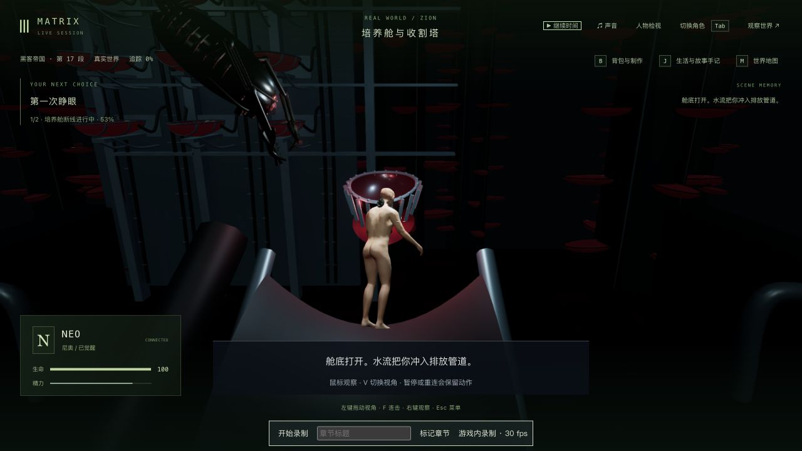
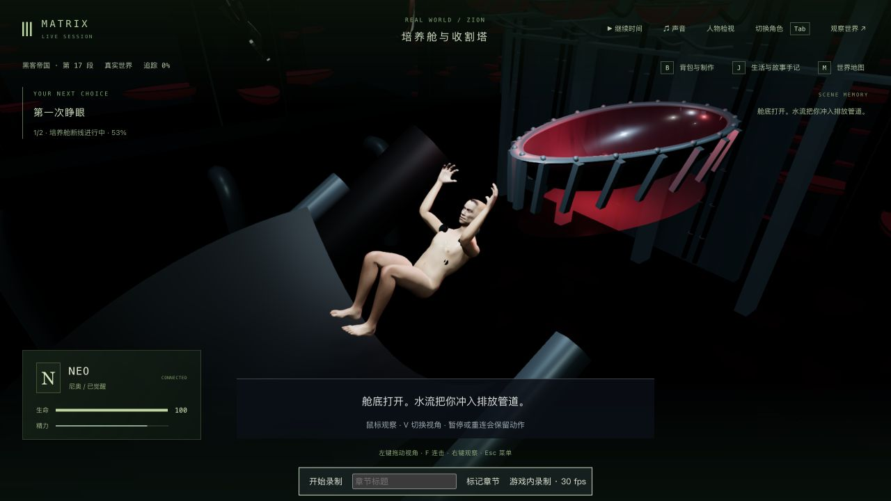
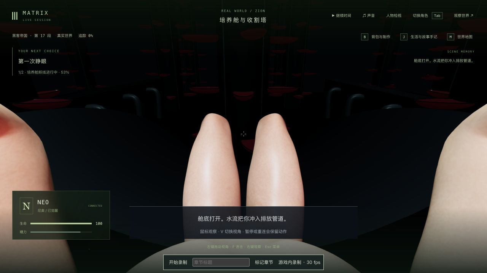
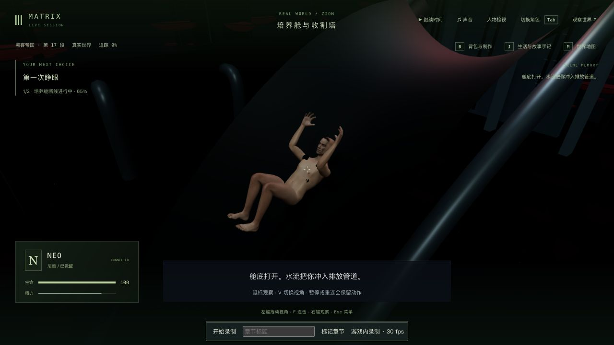

# 培养舱：颈部反应、蜷身滑落与真实眼位

2026-10-12，基于 `1b53b67`。本轮继续制作 1-07 的 Neo 动作和视角：颈针拔出时后仰，释放支撑后蜷身滑落，浮水和吊起使用连续的保存姿态；修正通道接触、暂停漂移和第一人称眼位。没有完成整组 1-07，也不把三部曲标为完成。

## 原片与实现范围

原生浏览器查看 [Neo Wakes Up Scene](https://www.youtube.com/watch?v=rChuqcbdf4U)，频道为 JoBlo Movie Clips，并非 Warner 官方频道。实际核对约 01:32 的机器、01:42 的颈后连接、01:47/01:52 的身体管线、02:02 的排放反应、02:07 的圆管出口和 02:12 的浮起；另播放了约 02:07–02:12。没有观看完整影片、下载电影或把影片像素放入游戏资产。

旧实现会直立滑下，5.2 秒附近手腕突变；浮水动作还使用不断累计的通用动画时间。现在保存的断线/救援时钟驱动骨骼，颈针收回时头部和胸部作轻微反应，松开支撑后弯腿、收身，再逐渐转为浮水与被托住的姿态。控制器不再覆盖下降身体的保存朝向；浮起和救援开始共享姿态，身体在吊起时回到舱口路径。

第一人称下降、浮水和救援取实际头部眼位，保留身体并隐藏头部表面；转动镜头不会改变保存身体的朝向。浮水观察的角度范围计入向上取景偏移，玩家能够低头看水面。第三人称下降镜头跟随实际头部和骨盆。

排水槽渲染与身体接触共用 561 个顶点的槽面定义；依据头手及完整裸身网格的实际蒙皮顶点校正位置，同一保存时刻/相同模型和变换复用接触结果。这里仍是按剧情轨迹演出的程序化身体，不是完整刚体、流体或接触形变模拟；开放槽面也尚未改为原片的封闭圆管。

## 失败与回归证据

- 修改前两份相关文件 **36/36**，见 `baseline-tests.log`。三项新回归先失败 **0/3**：5.2 秒手腕跳变约 0.114 单位、暂停浮水骨骼漂移、4.3 秒眼位偏离约 3.792 单位，见 `reactions-before.log`。
- 真实眼位修正后，另发现浮水仍不能低头、控制器覆盖身体朝向，以及槽面穿透。对应 `look-down-before.log` / `contact-before.log` 保留失败；后者的头手皮肤采样最深约 1.555 单位。
- 较窄接触检查一度通过，但它遗漏了独立的 `Patient_body` 网格。扩大到完整裸身后，在 5.2 秒仍发现约 0.484 单位穿透，见 `whole-body-contact-before.log`；随后校正和测试都覆盖完整身体，见 `whole-body-contact-after.log`。不以早期较窄的通过结果证明完整身体无穿模。
- 颈针反应标准先失败，见 `recoil-before.log`；最终实际骨骼后仰、结束后的回稳及原有颈部夹持/管线检查通过。
- 最终相关 **64/64**：两份完整培养舱文件 **42/42**（`final-tests.log`），实际资产/剧情相关 **16/16**（`final-assets.log`），相机相关 **6/6**（`final-camera-tests.log`）。相机首轮 5/6 的失败来自假 DOM 缺少 `createElementNS`，发生在本轮未修改的维修机纹理加载器；按现有测试写法 mock TextureLoader 后通过。原始失败日志留本地，没有用生产代码绕过纹理加载。
- 三包类型检查与三包生产构建通过，见 `verified-typecheck.log` / `verified-build.log`；仍有既有主包体积提示。本轮没有跑全库、完整自动电影路线或无录制性能对照。

槽面回归对四个滑落时刻检查完整皮肤的分格下包络，再用射线查询实际渲染槽面；骨骼连续性、冷加载、夹臂、管线、救援支臂和落脚使用各自的有限采样。它们不证明任意帧、所有服装、家具、槽口和视角均无穿模。

## 实机、保存与正常续玩

入口完整复制前轮 `trilogy-pod-maintenance-2026-10-12/approach-start-state/`，tick 5312 / `m1_pod` 第 0 步 / 挣脱 1.63 秒，包含 world 和 7 份记忆。沿用上游存档的来源及记忆修复限制，不宣称源自未经修复的完整电影开局。本轮没有注入人物位置、时间、生命值、完成状态或拼接记忆。

第一条副本通过原生持续 G、拔口管、检查后颈到 tick 5422 / 断线 4.787 秒。暂停拍修改前后同档画面，默认 1280×720 和 650×1000 窄窗口均检查双视角及实际拖动观察；六组状态、时间和 7 份记忆保持，见 `verified-descent-comparison.json`。

| 修改前：直立下降 | 最终：失去支撑后蜷身 |
| --- | --- |
|  |  |

随后正常续到 tick 5424 / 断线 5.868 秒，在相同配置、相同数据目录真正重启。启动立即严格比较 **4/6**：Neo 的临时 `currentAction` 清空、模型服务 `llmStatus` 从 degraded 变 ready；其余剧情、时间和记忆保持。原生重新接管并检查双视角，动作/接触恢复，严格比较 **5/6**，仍保留服务状态差异，见 `cold-contact-comparison.json` / `cold-reviewed-comparison.json`。没有过滤字段或报全部一致。

第二条副本从本轮 `initial-entry-state/` 完整复制，保留第一条副本的暂停检查点。最终版本原生从 tick 5312 的 31% 挣脱继续，按 G 拔口管、检查后颈，经历机器接近、拔针反应、滑落与浮水，再按 G 让机械爪托住身体、吊入飞船，最终 tick 5791 / `m1_recovery` 第 0 步等待开始康复。未开始针疗、舱室、构造体或新循环。辅助脚本仅普通暂停、公开读取与完整副本保存，不发送移动、战斗或剧情完成消息。

[本地实录：本轮动作与救援](../neo-longplay-2026-09-20/neo-2026-10-11T23-18-25-203Z.webm) 为最终版本，录制器时长 **241.269 秒**、1280×720、3,482 个采集帧、29.34 MiB，带 VP9 视频和 Opus 音轨。包含较长的待操作时间、开头与结尾暂停，从挣脱中途开始，不是整组 1-07 或三部曲完整连续人工通关。录像中没有重启；重启检查来自第一条副本。

录像统计 8,348 次渲染回调、平均 34.60 FPS / p95 142.4 ms，含录制、等待和不同场景；采集约 14.43 帧/秒，不能作为无录制性能基准或稳定流畅度证明。浏览器最终错误/警告检查为空。正式 `data/` 与前五轮记录共 **929 个文件**保持，见 `protected-after.json`；完整世界、记忆、原始日志、副本和视频留本地。

## 仍需制作

封闭排放管/出口、可信水流与溅水、受力和身体反应、手部/颈部精细动作、干呕与面部表演、演员级人物、第一人称构图、电影比例、船员照护与船体、正式声音、稳定性能及整组连续人工验收仍缺。三部曲继续补玩法、制作画面与分段验证，未全部完成。
