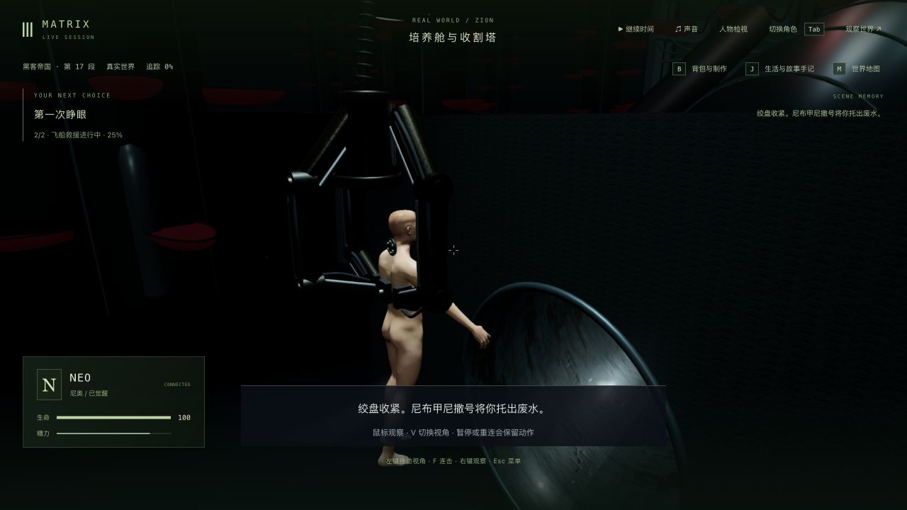
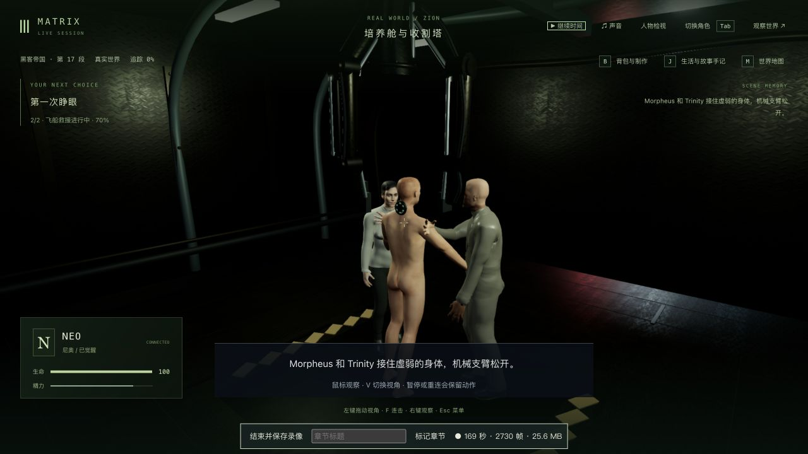
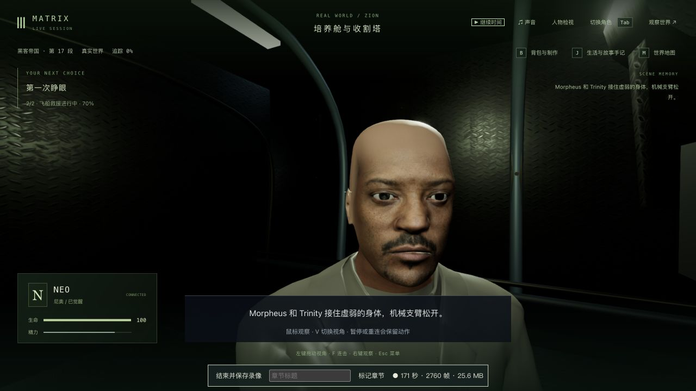

# 培养舱救援机构与接应甲板

2026-10-12。本轮继续制作 1-07 的救援局部：细圆杆替换为厚机壳、三组分节夹臂、液压杆、软管和护套缆线；接应区域补舱口厚边、甲板分缝、舱壁框架及舱口逆光，复用已有 `metal_plate` 金属贴图。救援时钟、Neo 的身体轨迹和接触点沿用既有保存状态。

参考实际查看的[成片片段](https://www.youtube.com/watch?v=gCZBY7a8kqE)：4:38 的水面、4:48 的抓取和 4:53 的吊起/明亮舱口。该上传者是 EPIC TV CLIPS，非 Warner 官方；没有下载或嵌入影片。接应与昏迷的先后另核对[1998 修订剧本](https://www.dailyscript.com/scripts/the_matrix.pdf#page=35)。内部甲板布局、机构比例和动作时长仍是游戏近似，不能据此称为完整成片还原。

## 修改与回归

- 新机构单独管理动态实例、金属贴图和释放，固定的皮肤接触垫继续跟随实际胸部骨骼。有限检查覆盖 12 个救援时刻，每四个皮肤顶点采一处，并展开全部实例的真实三角形；检查头部、身体和四肢对金属的穿透，接触垫不纳入金属穿透判断。这不证明每帧、所有顶点或船员全身均无穿模。
- 缆线缺少实体护套的[先失败记录](tether-before.log)保留。检查还复现了松开身体后装置升过绞盘、缆线方向翻转的[失败](winch-before.log)，现将其限在绞盘下方，保留缆线正向和机壳净空。
- 修改前相关 **36/36**，见[基线](baseline-tests.log)。最终[机构/真实模型/启动](final-tests.log) **39/39**、[相关剧情](final-story.log) **14/14**、[镜头](final-camera-fixed.log) **5/5**、[实际眼位与船体接近](final-connection.log) **2/2**，合计 60 项；[三包类型](typecheck-instanced.log)与[三包构建](final-build.log)通过，未跑最终全库，已有大包告警保留，无新增依赖。
- 镜头回归曾为 4/5：浮水测试的假 DOM 缺贴图加载模拟，未改动的 HEAD 渲染器也[复现同一错误](camera-baseline-failure.log)。按该文件已有模式补一行纹理加载模拟后 5/5；没有修改实际浏览器的贴图加载行为。

## 实机与完整存档

使用此前完整真实救援中途档，tick 5498 / 3.497 秒，独立端口 3163 / 5363。1280×720、650×1000 的第一/第三人称已局部检查。普通角色释放后[6/6](rig-reviewed-comparison.json)，停止并重启后台立即[6/6](rig-cold-comparison.json)，原生冷读/V/退出后[仍 6/6](rig-cold-reviewed-comparison.json)。六组是人物、区块、地点、事件、沙盒、模拟状态；另核对日期/时间/刻度和 7 份记忆字节，未过滤差异。

另一份完整真实旧档从滑落 5.868 秒 / tick 5424 原生继续：自然出管/落水，G 抓取，正常吊起至 9.824 秒暂停检查接应，再继续到 `m1_recovery` 第 0 步 / tick 5591。医疗 elapsed 0 / started false，未开始康复。没有改存档推进剧情，没有以此认定整组或三部曲通关。只查看了接应时刻的双视角，没有新的接应中途重启检查。

## 未录制的性能采样

均为同一暂停档/默认机位，1280×720、像素比 1.5、同一 Apple M3，预热 3 秒并采样 15 秒。前两项是一次采样，最后版本含一次真实后台重启复测；未做交替旧/新基准或覆盖整段运动。

| 版本 | 平均 FPS | p95 帧间隔 | 绘制/帧 | 三角形/帧 | 报告 |
| --- | ---: | ---: | ---: | ---: | --- |
| 旧细杆机构 | 30.66 | 38.6 ms | 347 | 3,107,362 | [基线](performance-before.json) |
| 新外形，未合批 | 27.41 | 43.9 ms | 465 | 3,137,014 | [中间退步](performance-first-rig.json) |
| 新外形，实例合批 | 51.08 | 20.9 ms | 331.54 | 3,136,827.76 | [最终](performance-instanced.json) |
| 同版本冷启动 | 51.25 | 20.8 ms | 331 | 3,136,758 | [复测](performance-cold.json) |

合批保持护甲、液压杆、软管、轴承、接触点和金属材质；没有降低画幅、像素密度或删除人物。三角形数量接近，但未做逐顶点/UV 的前后等价审计。51 FPS 仍不是稳定 60 FPS 或全游戏性能验收。

## 局部实录与剩余项

[本地原始录像](../neo-longplay-2026-09-20/neo-2026-10-12T05-18-53-763Z.webm)：约 **325.52 秒**、1280×720，5,255 个捕获帧、VP9 视频与 Opus 音轨，约 51.33 MB，详见[元数据](video-metadata.json)与[流信息](video-probe.json)。从滑落中途开始，包含较长的检查暂停，不是连续五分钟动作、整组或三部曲长玩；录制期渲染均值 27.81 FPS / p95 140.9 ms 包含录制开销与等待，不作为上述无录制基准。录像保留在本地。

正式 `data/` 与前八轮目录 **1449 文件**的增加/删除/内容均保持，见[保护检查](protected-comparison.json)。本轮服务、客户端和检查页已关闭，临时画幅已恢复。

金属仍偏暗，船员/Neo 的相似度、服装、自然受力/步态/表情/声音、精密机械及原片空间比例仍不足；水面/夹臂与人体的自然受力、正式混音、整组连续人工验收和稳定帧率继续制作。42 组剧情及三部曲目标保持未完成。
