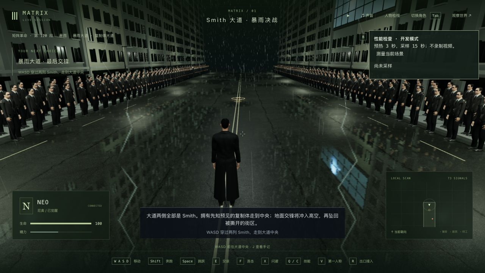
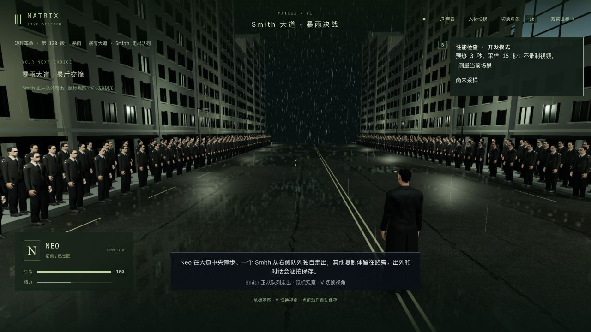
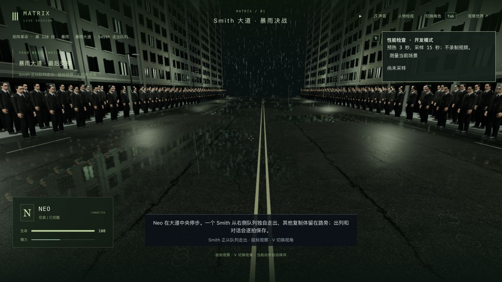

# 暴雨大道：真实入场、湿路面与读档检查

日期：2026-10-11。基于 `a37252e`。这是 3-11 的局部制作与验证，不是三部曲或本组电影级验收完成。

## 本轮改动

- 进入 Smith 出列范围时保存 Neo 的实际位置、朝向和水平速度，半秒内逐渐停下，再转向 Smith。对话保留实际停步位置，迎战从这里起跑；跳跃经过标记时等待落地，避免把身体拉回路面。没有 arrival 字段的旧档保留原有演出。
- 开场镜头在窄画幅按比例后退；用实际 Neo GLB 检查两种入口方向、转身各时刻的头和双手，修正裁出画面的问题。
- 大道复用项目内已有的 CC0 Asphalt 02 颜色、法线、粗糙度贴图；积水反光随区域和观察角度变化。雨滴位置、落下相位和长度采用固定散列分布，覆盖整条 190 米道路及空战高度；缩小地面雨圈。没有新增依赖、下载贴图或修改角色资产。

## 测试及准确范围

- 相关基线 41/41。入场移位、跳跃强制落地和雨区未覆盖道路两端三项回归先失败，修改后通过。
- 新增真实人物窄画幅检查先失败；第一次只减小侧向偏移仍裁掉手腕，最终按画幅调整距离后通过。最终九组相关测试 **84/84**，包含镜头、人物接触、复制体、坑洞、楼内、雨水与终局；`related-final.log` 保留结果。
- 完整电影自动路线 **1/1**，含交互、驾驶、战斗和新循环，但使用测试夹具，不是连续人工通关。
- 同批全部目标点可达性检查 **失败**：`m3_farewell` 第 0 步 `(5696, -100, 6005.5)` 被碰撞判为阻挡。将修改前 `a37252e` 的 shared 源码与根配置导出到独立临时目录、重新编译后同样返回 blocked=true；见 `reachability-head.log`。这是已有缺陷，本轮没有修改告别布景，也没有把这批 **1/2** 写成全部通过。
- 三包类型检查、共享/服务器构建与最终客户端生产构建通过；客户端主包 3,399.94 kB（gzip 1,032.75 kB），保留现有体积提示。没有跑最终全库。
- 实机末次检查 warning/error 为 0。几何测试夹具仍打印既有 Oracle 模型 mock 不完整的回退提示，不等同于浏览器加载出错。

## 存档与真实操作

使用完整旧档副本，没有修改剧情字段、传送或重置玩家世界：

1. `entry-check/runtime-state` 复制上一轮保留的真实机器交接入口，Neo / `m3_rain` 第 0 步 / tick 13244，局部 z=-78。这份副本用于入场回归，不倒退主验证进度。
2. 原生接入、检查画面和性能后释放角色，通过普通玩家输入向前行走。进入范围时实际局部 z=-45.634096、速度 3.126437；最终只减速前进约 **0.782 米**，没有跳到旧固定站位。轨迹见 `entry-check/trace-entrance.json`。
3. 在 **0.302 秒**减速中段暂停、释放、落盘并真正重启服务。前后六组公开状态、世界时间与 **15 份记忆**完全一致。原生冷读、V 两种视角和退出再比较也一致，见 `entry-check/brake-restart.json`、`entry-check/brake-native-restore.json`。
4. 用普通输入续到等待 Neo 回应；原生界面回应并主动迎战，刻意漏闪避，实际进入失败。J 打开手记重试后返回 ready；暂停时第一次重试未执行，继续时间后再次提交成功，保留这项操作限制。最终验证副本为 `m3_rain` 第 1 步 / ready / attempts 1 / **tick 13417**，暂停且全部角色释放。本轮没有在浏览器重新打完整场空战至同化。
5. 当前目录根部 `runtime-state` 的 16 份文件仍与上一轮主验证 ready / tick 13359 完全一致，没有启动或覆盖。这一轮不把回归副本的较晚 tick 当作主线新进度。

主试玩 3155/5355 保持原进度；156 项源档/主档/人物资产保护文件未改。原有 46 段完成历史、42 项选择、16 项反思、65 条手记及九名死者保持，见 `protection-and-progress.json`。临时服务与测试浏览器在检查后关闭，完整检查点和本地原始日志保留。

## 实机与性能

1280×720，像素比 1.5，Apple M3 / ANGLE；入口暂停、预热 3 秒并采样 15 秒，没有录制或并行构建/测试。本次 **19.2 FPS、p95 64.8 ms**，每帧 462 次绘制，人物更新 7.82 ms、绘制 CPU 13.31 ms。见 `entry-profile.json`。上一轮相同入口/画幅样本为 22.7 FPS，本次更低；没有同轮切换版本的成对测量，不能据此归因某一个着色器，更不能宣称优化或流畅达标。

## 仍未完成

立面、路灯与复制体排列仍有明显重复，人物相似度、自然减速落脚/重心、转身与镜头衔接、表情/口型、声音、雨体积与物理破坏没有达到原片质量；没有逐帧验证任意站位和接触，也没有从机器城连续人工通关到日出。性能仍需专项改善。新增发现的 3-09 目标点碰撞单独列入审计待修。

本轮尝试浏览 Movieclips 的旧版与 4K 决战片段，分别遇到无法播放和停在 0:00 缓冲；没有实际看到新的成片画面，也没有下载影片，不能把本轮称为新的逐镜对照验收。
