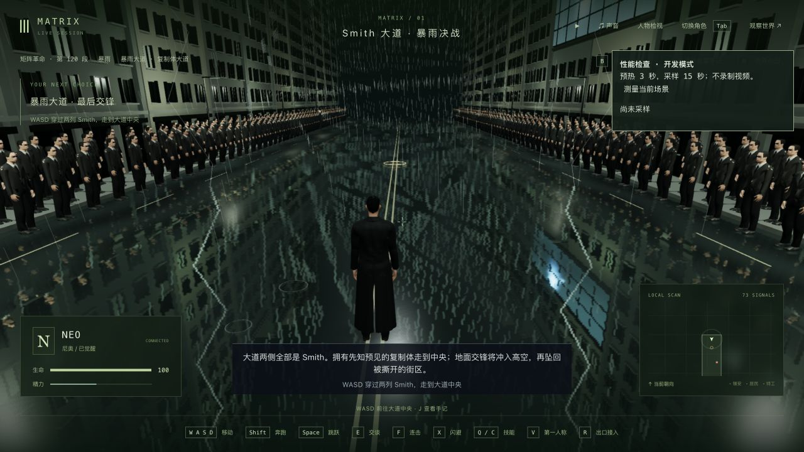
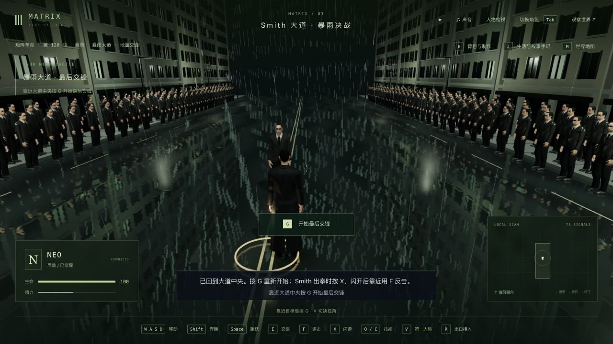

# 暴雨入口接管、镜头与真实续玩（2026-10-11）

基于 `a3f5417`。本轮仅修复 3-11 的入口边界并验证实际续玩，没有完成暴雨决战的美术、自然表演或三部曲最终验收。剧情框架接入不等于全部玩法和画面完成；当前不是从第一部重新逐镜制作。

## 修复与验证

机器核心交接把 Neo 放在大道局部 z = -78；旧碰撞场地只有 150 米长，半长 75，使这个真实入口被认作边界外。重新接管会走通用纠偏，把人物移到另一端的入口；跟随镜头也因同一边界被推到身体内。既有道路、路面反射和人行道实际已是 190 米，本轮只将共享场地深度对齐这个实际长度，没有增加传送、回填存档或修改通用接管规则。

- 原四文件基线 **39/39**：`baseline.log`。
- 两条新增回归在原版均失败：`entry-before.log`。真实交接/重连 z 5938 → 6064；实际 GLB 的宽屏入口镜头贴近头部。
- 修改后第一轮有一项测试仍失败，因为测试在 restore 后引用了旧的状态对象；用现有 `h.state()` 读取恢复后的状态，最终 **2/2**：`entry-verified.log`。中间日志保留，没有把测试引用错误称为新的产品缺陷。
- 最终相关四文件 **41/41**：`entry-related.log`，覆盖决战、镜头、街道和群众。入口相机回归使用实际 Neo 骨骼，检查 16:9、9:16；这不代表所有帧和所有接触均无穿模。
- 自动电影路线及各场地普通行走 **2/2**：`route-world.log`。整条自动路线含夹具，不等同于三部曲连续人工通关。
- 三包类型检查、共享/服务器构建和客户端打包通过：`typecheck.log`、`shared-build.log`、`server-build.log`、`client-build.log`。客户端仍有既有大包警告；没有跑最终全库。

## 两份副本的用途

原始档和主试玩档保持不变，检查保存在本目录。副本文件完整复制，没有编辑任务、人物或位置字段。

1. `entry-check/runtime-state` 来自上一轮的 `delivered-before-restart-state`，用于检查未被旧 bug 移位的原交接入口 z 5938。原生接管、V 双视角和退出后六组公开状态、时间与 15 份记忆完全保持，见 `entry-check/native-entry-comparison.json`。这份副本仅用于入口回归，不作为主验证路线的新进度。
2. 根目录 `runtime-state` 来自上一轮 `verified-state`，保留旧 bug 已造成的 z 6064。使用普通玩家协议沿大道步行，没有把位置改回原入口。行走实际触发 Smith 出列，在 2.043 秒 / tick 13299 暂停，见 `trace-entrance.json` 和 `played-entrance.json`。
3. 出列中途真实停止/重启后端，六组状态、时间及 15 份记忆保持，见 `entrance-restart.json`；原生冷读查看第三/第一人称，随后继续出列。
4. 原生界面实际点击回应 Smith、主动迎战；错过闪避后进入失败，再通过 J 的检查点按钮重试。公开 API 观察器只在到达阶段后发送普通 pause，不改阶段或人物。停于 `m3_rain` 第 1 步 / ready / attempts 1 / tick 13359，尚未赢下地面交锋。
5. 重试检查点第二次真实重启，见 `retry-restart.json`；原生再次冷读接管、退出，见 `retry-native-cold.json`。两对比较六组状态、时间与 15 份记忆一致。最终 `verified-state` 保留这个实际结果，后续从这里继续。

`protection-and-progress.json`：原 46 段完成记录、42 个选择、16 个反思和 65 条手记均保留；Trinity、Mifune 等九名既有死者没有复活。主试玩档八组公开状态不变，156 项来源档、主档和人物资产哈希没有变化。正常游戏期间的世界事件可以发生变化，不将其误报为整个世界始终冻结。

## 实机与性能

原生浏览器实际画幅 1280×720，没有截图专用相机或视口覆盖。`entry-settled.png`、`entry-first.png` 为原交接入口；`entrance-cold-third.png`、`entrance-cold-first.png` 为真实出列中途冷读；`reply-native.png`、`charge-ready-native.png`、`failed-native.png`、`retry-native.png` 为后续原生操作。最终 `retry-cold.png` 为同版本再次重启后的准备状态。当前页面读取的 error / warn 为空。

通过现有开发性能面板对暂停的入口第三人称视图预热 3 秒、采样 15 秒：342 帧，**22.7 FPS，p95 帧耗时 55.1 ms**；像素比 1.5，Apple M3 / ANGLE，无视频录制。CPU 平均人物更新 7.05 ms、渲染提交 11.49 ms；每帧约 462 次绘制、485 万三角形，主视图、反射、遮蔽通道重复绘制群众。原始报告见 `entry-profile.json`。这只是单个暂停场景测量，既不是运行中决战的基准，也不是性能通过或前后提升的证据。

## 仍待完成

- 上述碰撞纠偏已修复；普通步行抵达出列触发区时，演出仍把 Neo 固定到局部 z -42。本次原路径的相邻采样出现约 3.87 米移动，见 `trace-entrance.json`，这是另一个需要连续化的入场问题，没有隐藏或改写记录。
- 雨丝与反射存在明显规则重复，路面过于镜面；建筑、窗口复制体、人物/服装、自然步态与受击表演、天气/浑水、物理破坏和正式声音仍不够精确。
- 入口首次群众加载存在等待；当前帧率未达目标，尚未解决相应性能开销。两次原生冷读和有限骨骼采样不能证明全部视角、每帧和任意接触无穿模。
- 本轮没有重新观看完整影片，没有新电影资源、人物资产或依赖，没有长视频；没有从机器核心连续人工赢下整个决战到日出。3-11 和三部曲都保持继续制作。
