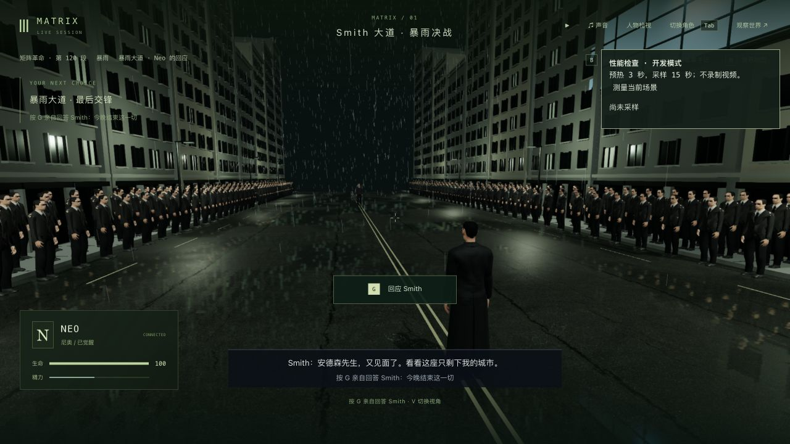
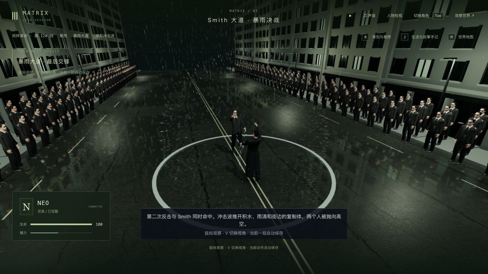
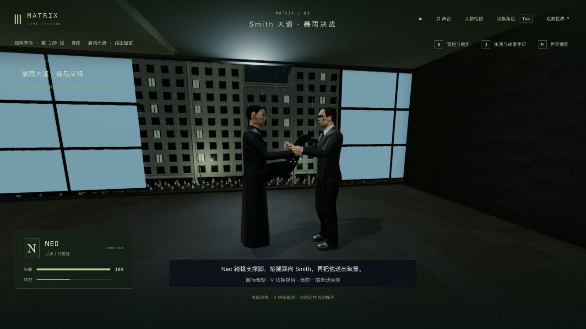
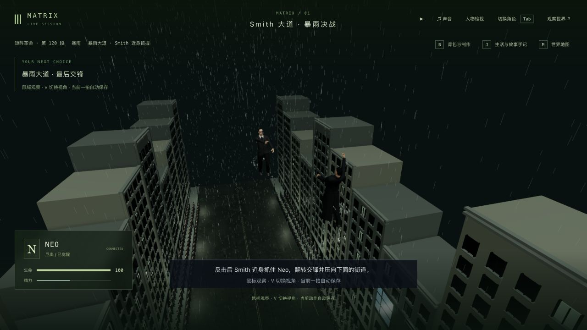
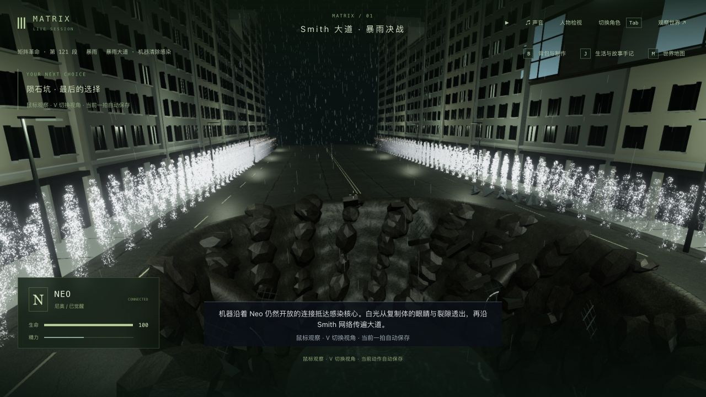
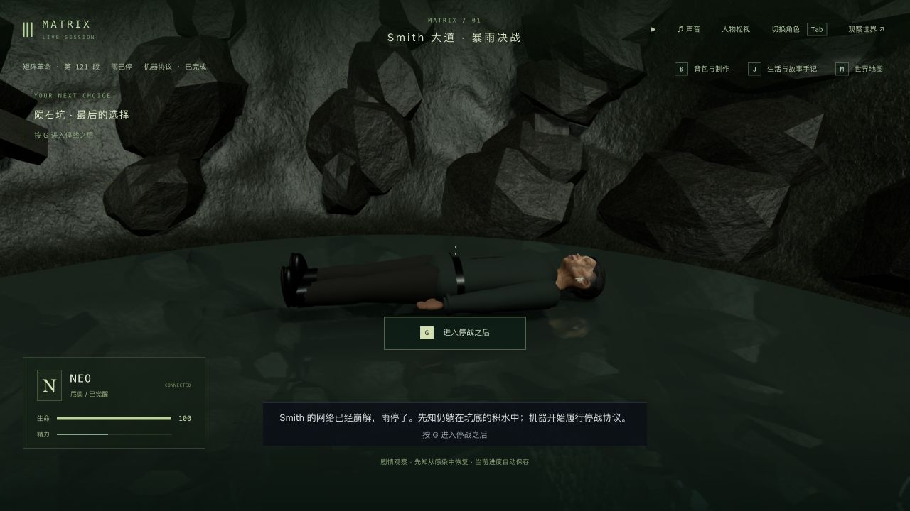

# 暴雨终局：人群可见性与远处人物更新（2026-10-11）

这次减少 3-11 现有场景的重复绘制和人物更新开销，没有新增电影美术资产、动画或玩法。三部曲关键流程已接入，但专用玩法、场景和动作仍在制作；125 个节点、365 个操作步骤、70 个场景定义不等于 42 组全部高质量完成，也不是已进入从头逐镜精修的单一阶段。

## 修改

- 323 名 Smith 旁观者由六段 × 八材质的 48 个批次改为近/远 × 八材质的 16 个批次，各细节级共用实例矩阵缓冲。按完整身体边界裁剪，保留直接可见或仅在水面倒影中可见的人物。站位、模型、材质和原有 50 米细节阈值保持；暂停且视角不变时不重复上传矩阵。
- 近模型先显示，远模型异步到达后沿用当前相机、水面和存档状态。没有相机时恢复全部 323 人；消散效果继续使用原有保存状态。
- 实测发现远处普通角色在细节级判断之前，每帧仍递归查询隐藏身体和衣物。将已有的三行 100 米判断提前，不改变近处动作与恢复先知的例外。衣物切换在重新进入近处的第一帧同步。

未新增依赖、贴图或模型；未为本轮重新观看电影。此前原片参考和改编边界沿用[入场记录](../trilogy-rain-arrival-2026-10-11/README.md)。

## 同一存档、机位的性能比较

原生 Codex 浏览器，1280×720，像素比 1.5，Apple M3 / ANGLE。每次先等待 3 秒，再采样 15 秒；暂停世界，不录屏，不同时运行构建/测试。基线客户端取自 `34c5cbf8`，连接同一隔离后端。每个位置只比较自身，不能跨位置相减。

| 暂停位置 / 版本 | FPS | 帧耗时 p95 / ms | 绘制调用 | 三角形 | 人物更新均值 / ms |
| --- | ---: | ---: | ---: | ---: | ---: |
| 入口 / 修改前 | 20.64 | 62.2 | 462 | 4,847,751 | 7.21 |
| 入口 / 仅人群优化 | 20.61 | 57.6 | 366 | 4,847,751 | 7.64 |
| 回应 / 修改前 | 22.88 | 58.0 | 445 | 6,078,801 | 10.94 |
| 回应 / 仅人群优化 | 23.17 | 54.7 | 349 | 4,257,135 | 11.34 |
| 回应 / 最终改动 | 23.41 | 52.1 | 349 | 4,257,135 | 6.90 |

对应 `profile-before.json`、`profile-crowd.json`、`reply-profile-before.json`、`reply-profile-after.json`、`reply-profile-final.json`。回应位置三角形减少 30.0%，绘制调用减少 21.6%，人物 CPU 更新均值减少 36.9%；入口所有人仍在取景内，没有减少三角形。**帧率仅小幅改善，稳定性能未达标。**这些是单次有限样本，不能证明所有机位或战斗期间的帧率；尚未进一步隔离剩余帧耗时，不能只凭 CPU 计时认定 GPU 是唯一瓶颈。

`actor-diagnostic.json` 是基线副本另加逐角色计时得到的诊断记录，不混入上述未插桩基线比较。正式代码没有加入该诊断包装。

## 真实存档、战斗和冷读

隔离后端 3158 / 前端 5358；来源是 `trilogy-rain-arrival-2026-10-11/entry-check/before-walk-state` 全部 16 文件副本。通过普通 Socket.IO 玩家移动、G/X/F、反思和继续命令推进；原生界面负责接管、回应/迎战、失败重试、V 和画面检查。没有编辑剧情或坐标，没有跳段。这是混合输入回归，不是全程人工游玩录像。

1. 从真实入口正常步行，经过出列，到回应 / tick 13285。原生回应、迎战后故意漏闪避，进入 failed / tick 13305；正常重试到 ready / tick 13387，attempts 为 1。
2. 普通闪避/反击进入 shockwave 0.463 秒 / tick 13390，保存全量文件并真正关闭、重启后端。`restart.json` 比较人物、地图块、地点、事件、沙盒、模拟六组状态、世界时间和 15 份记忆全部一致。原生冷加载接管、切换 V 并退出后，`native-restart.json` 同样一致。
3. 续过楼内高踢 0.564 秒、第二轮空中交锋 0.823 秒、坑底选择；记录 agency，进入最后猛攻，闪避/反击、trust、起身并主动接受同化。
4. 清除进行到 purging 5.261 秒 / tick 13475，再次全量保存并真正重启。`purge-restart.json`、随后原生冷读接管/退出的 `purge-native-restart.json` 比较范围均完全一致；冷加载画面仍为相同的两侧人群消散状态。
5. 继续到 `m3_surrender` 第 3 步 / done / tick 13488，原生检查雨停、复制体清除及坑底先知恢复。`done-native-check.json` 确认这次接管/退出也没有改变已比较状态。副本暂停并释放角色，未继续 Kid 的停战或日出段落。
6. `protection-and-progress.json`：主试玩八项公开状态及 156 个保护文件未变。包括原入口、副本之外的此前暴雨 ready / tick 13359、主档和人物资产；本轮回归没有替代此前进度。原有 46 段完成历史、42 个选择、16 个反思、65 条手记及 9 名死者保持。

实机发现一个既有问题：世界暂停时点击 J 的“从大道中央检查点重试”，菜单关闭但剧情仍为 failed；恢复世界时间再重试可用。本轮保留为未修项，没有以重复点击或修改存档绕过后声称首次成功。

建筑、坑壁、人物、服装和自然动作仍明显程序化，画面不等于电影级还原。这里只核对有限机位与姿态；顶点采样和现有接触测试不能证明所有动作帧、服装、倒影都没有穿模。完整自然搏斗、群体倒地、软组织同化、正式声音和从机器核心到日出的连续人工验收仍缺。

## 检查记录

归档日志仅清理行尾空白和多余末尾空行，失败信息与结果保留。

- 修改前 Smith 相关 `baseline.log` 84/84；人物相关 `character-baseline.log` 16/16。
- `culling-before.log` 0/2：先复现旧 48 批次和视野外人物仍全部提交。修改后 `culling-after.log` 2/2。完整人群检查曾有一个窄画幅夹具直朝空路导致可见采样数不足，改为朝向真实路沿后 `crowd-verified.log` 9/9；未因此修改生产裁剪逻辑。
- `character-repro.log` 2/3：修正测试夹具后、修改生产代码前，远处身体查询仍为 240 次而非 0。提前已有细节判断后 `character-after.log` 19/19，包含近/远切换衣物和远处先知仰卧。
- 最终 `regression.log` 105/105：人群、决战、同化、镜头、坑底/室内/空战接触、人物细节、先知请求/恢复、源头门和建筑师房间相关测试通过。有一个既有镜头夹具的 Oracle 异步模型警告，未造成测试失败；原生最终文档 warn/error 为零，见 `native-console.json`。
- `route.log` 2/2：场景目标可达和完整电影自动流程通过；这是测试夹具路线，不是全部画面或全程人工验收。
- `typecheck.log` 三包类型检查和 `build.log` 三包生产构建通过；保留约 3.40 MB 主包与大 chunk 警告。没有跑最终全库。

临时服务提交前关闭，主试玩服务不变。三部曲和 3-11 继续制作，不标高质量完成。
