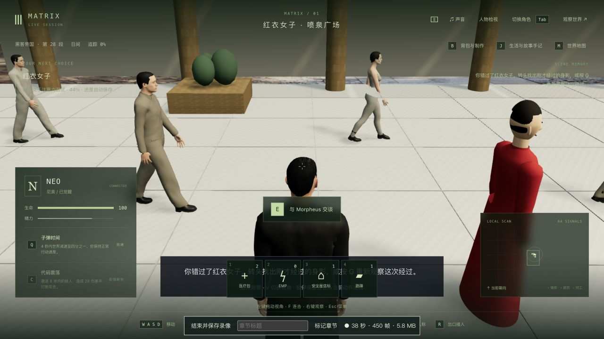
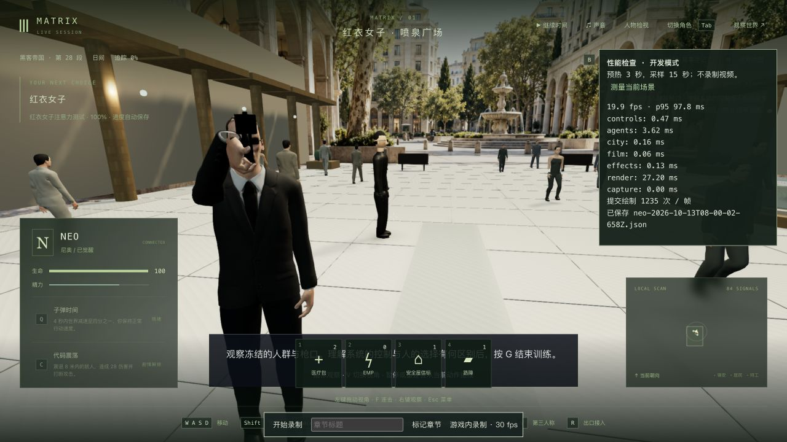
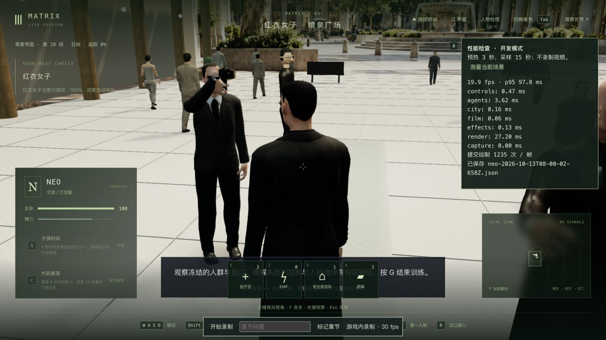

# 红衣女子：玩家注意力、回头与冻结

2026-10-13，第一部 1-08 的局部制作。三部曲仍为 42 组、126 个节点、367 个步骤、70 个场景定义；这些数量不是高质量完成数。

## 本轮行为

Neo 与 Morpheus 实际向前走，女子迎面经过。玩家必须用自己的镜头观察她，再回头发现取代她的 Smith，才触发冻结。看错方向、低头或只等待都不能完成；漏看可按 G 重放这一段经过。冻结后的说明结束仍等待玩家按 G 确认。观察时长、视线范围和重试是游戏设计，参考的是电影事件顺序，非逐帧复制。

两种视角均保留鼠标观察，第三人称靠近 Morpheus 时抬高镜头；第一人称使用实际头部眼位并保留自己的身体。女子自身被特工替换，另一位路人保持原身份；Morpheus 死亡/不可用或被另一玩家占用时不推进。所有行人、水柱和主要人物使用保存的程序时钟，冻结和重连不让动作继续漂移。

20 名背景行人改用项目已有的轻量蒙皮男女模型、真实骨骼步态与四种服色，无新运行时依赖或下载资产。修正误带 Neo 长风衣下摆、女性上衣腰部空隙、穿过长椅/喷泉边缘的路线，以及 Smith 举着空手、冻结后仍继续旧计时动作的问题。去掉训练中的普通 E 闲聊提示，并移远/减弱过近的特工补光。

参考[公开的广场训练片段](https://clip.cafe/the-matrix-1999/the-matrix-a-system-neo/)中的同行讲述、女子经过、回头发现持枪特工与叫停程序。中文说明为概述；关于系统控制与个人选择的区分是游戏的哲学表达。没有下载或声称完整观看三部电影。

## 实机与读档

从上一轮真实红衣女子入口完整八文件副本开始，tick 8382；实际移动到训练位置后为 tick 8837。原生操作先漏看、G 重试、看到女子、拖动鼠标回头发现特工，再暂停于冻结说明结束，tick 9064，misses=1、clock=49.058、elapsed=12，尚未按 G 确认结束。没有改存档中的坐标、时钟或完成项来通过这条流程。

冻结档真正停止并重启生产服务，六组公开状态（人物、沙盒、事件、阶段、位置、区块）、游戏时间和七份记忆保持；严格 simulation 比较仅 `llmStatus` 由 degraded 变为 ready，见 [重启结果](frozen-restart-check.json)。原生冷接入再检查自由转头和 V 切换，释放角色后六组、时间、simulation 和七份记忆均保持，见 [冷读结果](frozen-native-check.json)。

随后正常恢复时间、G 确认和 G 继续，进入 `m1_sentinels` 第 0 步并暂停/释放于 tick 9134；停机仍为 ready、elapsed=0，未启动下一段。只新增 `m1_red_dress` 完成，旧完成、选择、反思和哲学分数保持，见 [交接结果](completion-check.json)。完整八文件副本真正停服保存后重启，六组、时间和七份记忆保持，仅模型服务提示再次 degraded→ready；原生冷加载、双视角接管/释放后所有上述字段一致，见 [完成档重启](completed-restart-check.json) 和 [冷读结果](completed-native-check.json)。正式 data 与上一轮目录共 224 个保护文件未改，见 [保护检查](protected-check.json)。

117 秒原生录像 `neo-2026-10-13T07-26-00-905Z.webm` 覆盖漏看、重试、回头和冻结，位于相邻 `neo-longplay-2026-09-20/` 目录。它含等待和修正前的高面数行人、腰部缺口及空手姿势，属于诊断录像，不能当成最终画质演示；录制渲染均值 15.51 FPS，包含录像开销。

## 验证边界

新增专项先失败记录覆盖视线误判、行人多余衣摆、腰部缺口、冻结姿势、穿椅路线、遮挡提示及人群面数预算。相关扩大检查为 **449/454**：一个公园 4:3 镜头失败、两个旧救援/枕头对象查找失败、两个 Neo/Morpheus 旧模型面数预算失败。五项均在 HEAD 源码基线复现，详见 `park-baseline.log` 和 `assets-head-baseline.log`，不能报告全套全绿。之后界面独立 20/20；最后轻量资产版本的红衣专项 **10/10**，见 [测试输出](attention-lod-final.log)，客户端类型/构建通过，见 [构建输出](client-lod-final.log)。三包类型/构建曾在轻量资产切换前通过，较广 454 项未在切换后重跑，本轮没有全库全绿结论。

高面数行人的同场第三人称无录制测量为 **18.31 FPS / p95 76.2 ms**，每帧约 1235 次绘制，阴影约 446 万三角形。实际性能报告促使本轮复用轻量人群资产：同暂停档/镜头、1280×720 / DPR 1.5、预热 3 秒后采样 15 秒，变为 **19.87 FPS / p95 97.8 ms**，总三角形约 754 万→376 万（含各渲染过程），绘制次数仍为 1235。均值小幅改善但慢帧反而变差，性能未通过，不能称为流畅；原始 [修改前](performance-before.json) / [修改后](performance-after.json) 均保留。没有用录制帧率代替无录制性能验收。

仍缺：红衣女子专属服装/头部、Mouse 与普通路人的正确场面配置、演员级相似度与自然同行/回头表演、实际电影广场的完整三维建筑/雕塑/材质、配音/口型、任意接触与整组连续人工通关。现有远景仍含平面背景，测试只覆盖有限姿势和通道；这一段及三部曲均不标记高质量完成。
