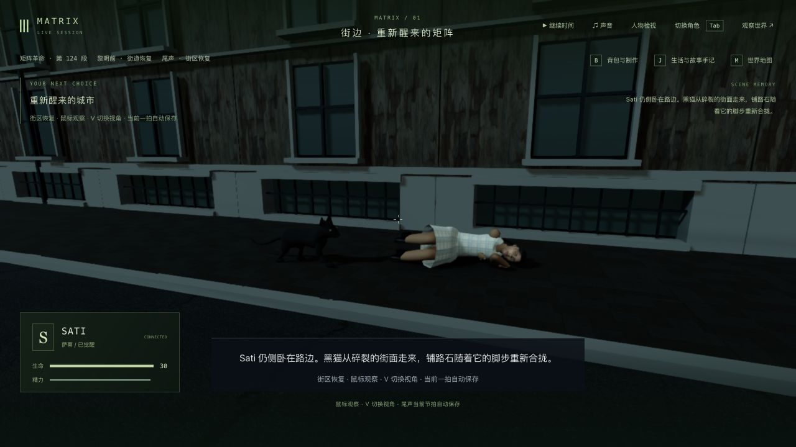
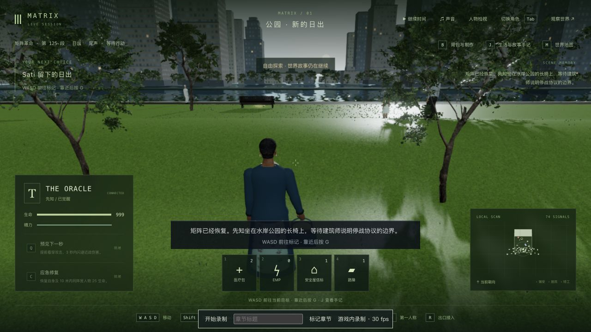

# 3-12：Sati 街边醒来与黑猫步态

2026-10-11，基于 `c0285b1`。黑猫改用连续截面构成躯干和头部，调整耳朵、眼睛、口鼻及低垂的渐细尾巴；四肢按保存的行进距离交错落脚，支撑期脚掌固定在地面。修复原有身体前移、脚掌仍跟着滑动的问题。没有修改剧情时序、存档字段、人物资产或依赖。

本轮查看了 [CutsceneChronicles 上传的第三部尾声片段](https://www.youtube.com/watch?v=HXV4mom9CGo)中黑猫经过、Sati 侧卧和撑起上身的短片段，参考低垂尾巴及行走轮廓；该上传者非官方。没有逐镜核对整部电影，也没有据此声称模型已经达到电影精度。参考帧仅留在本地，没有纳入提交。

修改前同一暂停时刻见 [旧画面](before-cat.png)；另检查了 [第一人称](final-cat-first.png)、[窄窗口](final-cat-narrow.png)、[撑起上身](waking-third.png)及[起身完成](standing-third.png)。黑猫与人物仍为简化游戏模型，自然身体动作、服装与场景质感继续制作。

## 验证

- 修改前尾声与角色基线 **33/33**。新脚掌测试先失败：1.3 秒时支撑脚在相邻 0.02 秒内滑动约 0.0122 米，见 `foot-slip-red.log`；修复后通过。
- 最终相关回归 **266/266**，覆盖尾声、演员、镜头、同步和玩家界面。新测试在真实场景偏移下采样 163 个姿态，检查脚掌接地、至少两足支撑、暂停/冷读姿态一致以及资源释放。属于有限采样，不表示所有连续帧或人物接触均已验收。
- 中间测试曾用严格浮点矩阵相等比较，产生约 1e-16 的舍入误差；改用 1e-7 容差后通过。这是测试精度修正，不作为产品缺陷修复。
- 客户端类型检查与生产构建通过，JS 3,421.80 kB / gzip 1,039.23 kB，已有大包警告保留。本轮没有重跑全库或新增无录制性能对照。录像中的帧率受录制和场景停留影响，不能当作稳定性能验收。
- 原生界面检查了 1280×720 与 650×1000、第三/第一人称、第一人称转头；最终浏览器没有 warning/error。

## 实际路线与保存

完整复制上一轮 `trilogy-neo-carrier-2026-10-11/verified-state` 的世界与 15 份记忆，在独立 3158 / 5358 服务里通过原生界面继续游戏。观察脚本只读取当前阶段并发送暂停，不跳步或编辑剧情。

| 检查点 | 实际状态 |
| --- | --- |
| 起点 | Sati / `m3_reset` / 第 0 步 ready / tick 13688 |
| 黑猫经过 | cat / 4.519 秒 / tick 13697；真实停止并重启服务 |
| Sati 撑起上身 | waking / 3.423 秒 / total 12.223 / tick 13712；真实停止并重启服务 |
| 起身完成 | done / 第 1 步 / total 16.025 / tick 13719 |
| 最终交接 | The Oracle / `m3_dawn` / 第 0 步 ready / tick 13719；暂停、无角色占用 |

黑猫同一暂停档的原生接管、退出及视角检查保持六组公开状态、时间和 15 份记忆一致。两次真实服务重启均保持人物、地图、剧情、时间和记忆；严格公开比较为 **5/6**，唯一变化为外部模型服务 `llmStatus: degraded → ready`，见 `cat-restart-comparison.json`、`waking-restart-comparison.json`。两次重新加载后均看见黑猫。

此前 2026-10-05 记录过一次重连后黑猫暂时缺失，原因尚未明确。本轮在释放角色后重启、重新进入的流程没有复现，不能表述为该历史问题已修复。

交接保留此前 50 段完成记录、45 个选择、18 个反思、71 条旧手记、Neo 背包、10 个既有死者及 15 份记忆，只新增 `m3_reset` 完成及一条手记。手记是最新在前，所以原先按前缀比较得到 false，按旧内容作为后缀比较一致；两项结果均保留在 `continuity.json`。

Neo 仍 disconnected、生命 0，位置/朝向不变；当前既有交接逻辑将其已完成动作的 `startedAt` 从 13657 改到 13719，整份动作对象不相等，没有把正常推进说成所有字段都相同。

本轮停在入口，没有人工继续公园落座、建筑师谈话、日出、最终确认或新循环。公园草地的大面积高光、场景与人物的粗糙表现仍清楚可见，尚未检查原因或修复。

用户主试玩 3155 / 5355 保持暂停在 tick 10432，六组状态和时间未变，211 项保护文件全部一致。验收服务和临时窗口已关闭。完整最新 16 份存档保留在本地 `verified-state/`，没有提交世界或记忆原文。

## 本地录像

- `cat-to-waking.webm`：24.442 秒，包含剩余黑猫行走与撑起上身，其余时间为检查停留。
- `waking-to-standing.webm`：31.638 秒，包含剩余起身，其余时间为检查停留。
- `walk-and-rise-preview.mp4`：前两段分别取前 10 秒和 5 秒拼接，H.264 / AAC，1280×720、30 fps，解码检查通过。两段录制之间进行过服务重启，属于局部试玩剪辑，不是连续通关录像；30 fps 是导出规格，不代表游戏渲染性能。

视频及原始存档仅保留在项目本地；提交中包含录像元数据、验收截图及测试结果。完整连续人工游玩、电影级场景与人物、自然表演、声音细节及稳定帧率仍未完成，3-12 和三部曲不标记为高质量完成。
