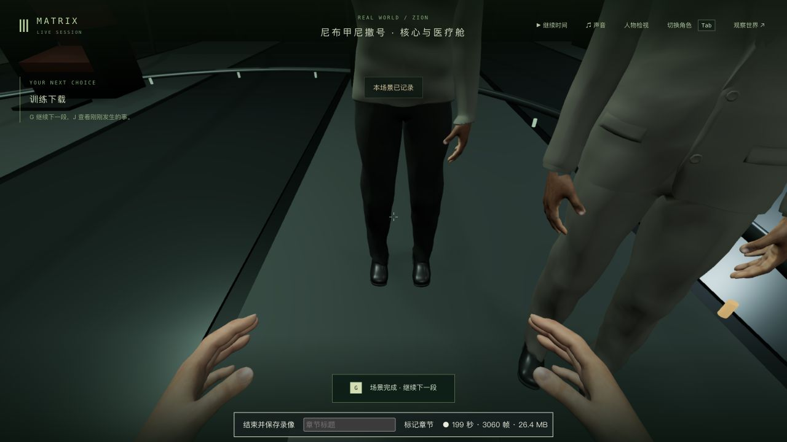
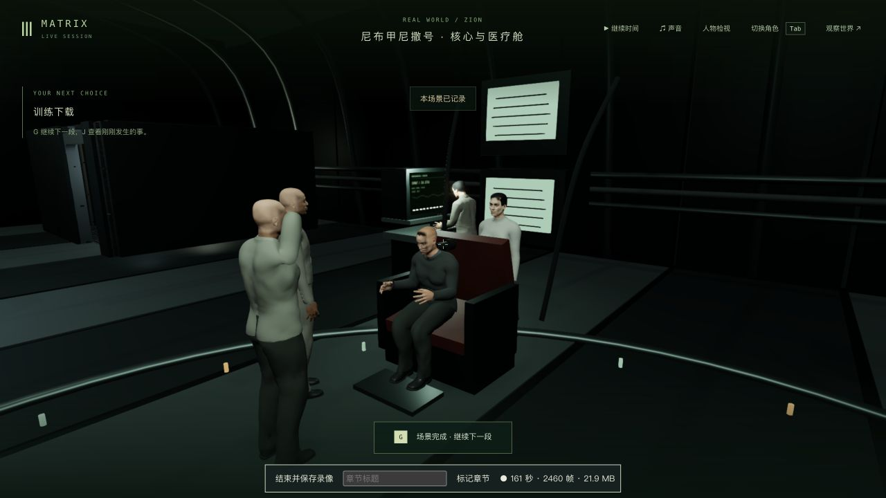

# 训练入口、接线与上传

2026-10-13，第一部训练下载的局部制作。接管/释放/暂停现在以零时间恢复床上、起身、接线与上传姿势；行走仍保留玩家位置，死亡玩家不被这项恢复复活。训练身体按保存时钟重建，Tank 返回操作台有与路径一致的步态；Neo 在第一人称保留实际双手和衣物，使用模型眼位，V/离场恢复原来的皮肤/材质。修正上传时按站立脚底贴地导致裤子陷入坐垫约 0.15 单位，扩展真实身体/衣物对椅子、脚踏和甲板的检查。

核对[原片训练完成短片](https://clip.cafe/the-matrix-1999/i-know-kung-fu-s1/t/1)的 Neo 椅上近景与约 4.5 秒 Morpheus 托腮画面；只查看这个约六秒片段中的画面，未下载或声称看完原片。Morpheus 现在等待在核心区，上传后段沿保存路径走到 Neo 面前，托腮并邀请到道场；加入浅灰针织颜色，使用已有模型与骨骼，没有新增模型/贴图/依赖。占用的导师不被移动，死亡的导师不会为演出复活，上传保留并明确提示无法继续。首次掌心代理虽然接近颌部，实际手指仍穿脸；扩大为真实手部表面对真实头部三角面的检查后，调整了握持位置。最终在 9.7/10 秒各检查约一千余个投影样点，穿入小于 .025、实际最近接触小于 .045 单位。不是整只手在所有帧/任意模型下无穿模的证明。

实录暴露起身到自由行走的朝向问题：演出结束后的旧输入/丢失快照会使控制朝向偏离保存的起身方向。补最终方向的恢复，第一人称保留观察偏移，并在服务端交接帧清除旧运动；先失败回归及真实过渡日志保留。回归中曾把松开 W 后的零输入用作移动方向，及错误地要求第三人称固定演出镜头保留鼠标偏移，修正夹具后重新验证旧实现失败。真实日志进一步确认过渡角度正确；实机直线去门仍会碰床并沿床侧滑动，镜头会随滑动方向转动，必须沿床侧通道绕行。没有为通过验收删除床碰撞或传送玩家。临时控制日志已从代码移除。

相关基线剧情/渲染 7/7、接触/相机 5/5。接管姿势、第一人称身体/眼位、动作历史、导师缺席和朝向均保留先失败记录。最终剧情/动作 35/35、画面/接触 9/9，共 44 个不同测试，三包类型和生产构建通过，未跑本轮全库。实际皮肤检查发现坐垫及托腮两处穿入，修复后复验；没有新无录制性能基准，录制帧率含额外负载，不能据此报告稳定性能。

全部实机使用端口 3174/5374 的完整独立入口副本，来自上一轮 tick 6384/m1_download 第 0 步。较早绕床错误与朝向诊断副本保留；最终实际普通输入完成起身、绕床/穿门、沿通道行走、明确落座、Tank 接线/回操作台、明确上传、导师邀请，正常继续到 m1_dojo 第 0 步/tick 7177。只新增 m1_download 完成，哲学分数保持，对练未启动，见 progression-summary.json。约 200 秒实录从舱门附近开始，包含核心区行走、连接、上传、暂停双视角；约 27 秒实录覆盖正常衔接道场。均原生保存于 ../neo-longplay-2026-09-20/，不是无暂停的全程录像。另有 128/94 秒失败或诊断实录；一次 HMR 中断录像只留下 webm、未得到元数据，不能当作正常结束的录像。完整副本及原始录像只留本地。

完成档用编译后的生产服务端真正重启，六组公开状态、tick/时间及七份重启前记忆严格保持；原生冷接管/释放后也 6/6，见 completed-cold-comparison.json 和 cold-native-reviewed-comparison.json。自然推进期间 NPC 记忆变化与冷读比较分开。正式 data 和此前 3467 个保护文件未改；临时页面和端口已关闭，用户原有试玩页未动。用于后续的完整副本为 completed-state/cold-runtime-state。

人物仍是已有通用模型，Tank/Dozer/Trinity 的相貌和衣物、Morpheus 的精确针织剪裁/自然表情、Neo 的椅上后仰与头托、飞船/操作台/连接椅细节、正式对白/声音、稳定性能与完整连续电影还原仍缺。道场入口仍显示长外套，尚未更换原片训练服，也未开始本轮道场制作。**本轮是训练下载的局部功能、演出和验收，整个训练组、42 组和三部曲保持未完成。**
