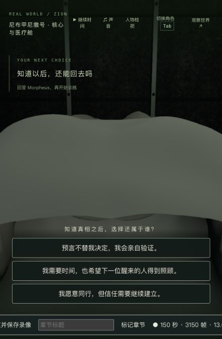
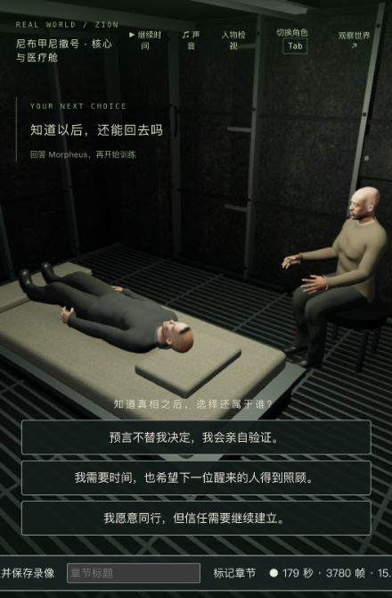

# 真相余波：第一人称身体与眼位

2026-10-13，继续第一部 1-07。退出构造体、船上拔接头和床边对话沿用原有剧情，本轮修正 Neo 第一人称身体被整体隐藏、眼位使用估计高度，以及床上视线过度朝上的问题。保留实际手臂与衣物，去掉自己的头脸/头发；眼位使用已有模型标记，V/离场恢复原皮肤和材质。床上可转头、低头看身体。没有新增模型、贴图或依赖。

演出改为用保存的 truth 时钟重建动作，不继承跑步、落地、受击或技能的残留姿势；离椅行走仍使用已有的保存路径。相关基线剧情 3/3、画面/接触 4/4；四个回归先失败。最终身体/眼位/接触/姿势 10/10、动作/剧情 23/23（有一项重叠，共 32 个不同测试）、三包类型和客户端生产构建通过，未跑本轮全库。中间一次自由观察用例因循环累计鼠标俯仰触及上限而失败，补回原视线并另验床上低头；原日志保留本地。有限真实蒙皮/椅子/甲板/床接触检查通过，不是任意帧无穿模证明。原生拔接头后段（12.883 秒）第一人称仍主要看到近处甲板，手掌/船员不在当前窄画面中；该取景尚不理想，原图 final-unplug-first.png 保留，不算完整第一人称演出验收。

研究副本完整复制上轮 ready/tick 6262 入口，共八文件。端口 3173/5373，原生 Neo/G 正常走过退出、拔接头、失衡、休息；正常继续世界时间后选择 agency，至训练下载第 0 步/tick 6384，未起身或开始训练。只新增 m1_truth_exit、m1_truth_return 两个完成节点和本次回答，agency +1。第一次在暂停中点击回答被现有服务器暂停规则拒绝，未计分；不是跳过剧情。详见 progression-summary.json。

真实重启的六组公开状态为 **5/6**：Neo 的临时动作从正常释放后的 null 重建为训练入口 greeting；其余人物字段、另外五组、保存 tick/时间和重启前七份记忆严格保持。没有隐藏或归一化这项差异；释放与启动演出动作的一致性仍需统一。自然推进期间七份 NPC 记忆随日常模拟变化，这与冷启动的记忆比较分开记录，见 completed-cold-comparison.json 和 completed-cold-differences.json。原生冷接管仍进入训练入口，正常释放后六组/时间全部恢复一致，见 completed-cold-reviewed-comparison.json；冷接管会再次清掉 Neo 的临时训练演出动作，人物回到普通床边姿态，这个后续训练节点的问题保留。不能用后续 6/6 覆盖初始冷启动 5/6。完整存档/记忆只留本地。

正式 data 和此前 3394 个保护文件未改，见 protected-comparison.json。原始入口保持，完成副本保存在 completed-state/final-runtime-state。最终局部实录约 194 秒（含拔接头后段和较长暂停）及 10 秒（正式回答至训练入口），原生保存于 ../neo-longplay-2026-09-20/；相关 metadata 留在本目录。另有 300 秒修改前录像，含长等待。录制帧率含额外负载，均不是连续通关或无录制性能基准。

本轮实际观看的公开原片素材只核到 Morpheus 讲解/近景，未核实完整失衡/昏倒片段和全部参与人员，因此不能据此宣称这段动作或人员已高质量还原原片。身体/服装仍是现有模型，船上材质、自然干呕/倒下、人物/表情/声音、视角与界面、稳定性能和完整连续验收仍需制作。**1-07、42 组和三部曲均未达到完整高质量验收。**

临时测试页面及端口已关闭，用户原有试玩页面未动。本轮没有宣布整段电影还原完成。
