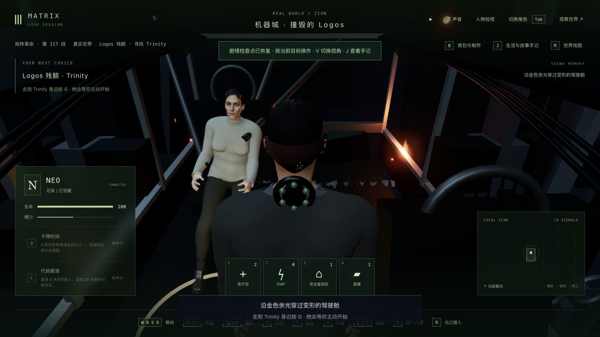
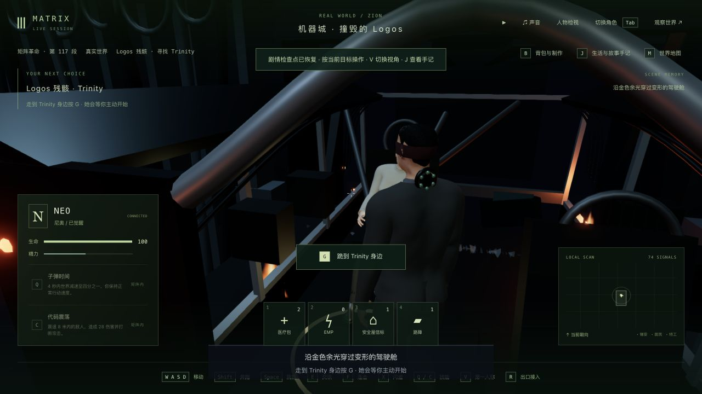
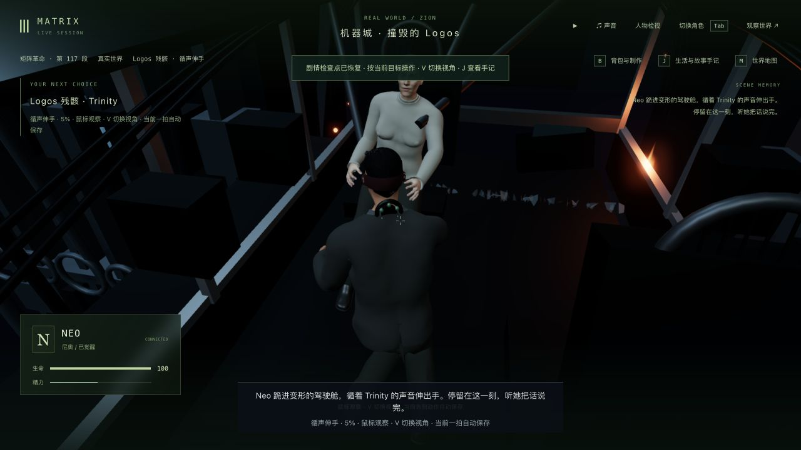

# Logos 残骸通行与告别距离（2026-10-11）

修复上一轮目标点检查发现的 3-09 入口碰撞，并继续检查实际人物与家具。三部曲关键框架已连接；这次是局部通行/交互修复，不能据此提升 3-09 或全部 42 组为高质量完成。

## 修改与复现

- 旧第 0 步局部目标 `(0, -10.5)` 落入后舱壁的玩家碰撞范围，旧几何测试仅用 0.38 半径，漏掉运行时实际 1.1 半径。目标移到门内 `(1.35, -11.8)`；用生产 `stepPlayer` 从入口正常走到两个目标，保留现有舱壁和全局玩家尺寸。
- 默认 4 米完成距离让任务在穿门前推进，也允许远处启动告别。首步改为 0.45 米，接近 Trinity 为 1.6 米；HUD 使用同一个动作可用条件，远处/另一世界/步行目标不再亮 G 按钮。
- 实际 GLB 关节段检测又复现右腿穿过翻倒副驾座椅。将座垫/靠背宽度从 2.25 对齐飞行舱已有的 1.35/1.23；Trinity 支撑椅和其他场景资产未改。

几何检查仅覆盖路线上 42 个站立采样点的身体关节连线，不能证明全部蒙皮、服装、奔跑/跳跃或任意帧都不穿模。本轮没有新增美术素材、依赖或重新观看电影；座椅尺寸依据本项目已有驾驶舱，原片参考边界沿用[上一轮残骸记录](../trilogy-logos-wreck-cabin-2026-10-11/README.md)。

## 真实存档与实机

隔离后端 3158 / 前端 5358，来源是 `trilogy-logos-impact-2026-10-11/verified-state` 全部 16 文件的副本。从真实旧远入口开始，没有编辑人物坐标、剧情字段或使用跳段命令；普通 Socket.IO 玩家输入用于步行和继续演出，原生界面用于接管、G、V、反思和交接。这不是全程人工通关。

1. 普通移动经新目标穿门，停在第 1 步；原生接管核对远处没有 G 按钮，远处按 G 仍停在 ready。继续步行进入 1.6 米范围后，按钮出现。
2. 原生继续世界时间并 G 开始，公开快照观察器只发送 pause，停在 reaching 1.004 秒 / tick 12705。完整存档后真正停止、重启后端，`reaching-comparison.json` 六组状态、时间与 15 份记忆严格一致。
3. 冷读后原生接管，切换两种视角，再退出；`native-comparison.json` 比较范围同样一致。普通零输入推进到 still / tick 12740 / total 18.561 秒。
4. 原生 J 记录 care 反思并选择“转入锡安的最后防线”，正常接到 Lock / `m3_temple_breach` 第 0 步 / tick 12816，暂停并释放角色，没有开始部署。`verified-state` 保留完整 16 文件。
5. `protection-and-progress.json`：主试玩全部已比较状态、156 个保护文件保持；包括先前暴雨主验证进度，其 ready / tick 13359 未被本次回归副本替代。旧 43 段、38 个选择、14 个反思、60 条手记与 8 名死者保留；只新增告别完成、care 与两条对应手记，Trinity 死亡。死亡/结算只发生一次由相关行为测试验证。

画面仍有程序化人物、过于平滑的现实衣物、僵硬表情、离世后未自然闭眼等问题；金色主观感知、连续事故转换、原片精确船舱/声音和自然动作仍未完成。没有进行稳定帧率或前序飞行至机器谈判的完整人工长玩验收。

## 检查记录

- `baseline.log`：改动前相关 14/14。
- `regression-before.log` 0/2：先复现真实碰撞半径与提前推进；`regression-after.log` 4/4。
- `body-clearance-before.log` 0/1：实际右腿穿座椅；修正后 `body-and-story-after.log` 13/13。
- `hud-before.log` 0/1：实机发现的提前显示按钮；`hud-after.log` 1/1。
- `related.log` 59/60 的失败来自旧告别测试把首目标当成可跪下位置；测试改为先断言远处拒绝，再走到第二目标检查另一玩家占用，没有放宽生产判定。
- 最终 `related-final.log` 78/78，包含现有告别、镜头、衣物/支撑、几何、剧情和界面测试；`full-route.log` 2/2，所有场景目标可达与完整电影自动流程通过。自动路线使用测试夹具，不是全部画面通过。
- `typecheck.log` 三包类型检查、`build.log` 共享/服务器/客户端生产构建全部通过。保留约 3.40 MB 主包和大 chunk 警告；未跑最终全库或稳定性能验收。

本次浏览器最终文档 warn/error 记录为空，不代表所有历史连接阶段都没有日志。主试玩服务保持运行；临时服务在提交前关闭。
