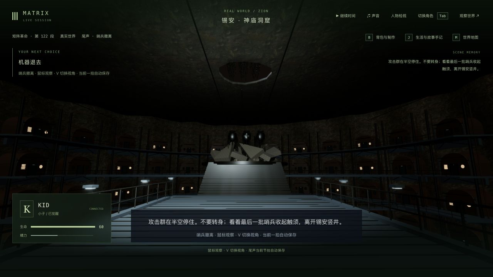
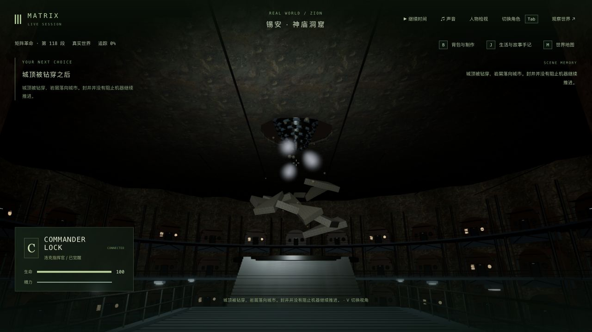
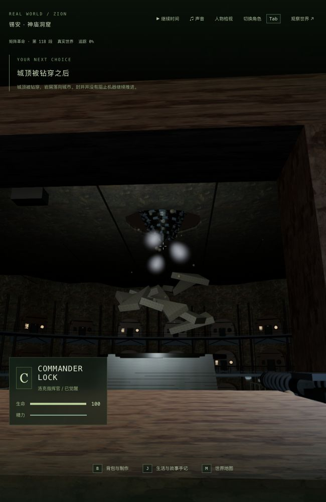

# 3-07 / 3-12：锡安入口外的居住竖井

2026-10-11，基于 `3e90418`。本轮制作神庙入口外、破顶与撤军共用的城市外景，没有新增剧情节点。三部曲继续制作，不将这一版城体计为电影级完成。

## 改动与参照

- 用七层、91 个住宅模块替换九根带圆环的实心柱。增加拱顶住宅、门框、舷窗、百叶窗、雨棚、灯具、外露管线、支撑梁和连续阳台；居住层向入口以下延伸。
- 保留入口柱、门梁、现有可走边界与机器通道，增加桥面拼板、下方管线和通往中心服务平台的阶梯。侧面实体探照灯取代原城体上方点光源，仍保留总共三盏局部灯。它们是边界以外的场景布置，本轮没有开放这些住宅内部或外部城市的步行探索。
- 平板屋顶改为有厚度和起伏的岩层，继续保留原来的十二边形破口、掉落碎片与钻机时序。中央平台顶面继续承接破顶残骸；没有为了让镜头穿过而隐藏屋顶。
- 增加 [Poly Haven 的 Rock Wall 02](https://polyhaven.com/a/rock_wall_02)，作者 Rob Tuytel，CC0。三个原始 1K JPG 合计 757,539 字节，分别用于颜色、OpenGL 法线和粗糙度；下载文件大小与官方 API 的 MD5 均一致。来源记录在 `packages/client/public/assets/film-materials/sources.json`。没有新增运行库。
- [Michael Turner 的官方访谈存档](https://www.matrixfans.net/interview-with-michael-turner-assistant-art-director-australia-from-the-matrix-reloaded-and-revolutions-2003/)描述了重复住宅、栏杆、工业构件、锈迹和过量服务管线，以及神庙入口在第三部改为最后防线。[转载的 Jim Martin 住宅概念图](https://filmsketchr.blogspot.com/2021/09/moody-matrix-reloaded-2003-zion-concept.html)用于核对圆拱单元与管线关系。概念图不是电影实拍帧，也没有作为运行时贴图导入。

本次实际查看的 Niobe 停战短片主要是人物和舰内镜头，不足以验证完整城市布局。另一个原片居住层图片地址遇到站点验证，未绕过；没有据此声称已逐镜核对全景。环形布局、七层数量、局部尺度和灯位属于本游戏的近似重建。

## 检查与真实失败

- 修改前相关基线 34/34。
- 第一版相关检查 33/34：新增外景超过旧测试的 100 米横向界限。只将神庙外景的检查范围改为 120 米，其余五个场景保持原限制；实际城体横向约 −104.93 至 105.19 米。
- 第二版相关检查 19/20：新检查在中间住宅的阳台拼接处发现细缝。将分段矩形板改为连续挤出网格后 2/2 通过，没有扩大射线容差掩盖缺口。
- 新增照明灯具后一次回归 **83/84**：灯罩挡住了旧存档站位向破口看的视线。将灯和灯罩一起移到门梁侧面，原失败用例 1/1，再跑最终相关回归 **84/84**。没有删除灯具、隐藏实体或降低视线检查要求。失败保留在 `final-flood-regressions.log`，最终结果见 `final-clearance-regressions.log`。
- 最终回归覆盖城体、阳台支撑、封闭屋顶、破顶、撤军路径及双画幅镜头、人物接触、尾声流程、服务端同步、界面和资源释放。没有另跑最终全库或新增整部电影人工通关。
- 三包类型检查和三包构建在增加灯具前通过；最后灯位修正后重新执行客户端类型检查和构建通过。未改服务器或共享包代码。最终客户端 JS 3,410.66 kB / gzip 1,035.96 kB，既有大包警告保留。
- 城体合批后 10 次绘制、118,404 个三角形；旧城体为 3 次、34,964 个。新增细杆截面由 16 面降为 8 面。资源释放、确定性重建、住宅入口支撑及机器通道有回归检查；有限采样不证明任意帧均无穿模。

## 真实存档与画面

使用独立服务 3158 / 5358，复制之前真实游玩保存的完整世界和记忆；没有重置或改写用户主试玩存档。撤军存档停在 2.560 秒 / tick 13559，真实重启前后六组公开状态、世界时间和 15 份记忆完全相同，见 `restart-comparison.json`。

最终灯位修正后，撤军横屏与 650×1000 双视角接管/退出、性能测量结束，再和最初重启前比较，六组状态、世界时间及 15 份记忆仍保持，见 `final-native-comparison.json`。用户主试玩 3155 / 5355 保持暂停 / tick 10432，六组状态和时间一致；337 项保护文件全部未改，其中包括主档、此前真实剧情来源和最新 Neo 入口档。检查用 3158 / 5358 / 5359 已结束，未停止主试玩服务。两段最终原生控制台没有警告或错误。

撤军第一人称的实际城市外景：

另从实际旧破顶检查点重看 2.854 秒 / tick 13015。旧版本到本版本冷读为 5/6：只有 `film_smith_avenue` 的 z 边界因之前已经提交的雨战地图扩展而不同（5941/6091 → 5921/6111）；游戏人物、剧情、时间和 15 份记忆均保持。保留 `breach-cold-comparison.json` 与 `breach-location-difference.json`，不把跨版本边界变化报成完全一致。同版本原生接管、横屏/650×1000 双视角后退出，再比较六组状态、时间及记忆全部相同，见 `breach-native-comparison.json`。

破顶宽画幅与第一人称窄画幅实际截图：

## 性能：新增细节的代价尚未解决

同一台 Apple M3、1280×720 / pixelRatio 1.5、同一份 2.560 秒暂停撤军档、同一第一人称机位，预热 3 秒后采样 15 秒，没有录制视频。后两次依次打开单个浏览器测试页，测量时相关测试与构建均已结束。旧版对照由独立 5359 前端引用本轮修改前的渲染器，其他客户端代码和后端存档相同，没有回退工作区文件。

| 版本 | 平均 FPS | 每帧绘制次数 | 每帧三角形（含阴影/后处理各通道） | 证据 |
| --- | ---: | ---: | ---: | --- |
| 修改前首次采样 | 26.55 | 338 | 1,317,263 | `performance-before-first.json` |
| 修改前结束前复测 | 26.13 | 338 | 1,317,263 | `performance-control-first.json` |
| 最终新城体/侧面探照灯 | 21.44 | 359 | 1,570,847 | `performance-final-first.json` |

最终相对紧邻的旧版复测约慢 17.9%，不能称为性能优化成功。初版额外第四盏灯已去掉、细杆截面也已减少，但仍没有抵消新增建筑、管线和材质的成本。此次保留更具体的城体制作与公开退步记录，稳定流畅度继续列为未完成项；暂停单机位采样也不代替动态游玩或全机型验收。

## 尚未完成

城体仍是参数化近似，洞窟和原片巨型竖井的整体尺度、工业损耗与复杂接合、室内外连续空间尚未还原。哨兵编队仍过于整齐，身体背面偏暗，碎片与居民表演仍粗糙，破顶第一人称可见的炮手仍为简略模型；人物、衣物、触须、自然动作、正式声音、稳定帧率及从终战到日出的连续人工验收继续制作。原有最新剧情存档仍是 Neo / `m3_neo_carried` 第 0 步 ready / tick 13628，本轮没有把重看旧段落冒充新的剧情推进。三部曲是框架接通、专用玩法补齐与画面/动作/验收并行，尚未进入全内容制作完毕后的统一精修阶段。
