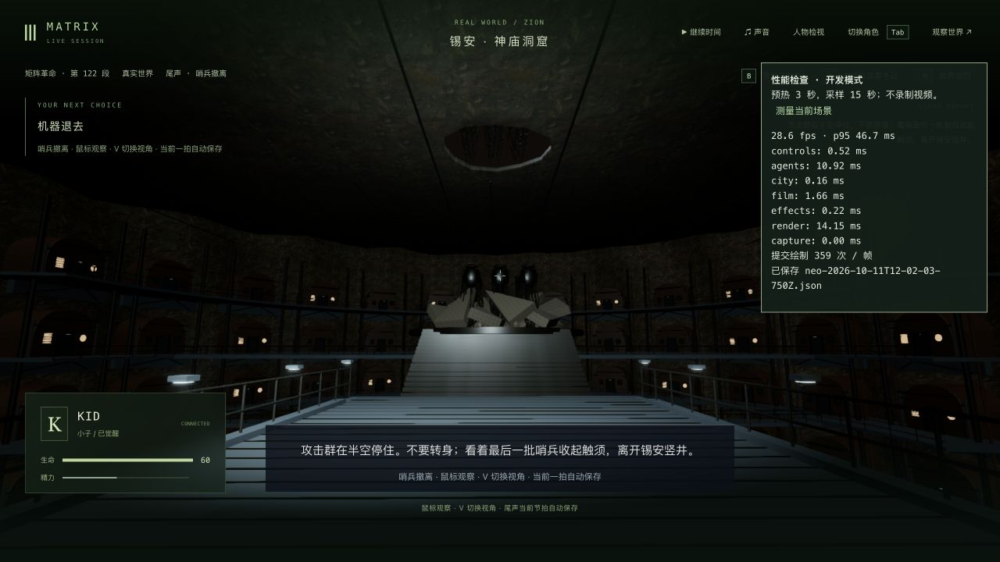
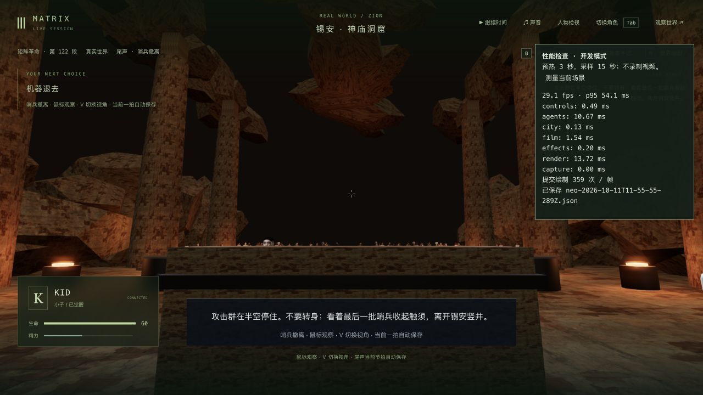
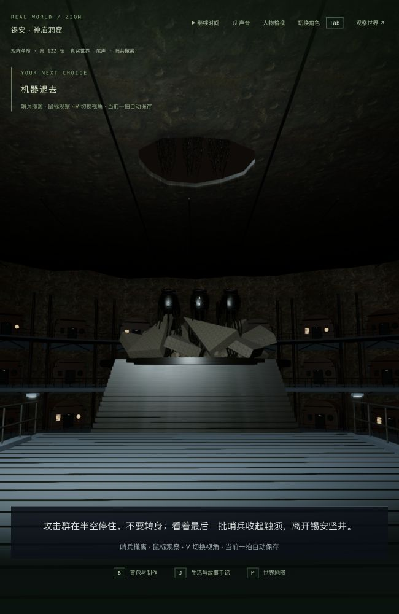

# 3-07 / 3-12：神庙外景照明开销

2026-10-11，基于 `56444e7`。上一轮城体增加细节后发生性能退步；本轮将船坞已有的点光源范围剔除用于神庙，没有减少住宅、管线、岩壁、人物、阴影、材质或分辨率。没有新增剧情节点或依赖。

## 原因与修改

神庙拥有 22 盏点光源，以及城外探照灯。玩家从入口向城外看时，19 盏内场灯的整个照明球都在视锥外，却仍进入每个像素的光照循环。原有剔除仅在 `film_zion_hangar` 生效；现在也用于 `film_zion_temple`。

每帧先恢复上帧略过的灯，再检查完整照明范围。灯泡在身后但能照到桥面的两盏入口灯、覆盖城体的大范围补光和外部探照灯仍保留；转回大厅恢复室内灯。发光灯具自身始终存在，灯光强度没有变化。可见性依赖当前镜头，不写进剧情存档。

## 实测

Apple M3，1280×720，pixelRatio 1.5；同一份真实撤军检查点，第一人称，2.560 秒 / tick 13559，世界暂停。每次预热 3 秒、采样 15 秒，没有视频录制；测试和构建均结束后才采样。

| 版本 | 平均 FPS | 帧时间 p95 | 每帧绘制次数 | 每帧三角形（各渲染通道合计） | 报告 |
| --- | ---: | ---: | ---: | ---: | --- |
| 修改前的新城体 | 20.32 | 56.7 ms | 359 | 1,570,847 | `performance-before-first.json` |
| 范围剔除后 | 29.05 | 54.1 ms | 359 | 1,570,847 | `performance-after-first.json` |
| 真正重启后复测 | 28.58 | 46.7 ms | 359 | 1,570,847 | `performance-cold-first.json` |

两次优化后均比本轮基线快约四成，同机位也超过上一轮旧柱体对照的 26.13 FPS。但这只是暂停单机位的结果，帧时间仍波动，没有达到稳定 60 FPS，不能推广为整款游戏的性能结果。

## 验证范围

- 修改前相关基线 19/19。
- 先新增真实入口朝向/回转检查，修改前失败为 `22 !== 3`，保留 `lighting-red.log`；接入现有剔除后照明检查 4/4。
- 最终相关回归 85/85：含照明、城体连续支撑、屋顶和机器通道、破顶与撤军双视角、人物接触、资源释放、尾声规则、服务端同步与界面。没有重跑全库或完整电影路线。
- 最终客户端类型检查和生产构建通过。JS 3,410.69 kB / gzip 1,035.96 kB，原有大包警告保留；服务器和共享包代码没有变更。
- 原生界面实际接管、V 切换、鼠标转回大厅、1280×720 与 650×1000 双视角已检查；暖色室内灯能恢复，城外桥面、住宅和撤军出口保持可见。这是有限画面检查，不是逐像素相同或任意姿态无穿模的证明。
- 实际存档的原生退出、真正停止/重启服务、重启后再次接管/退出，六组公开状态、时间及 15 份记忆全部相同。见 `native-comparison.json`、`restart-comparison.json`、`final-native-comparison.json`。没有跳转、改写或推进剧情。
- 用户主试玩 3155 / 5355 保持暂停 / tick 10432，六组状态和时间一致；389 项保护文件全部未改，包括既有城体代码/贴图、主档和最新 Neo 运送入口档。独立测试服务 3158 / 5358 已结束，最终原生控制台没有警告或错误。

实际转回大厅，灯具和受光仍保留：

窄窗口第一人称：

## 剩余制作

人物更新和绘制仍有较高开销，稳定帧率未验收；城体/神庙空间、人物/服装、自然表演与声音依旧需要制作。沿用最新真实剧情 Neo / `m3_neo_carried` 第 0 步 ready / tick 13628，本轮只是重看更早的撤军检查点。终战到日出的完整连续人工通关未在本轮重跑；42 组及三部曲仍未达到最终高质量验收。
