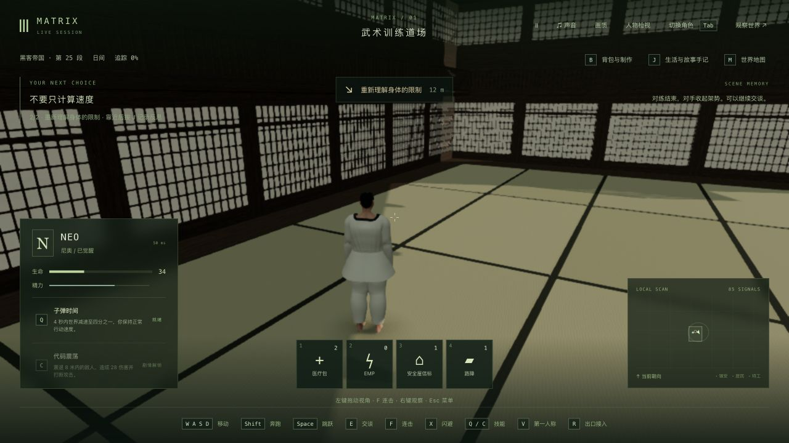
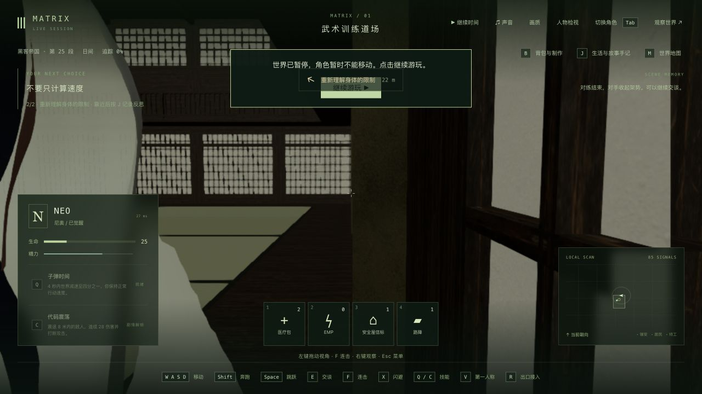
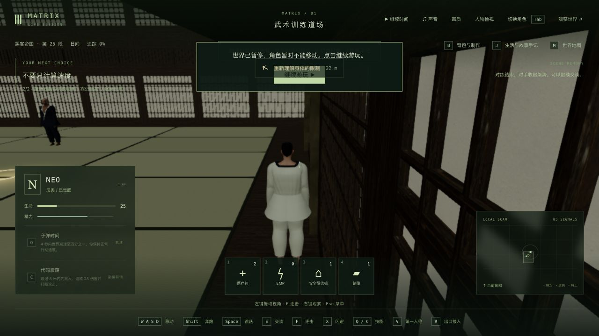

# 封闭双层训练道场与靠墙镜头

2026-10-24。已更新固定本机入口 <http://localhost:5173/>，客户端 `index-CncHqNS0.js`。本单元改善空间和镜头，**不增加 42 组电影质量验收完成数，稳定 60 帧仍未达到**。

## 场景依据与实际改动

参考华纳官方 [I Know Kung Fu — 25th Anniversary](https://www.youtube.com/watch?v=ozS_6vqnJ8w) 的已有抽帧 `output/characters/dojo-tailoring-2026-10-24/reference-dojo-08.png`，没有宣称重新观看整部电影。把原先开放庭院、山景和鸟居改为封闭矩形木厅：四面纸格窗、深色踢脚、上层木廊与栏杆、高窗、平顶横梁、后墙凹间、架台/花瓶/双卷轴和训练兵器架。

保留共享场景的 50×62×17 尺寸和原物理边界；未测量原片实际场地尺寸。24 块编织垫、边条和连续木底板的可见顶面都位于共享落脚面，修正接缝浮点误差和旧垫面高度差。窗纸改为不透明材质，纸面与木格保持深度间隔；静态木构件合批。道场使用固定窗向光和填充光，不再随对练状态或暂停时钟闪动。

实机发现靠墙时肩侧镜头枢轴越界，压缩后的镜头进入胸口。沿用已有旧楼镜头的枢轴收缩/抬高和插值后碰撞检查，并限制二楼底面附近的镜头高度。初次修正仍被真实几何射线抓到木廊底面穿越，补正后通过；保留失败日志。普通运动、第一人称自由观察和战斗规则未改。

## 验证

- 修改前相关场景测试 20/20、镜头测试 207/207。新增房间原版 0/5、镜头原版 0/3；候选新增窗纸/格栅深度、木廊角落重面各先失败 0/1。最终新增房间 7 项、镜头 3 项及相关合计 **241/241** 通过。
- 房间检查包含 10,881 个地面射线、四个高度的全周墙面射线、顶面/物理边界、窗格深度、木廊角落、光源和绘制预算。镜头检查覆盖六个边界站位、四个方向、宽/窄视口、冷加载、V 往返、绕行和 30/60Hz 跳跃插值；它们是有限采样，不能证明任意状态无穿模。
- 客户端 TypeScript 和 Vite 生产构建通过，仍有现有的大包体提示。没有重跑全仓或新增后端逻辑测试。详见 [validation.json](validation.json)、[完整相关结果](combined-final.log)、[生产构建](client-build-camera.log)。
- 原生 X/W/F 对练：先出现格挡、两次窗口超时重试，再正常完成闪避和三连击，结果 hits=4、combo=3、resets=2。此段使用房间完成但尚未修正镜头的 `index-CREXBPnQ.js`；**最终包未重新打一场全新对练**，而是保留成功状态后验证墙边、移动、跳跃和两种视角。见 [实际操作范围](native-verification.json)。
- 最终包实际冷读档 W/D/Space/V 产生 117 个采样，最大位移约 4.33 单位、最高 y≈2.664；宽/窄视口墙边均实查。更早的镜头操作有 747 个成功样本，另有 19 次读取失败发生于主动 QA 后端重启期间，未隐去。
- 真正结束 QA 后端 PID 75179 并启动 18566，tick 10688 前后完整世界相同、7 份记忆相同；重连后正常继续。最终 QA 世界暂停于 tick 10702。见 [重启核对](restart-verification.json)。
- QA 5200/5201 已停止。主服务 PID 43571 未重启，280 份后端产物与全部共享编译产物未改；主世界 tick 3757、暂停状态和 85 份记忆在发布及原生重载后保持。5173 页面确认加载新 JS、连接可用、0 warning/error。11 份既有脱衣实验逐字节保留。见 [本机发布核对](local-update-verification.json)。Render 未接回。

## 性能和资源成本

Apple M3 / 24GB；每次预热 3 秒、测量 15 秒，暂停道场，无录制、无并行构建/测试、未启用 GPU 计时。使用本地开发页的性能采样器；生产包的原生玩法验证另行进行。下表为实际绘制缓冲尺寸，不以 CSS 窗口或画质名称代替。

| 阶段 | 实际绘制尺寸 | 平均 FPS | P95 帧时间 | 每帧绘制数 | 提交三角形数（含多 pass） |
| --- | --- | ---: | ---: | ---: | ---: |
| 原开放庭院 | 约 799×450 | 51.83 | 24.9ms | 1602 | 1,646,081 |
| 木厅初稿 | 约 799×450 | 59.99 | 19.2ms | 193 | 1,057,829 |
| 木厅修正窗格/角落后 | 约 799×450 | 60.00 | 19.2ms | 193 | 1,056,173 |
| 同阶段高分辨率 | 1920×1080 | 33.14 | 41.4ms | 193 | 1,056,173 |
| 最终镜头代码、后续站位 | 1280×720 | 29.23 | 56.2ms | 174 | 1,055,503 |
| 最终镜头代码、相同后续站位 | 1920×1080 | 24.20 | 55.8ms | 174 | 1,055,503 |

前后阶段的角色站位、方向和浏览器会话不同，背景负载未隔离，**不能把 33→24 或 52→60 宣称为同一条件下最终版本的升降，也不能声称已达到稳定 60 帧**。早期低分辨率前后镜头相同，但建筑、材质、灯光和合批一起变化，不是单项优化对照。后续两次样本镜头完全相同；角色更新 CPU 平均约 14–16ms，渲染 CPU 约 8–11ms，不能把 CPU 提交时间当成 GPU 时间。未测实际战斗/行走 FPS，内存压力与硬件最低要求也未完成测量。

[全部六次原始采样压缩包](raw-profiles.json.gz)及[汇总与条件](performance-summary.json)均保留。道场合批后 33 个网格、27,592 个三角形，绘制几何数组约 1.92MB（不含仍保留用于释放的原几何或全游戏 RAM）；编织纹理 256×256 RGBA、约 256KiB，另有 mipmaps。复用已有木材/灰泥贴图，无新模型文件、素材下载或依赖。JS 比前版小 569 字节，CSS/人物资产未变；没有据此推算整体显存占用。

## 仍需制作

双卷轴目前没有书法内容，具体摆件和建筑比例未逐镜标定；上层木廊只作布景、不可步行。柔光与色彩、演员相似度、衣物/手部细节、完整对手接触和连续原片攻防编排仍不足。共享场景说明中的旧“庭院和瓦檐”文字未在本单元修改。以上未完成项不会因测试通过而视作电影质量验收完成。

原始 QA 世界、记忆、采样流水和隔离候选保留在本机本目录，未随证据提交；两份失败日志入库时仅去掉行尾空白，原输出保存在本机 `original-logs/`。冻结构建输入共 1,212 份，实际变更范围见 [源码核对](source-audit.json)。
