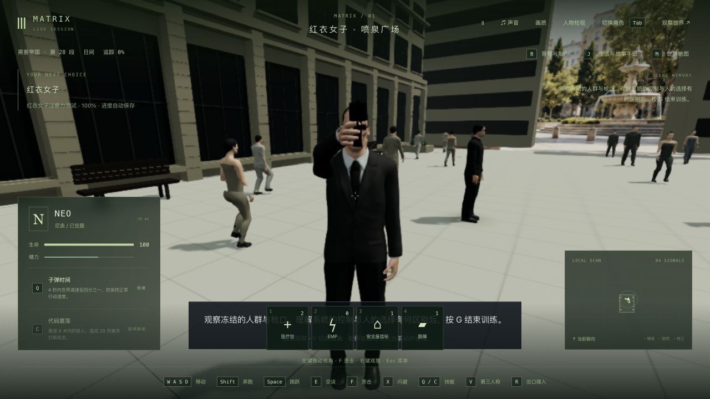
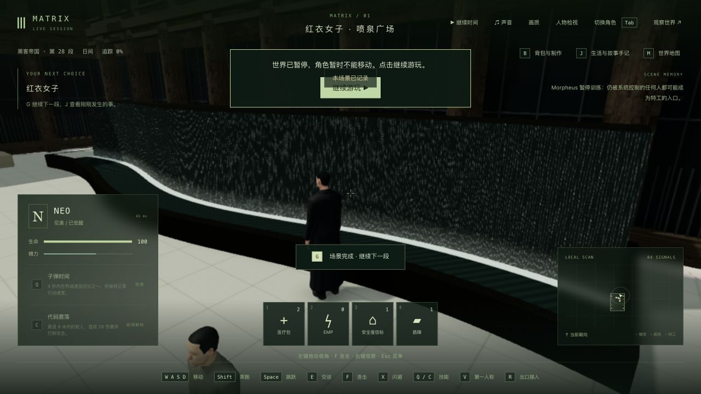

# 红衣女子广场：弧形水幕、物理边界与绘制开销

日期：2026-10-24。基线：`c1bb477cf65a27060982740dbb1d0ba399fac0a8`。

这是一个场景制作单元，不是电影质量验收。42 组完成数仍为 0；三部连续人工通关、演员相似度和稳定 60 FPS 都未完成。Render 不再接入，最新本机入口为 <http://localhost:5173/>。

## 参考与实际修改

- 观看了 [红衣女子片段](https://www.youtube.com/watch?v=YgJ5ZEn67tk) 的约 00:20、00:40 和 00:50：银行石墙、女子背后的宽水幕、低深色池沿与商务人群。该上传不是官方电影发行源，也没有据此声称观看完整三部原片。
- 核对悉尼市档案 [Lloyd Rees Fountain, Martin Place, 1997 / A-01216381](https://archives.cityofsydney.nsw.gov.au/nodes/view/1983377) 及 [俯视照片 / A-01216380](https://archives.cityofsydney.nsw.gov.au/nodes/view/1983376)。水幕沿弧形溢流边落下；此前文档的“矩形水墙”说法不准确。
- 原中央圆形喷水台替换为弧形落水幕、承水池和深色石池沿，位于女子来向后方。近处银行和办公楼采用实体窗洞、柱子、檐口及栏杆；远景沿用已有素材。尺寸为适配现有 62×82 游戏空间的解释，不是实地测绘复原。
- 池沿、溢流实体、凹池底、长椅和花池使用共享坐标；人群活动范围避开新池体。水纹使用保存的训练时钟，程序冻结、暂停及恢复时不会继续流动。
- 固定建筑/家具合批。删除旧的广场补光点灯，保留场景日光，关闭该场景多余的全局太阳；离开后恢复普通世界的太阳阴影。
- 没有新增模型、贴图、音乐或依赖。正式 JS 增加 4,251 字节，CSS 保持。

引用照片和电影截图仅作本地参考，没有加入游戏资产或本次提交。`references.json` 保存来源与观察范围。

## 测试及真实失败

冻结的隔离副本包含 1,237 个输入文件。根目录的 11 份旧楼实验源码/测试，以及根共享包中相应 4 份旧楼编译产物全部保持；没有把这些未完成实验混入发布版。

| 检查 | 结果 |
| --- | --- |
| 修改前训练/人物/表演基线 | 18/18 |
| 新几何检查对旧广场 | 1/5，4 项失败 |
| 第一版几何 | 3/5；长椅射线正好落在板条缝、窗面位于柱后，改用实际可见表面采样后 5/5 |
| 加入池沿/池底网格扫描 | 11/12；发现精确边界上的落脚高度错误，修正边界判定后 12/12 |
| 双太阳行为回归 | 先 0/1；真实场景存在两个阴影太阳，修正后通过 |
| 最终广场/训练/灯光 | 14/14 |
| 人物与相关渲染 | 21/21 |
| 扩大剧情/世界/渲染 | 159/162，3 项失败 |
| 原 HEAD 复现这 3 项 | 同样 0/3，相同断言位置与结果 |
| 部署回归 | 75/75 |
| 三包类型与生产构建 | 通过；保留大 JS 包警告 |

三项已有失败是旧楼重复黑猫、特工接近封门（均 `3 !== 2`），以及全路线测试第 3659 行（`1 !== 2`）。在与 HEAD 一致的 486 份相关源码/配置输入中重新运行对应测试确认，没有通过改阈值或跳过失败声称全部通过。

新网格扫描检查 1,869 个实际渲染支撑点，并覆盖整条人物演出路线和行人通道；广场固定部分为 43 个网格、44,108 个三角形，不包括完整人物和多次渲染通道。

## 帧率测量

浏览器实际使用 Apple M3。三次采样镜头位置、旋转、投影相同；CSS 1280×720、DPR 1.5，实际渲染 1920×1080。世界暂停、模型加载后，预热 3 秒、采样 15 秒，不录制、不插入 GPU 查询。采样时没有本轮构建/测试并行，但系统后台没有完全隔离。

| 版本 | 平均 FPS | P95 帧耗时 | 绘制次数/帧 | 阴影次数/帧 |
| --- | ---: | ---: | ---: | ---: |
| 旧广场 | 19.47 | 73.2 ms | 1,613 | 742 |
| 新广场，仍有双太阳 | 22.29 | 59.3 ms | 1,239 | 550 |
| 新广场，单太阳 | 23.06 | 59.6 ms | 964 | 275 |

这是三个静态场景样本，不是严格交错 A/B，不是行走/战斗平均，也没有证明所有差异来自同一项优化。新建筑本身增加了几何，合批和灯光减少了提交；动态人群依旧需要多通道绘制。`render` 的 CPU 时间包含渲染提交/驱动等待，不是 GPU 实测耗时，不能与 FPS 或各嵌套人物计时相加。

60 FPS 的预算为每帧 16.7 ms，本轮尚未达到。当前设备为 M3、24 GB 内存；没有证据表明增加磁盘空间或 RAM 会解决这些每帧开销。后续应继续按场景测量人物更新、远近细节、阴影和后期，再确定合理画质/分辨率，不能以降低测试窗口尺寸冒充全屏 60 FPS。

## 实际游玩与恢复

使用隔离测试存档和正式生产构建，通过浏览器原生输入完成：

1. 接入 Neo，W/D 步行穿过广场并按 G 开始训练。
2. 视线偏离，真实出现漏看提示；G 重试后转动鼠标观察女子，再回头发现 Smith。
3. 人群和水幕冻结。暂停、关闭页面、正常停止后端，再启动后完整 `/api/world` 与 7 份记忆逐项相同，tick 12520。
4. 新页面冷加载，V 切换第一人称并环视；G 主动结束训练，记录 `m1_red_dress` 完成。
5. 继续步行至池沿，持续 W 1.6 秒前后位置完全相同，脚仍在池外地面；V 返回第三人称确认。最终 tick 12843、step 2、生命 100，测试世界暂停，两个 QA 端口均已关闭。

正式试玩页面未记录 warning/error。长椅/花池碰撞由几何测试验证，没有把它们写成全部原生绕行/跳跃验收。没有录制本轮长视频，也没有重玩整个第一部。

## 本机发布与限制

正式构建为 `index-7Ae-Hj1c.js`，SHA-256 `d0e0e28a46ed97021a336669a4da10615674b1b1426c156497c09717757e6008`。侧栏原生重载确认新 JS、85 个角色的正常连接，无控制台 warning/error，没有接管主世界的 Neo。

共享碰撞规则需要重启：原服务 PID 43571 正常保存 tick 40289，启动 PID 83388 从同一存档恢复并继续自然运行。没有手改/恢复主存档；85 份已保存记忆和 checkpoint 在重启时保持。后端 280 个编译文件不变，更新 11 个共享产物和新 JS；旧 JS 保留给未刷新的页面。726 份发布包输入与验证副本一致。

发布预检先发现根共享包包含旧楼实验的编译差异，因此改为保留这些产物。随后发布脚本误以为主世界已存在 `journey`，在旧服务完成正常保存后停止；主世界实际仍是普通生活。修正校验后，从这次已保存状态继续发布，没有重建世界。原存档备份留在本地 `publication-backup/data/`，不提交。

仍缺：水的自然散射与随机细流、完整的原片建筑比例及转角、真实商务人群衣着/数量、角色相似度、枪械外观、连续摄影式演出和稳定性能。当前水纹仍有程序化重复感；这轮是可运行场景的改进，不称为高质量复原已经完成。
